# ChorNMT experiment protocol

This document describes the ChorNMT experiment: a BPMN choreography governed on-chain by smart policies, run end to end on a local EVM network, with its costs estimated for Polygon. It is written for reviewers who want to know what was done, by whom, under which policies, and what came out, and who may want to run it again.

## How to read this document

The text in this document is narrative. Every number, table, outcome, chart, BPMN drawing, and sequence diagram comes from the experiment run and is inserted by `scripts/experiment/protocol.js` between `<!-- evidence:... -->` markers (decision D21 in [Design decisions](decisions.md)). `npm run check:protocol` fails if a generated block differs from the evidence in [`evaluation/evidence/`](../evaluation/evidence/), if a number or an outcome word appears in the narrative, or if the phases are not those of the [experiment specification](../scripts/experiment/phases.js). The evidence itself is regenerated by `npm run evidence:update`, which fails if any transaction differs from the specification or if two runs give different results.

<!-- narrative:purpose -->
## Purpose

The experiment shows the claims of [Requirements](requirements.md) on one choreography, from deployment to sale of a role, with a different account for each part the policies tell apart: the administrator of the Master policy, the authorized creator, the holder of the instance, the license authorities, and the organizations that play the roles:

- a choreography lives on-chain as the model of a choreography type, and is drawn again as BPMN from the chain (claim C1);
- every change is decided by policies at the right level: the Master policy for the type, the Creator AND the Holder policy for an instance (claim C2);
- the Creator policy sets structural limits the Holder cannot remove (claim C3);
- a role is played by a participant license that can be sold, and the organization behind the role changes with the sale (claim C4);
- the cost of every step is measured: the deployment of a type, the mint of an instance, the licenses, and a delta update (hypothesis H5).

Each phase below lists its actors, the policies in force, the transactions with their outcome and gas, the state of the instance afterwards, its duration, and its sequence diagram, drawn from the call traces of the run.

## Provenance

<!-- evidence:provenance -->
| Item | Value |
| --- | --- |
| Solidity compiler | `0.8.28` |
| Optimizer | enabled, 200 runs |
| Node.js | `22.15.1` |
| Hardhat | `^3.9.0` |
| Network | hardhat (edr-simulated, ephemeral) |
| POL/USD price of the USD columns | $0.090 (a calculation assumption, fixed, `POL_USD_PRICE`) |
| Measured runs (timings) | 10 after 1 warm-up run, each on a fresh network; all gave the same evidence |
| Machine of the timings | Apple M2 Pro, 10 cores, 32 GiB, darwin 25.6.0 arm64 |

Gas and costs are local Hardhat measurements with the compiler and optimizer above. The USD columns price the measured gas on Polygon, at the gas prices of the scenarios and the POL/USD price above, not at the local gas price: USD = gas × gas price in gwei × 10⁻⁹ × POL/USD. The cost columns in POL use the local gas price of each receipt.
<!-- /evidence:provenance -->

## Reproduction

<!-- evidence:reproduction -->
```bash
nvm use && npm install && (cd bpmn-builder-js && npm install) && npm run setup:evaluation
npm run compile
npm run evidence:update                       # the experiment, its traces, timings, diagrams, charts, and this document
EXPERIMENT_REPETITIONS=10 npm run evidence:update     # the repetitions of these timings
npm run evidence:update -- --out /tmp/run     # an exploratory run, elsewhere
npm run check:protocol                        # this document against the evidence
```

Prerequisites: Node.js 22, gnuplot, the Chromium of setup:evaluation, Java, and Graphviz.
<!-- /evidence:reproduction -->

## The case study

The model is the paper example, [`references/paper-example.bpmn`](../references/paper-example.bpmn): a supply chain choreography in which a bulk buyer orders a product from a manufacturer, who orders an intermediate product from a middleman; the middleman forwards the order to the supplier and orders a special transport from a special carrier; the special carrier requests the transport details from the supplier, who sends them and the waybill for the intermediate; the special carrier reports the arrival of the intermediate to the manufacturer, who delivers the product to the bulk buyer. In the paper example every task is an exchange between two roles (Bulk Buyer, Manufacturer, Middleman, Supplier, and Special Carrier), and each carries two named messages, one on the band of each role: the initiator sends the first (a Purchase Order, a Transport Order, a Waybill) and the other role answers with the second (an Order Confirmation, a Pickup Schedule, a Signed Waybill).

The experiment deploys this model as a choreography type, mints an instance, and then changes it with a delta, [`paper-example-parallel-transport-preparation.delta.json`](../scripts/data/paper-example-parallel-transport-preparation.delta.json): the transport preparation is split into two parallel branches, the collection of the transport details and the preparation of the transport documentation, joined again before the waybill; the new documentation task is one-way, a single message from the middleman. Every role is played by a participant license of its own type, issued by the authority of that type; the license of the Special Carrier changes hands during the experiment.

## Actors and accounts

The accounts are the default Hardhat ones, and no account plays two of the parts the policies tell apart. The choreography Master policy names an administrator, an authorized creator, and the accounts eligible to hold an instance; here they are three accounts: the Master, who administers the policy, deploys the type, and cannot mint, although the policy would accept it as a holder; the authorized creator, who mints an instance and cannot edit it; and the holder, who edits the instance it was minted for. The participant Master policy names the license authorities, each with its own license types, and the organizations qualified for each type. The outsider is named by no policy.

<!-- evidence:accounts -->
| Account | Index | Address | Plays |
| --- | ---: | --- | --- |
| Master | 0 | `0xf39Fd6e51aad88F6F4ce6aB8827279cffFb92266` | administrator of the Master policy, deploys the choreography type; not an authorized creator |
| Holder | 1 | `0x70997970C51812dc3A010C7d01b50e0d17dc79C8` | eligible holder: holds and edits the instances |
| Outsider | 2 | `0x3C44CdDdB6a900fa2b585dd299e03d12FA4293BC` | an account no choreography policy names |
| Ineligible holder | 3 | `0x90F79bf6EB2c4f870365E785982E1f101E93b906` | an account the Master policy does not accept as holder |
| Authorized creator | 4 | `0x15d34AAf54267DB7D7c367839AAf71A00a2C6A65` | the account the Master policy authorizes to mint an instance |
| Carrier A | 5 | `0x9965507D1a55bcC2695C58ba16FB37d819B0A4dc` | organization qualified for SpecialCarrier, first holder of its license |
| Carrier B | 6 | `0x976EA74026E726554dB657fA54763abd0C3a0aa9` | organization qualified for SpecialCarrier, buyer of the license |
| Carrier C | 7 | `0x14dC79964da2C08b23698B3D3cc7Ca32193d9955` | organization qualified only for Carrier |
| Supplier company | 8 | `0x23618e81E3f5cdF7f54C3d65f7FBc0aBf5B21E8f` | organization qualified only for Supplier |
| Transport authority | 9 | `0xa0Ee7A142d267C1f36714E4a8F75612F20a79720` | issuer and certifier of the SpecialCarrier and Carrier licenses |
| Bulk Buyer authority | 10 | `0xBcd4042DE499D14e55001CcbB24a551F3b954096` | issuer and certifier of the BulkBuyer licenses |
| Manufacturer authority | 11 | `0x71bE63f3384f5fb98995898A86B02Fb2426c5788` | issuer and certifier of the Manufacturer licenses |
| Middleman authority | 12 | `0xFABB0ac9d68B0B445fB7357272Ff202C5651694a` | issuer and certifier of the Middleman licenses |
| Supplier authority | 13 | `0x1CBd3b2770909D4e10f157cABC84C7264073C9Ec` | issuer and certifier of the Supplier licenses |
| Bulk Buyer company | 14 | `0xdF3e18d64BC6A983f673Ab319CCaE4f1a57C7097` | organization qualified only for BulkBuyer |
| Manufacturer company | 15 | `0xcd3B766CCDd6AE721141F452C550Ca635964ce71` | organization qualified only for Manufacturer |
| Middleman company | 16 | `0x2546BcD3c84621e976D8185a91A922aE77ECEc30` | organization qualified only for Middleman |
<!-- /evidence:accounts -->

## Inputs

<!-- evidence:inputs -->
| Input | File | SHA-256 |
| --- | --- | --- |
| bpmn | [references/paper-example.bpmn](../references/paper-example.bpmn) | `db4dd683fb621f205a02c4593dfb628eeb9b493bb360a7c46de4830c61f0ff99` |
| delta | [scripts/data/paper-example-parallel-transport-preparation.delta.json](../scripts/data/paper-example-parallel-transport-preparation.delta.json) | `43416b130a769acca4ea93a75afdcb827e9f69d548bdb2a8307987c1e22cb490` |
| trustTables | [docs/choreography-policies.md](../docs/choreography-policies.md) | `ff35c129c2d73ead63cd83dcf8dc61382ca8892bfedd2c37a8efc62023eba6cb` |
<!-- /evidence:inputs -->

<!-- narrative:policies -->
## Policies

Policies stand for XACML policies translated to Solidity: their rules are literals, with no runtime configuration, and a rule change would be a new policy ([Choreography policies](choreography-policies.md) has the trust table; every transaction below names its row).

- The **Master policy** of the choreography type decides who mints an instance and to which holder, and every transfer of an instance. Its administrator is not an authorized creator; in the experiment the administrator, the authorized creator, and the holder are three accounts.
- The **Creator policy** of an instance sets the outer bounds of the model. The instance of this experiment is born with `CreatorSmartPolicyPaperScenario`: a limit on tasks and on sequence flows, an allowlist of task names, flows only between known nodes, the `Order` task protected, and every role reserved to a license of its own type (`BulkBuyer`, `Manufacturer`, `Middleman`, `Supplier`, `SpecialCarrier`), read through the `ChoreographyParticipantAM` of that type. Every Creator policy also requires a flow to be declared on both endpoints.
- The **Holder policy** of an instance is the second approval: a change to the model passes the Creator AND the Holder policy, at the action check and at the domain check. A holder can only restrict further, for example with `DenyAllSmartPolicy`.
- The **participant Master policy** decides which authority issues each license type and which organizations may hold it, so an authority issues only its own types and a license can be sold only to an organization qualified for its type; the **certifier** of an authority (the Creator policy of the licenses it issues) decides which messages each type may declare, by name, from a list written in the policy.

By rule the Master and the Creator policies are never replaced: their setters stay in the contracts and in the tests, but the experiment never calls them (an open question in [Design decisions](decisions.md#open-questions)).

<!-- narrative:outcomes -->
## Outcomes and their cost

An operation the policies refuse is a real transaction that the chain mines and rolls back: it has a receipt with a failed status, the decoded error the contract raised, and the gas spent until the policy check refused it. The run sends every such transaction with a fixed gas limit and records its receipt, so a refusal by a policy is never confused with a client-side simulation error. Each transaction names its expected outcome in the specification, and the run stops if the chain gives another one.

<!-- narrative:phases -->
## Phases

The experiment is one run, on one ephemeral network, in which the choreography steps (type, mint, delta, render) go through the same functions as the command-line tools (`deploy:asset`, `modify:asset`, `render:asset`) and the license steps call the license contracts directly. The phases follow the life of the choreography.

<!-- evidence:phases-overview -->
| Phase | Title | Transactions | Allowed | Denied | Gas allowed | Gas denied | Cost (POL) | Median (ms) | Nodes | Tasks | Edges | Gateways | Messages |
| --- | --- | ---: | --- | --- | ---: | ---: | ---: | ---: | ---: | ---: | ---: | ---: | ---: |
| [F1](#f1) | Deploy the choreography type and the license infrastructure | 26 | 26 | 0 | 33,888,410 | 0 | 0.012709786140464698 | 55.116 | — | — | — | — | — |
| [F2](#f2) | Mint the instance for its holder | 4 | 1 | 3 | 5,799,185 | 89,743 | 0.000237063923387315 | 10.846 | 11 | 9 | 10 | 0 | 18 |
| [F3](#f3) | Issue the participant licenses and link every role to its license | 15 | 9 | 6 | 7,741,738 | 323,943 | 0.000135683017525273 | 22.338 | 11 | 9 | 10 | 0 | 18 |
| [F4](#f4) | Render the baseline model from the chain | 0 | 0 | 0 | 0 | 0 | 0.0 | 15.203 | 11 | 9 | 10 | 0 | 18 |
| [F5](#f5) | Apply the delta: one allowed update and seven denied ones | 8 | 1 | 7 | 1,867,847 | 1,841,022 | 0.000010609130724406 | 116.042 | 14 | 10 | 14 | 2 | 19 |
| [F6](#f6) | Sell the Special Carrier role: Carrier A to Carrier B | 10 | 5 | 5 | 364,960 | 176,717 | 0.000000358230406225 | 13.677 | 14 | 10 | 14 | 2 | 19 |
| [F7](#f7) | Restrict a second instance through its Holder policy | 4 | 3 | 1 | 6,172,776 | 137,644 | 0.000001744657991383 | 14.832 | — | — | — | — | — |
| [F8](#f8) | Render the final model from the chain | 0 | 0 | 0 | 0 | 0 | 0.0 | 20.121 | 14 | 10 | 14 | 2 | 19 |

| Whole experiment | Value |
| --- | --- |
| Transactions | 67 |
| Allowed transactions, gas | 45, 55,834,916 |
| Denied transactions, gas | 22, 2,569,069 |
| Duration of a run, median (min–max), ms | 270.102 (262.727–288.488) |

Nodes to messages: the main instance at the end of the phase (F7 works on a second instance). Durations leave out the time the run spends tracing and checking.
<!-- /evidence:phases-overview -->

<!-- evidence:phase-title:F1 -->
### F1

**Deploy the choreography type and the license infrastructure**
<!-- /evidence:phase-title:F1 -->

<!-- narrative:F1 -->
The Master imports the BPMN into the model of a choreography type, off-chain, and deploys the type: the Master policy, the default Creator policy, and the Holder policy, the renderer of `tokenURI`, the model as the code of a data-only contract (SSTORE2), and the `ChoreographyNMT` that fixes it. The license infrastructure follows: the participant Master policy, which names the authority of each license type, the license renderer, and a license Holder policy. Each license type has its own license NMT, deployed by its authority, which fixes the type of every license it mints: BulkBuyer, Manufacturer, Middleman, Supplier, and SpecialCarrier for the roles of the model, and Carrier, a type no role requires, issued by the same authority as SpecialCarrier. Each authority also deploys its certifier, the Creator policy of the licenses it issues. An attribute manager tells a choreography Creator policy which license type an address holds: there is one for each type a role requires, bound to the NMT of the type and to the certifier of its authority. Last comes the paper-scenario Creator policy the instance will be born with, which reads the license of each role through the attribute manager of its type.

<!-- evidence:phase:F1 -->
**Actors**

| Account | Index | Address | Plays |
| --- | ---: | --- | --- |
| Master | 0 | `0xf39Fd6e51aad88F6F4ce6aB8827279cffFb92266` | administrator of the Master policy, deploys the choreography type; not an authorized creator |
| Transport authority | 9 | `0xa0Ee7A142d267C1f36714E4a8F75612F20a79720` | issuer and certifier of the SpecialCarrier and Carrier licenses |
| Supplier authority | 13 | `0x1CBd3b2770909D4e10f157cABC84C7264073C9Ec` | issuer and certifier of the Supplier licenses |
| Bulk Buyer authority | 10 | `0xBcd4042DE499D14e55001CcbB24a551F3b954096` | issuer and certifier of the BulkBuyer licenses |
| Manufacturer authority | 11 | `0x71bE63f3384f5fb98995898A86B02Fb2426c5788` | issuer and certifier of the Manufacturer licenses |
| Middleman authority | 12 | `0xFABB0ac9d68B0B445fB7357272Ff202C5651694a` | issuer and certifier of the Middleman licenses |

**Inputs**

| File | SHA-256 |
| --- | --- |
| [references/paper-example.bpmn](../references/paper-example.bpmn) | `db4dd683fb621f205a02c4593dfb628eeb9b493bb360a7c46de4830c61f0ff99` |

**Off-chain steps**

| Step | Function | Output | SHA-256 |
| --- | --- | --- | --- |
| import | `importBpmnToNmt` | NMT dataset (roles and nodes) | `e5324e0182122a00d93fbca34233f4de4683ff1c415de0ce8b12ba46376f08f8` |

**Transactions**

| Key | Operation | From | Call | Contract | Outcome | Reason | Gas |
| --- | --- | --- | --- | --- | --- | --- | ---: |
| `F1.deploy.master` | deploy the Master policy | Master | `MasterSmartPolicy.constructor` | MasterSmartPolicy `0x5FbDB2315678afecb367f032d93F642f64180aa3` | allowed | — | 368,379 |
| `F1.deploy.creator` | deploy the default Creator policy | Master | `CreatorSmartPolicy.constructor` | CreatorSmartPolicy `0xe7f1725E7734CE288F8367e1Bb143E90bb3F0512` | allowed | — | 1,047,571 |
| `F1.deploy.holder` | deploy the Holder policy | Master | `HolderSmartPolicy.constructor` | HolderSmartPolicy `0x9fE46736679d2D9a65F0992F2272dE9f3c7fa6e0` | allowed | — | 391,047 |
| `F1.deploy.renderer` | deploy the tokenURI renderer | Master | `ChoreographyTokenURIRenderer.constructor` | ChoreographyTokenURIRenderer `0xCf7Ed3AccA5a467e9e704C703E8D87F634fB0Fc9` | allowed | — | 1,236,012 |
| `F1.deploy.model` | deploy the paper-example model (SSTORE2) | Master | `ChoreographyModel.constructor` | ChoreographyModel `0xDc64a140Aa3E981100a9becA4E685f962f0cF6C9` | allowed | — | 2,403,302 |
| `F1.deploy.nmt` | deploy the choreography type | Master | `ChoreographyNMT.constructor` | ChoreographyNMT `0x5FC8d32690cc91D4c39d9d3abcBD16989F875707` | allowed | — | 4,815,956 |
| `F1.deploy.participant-master` | deploy the participant Master policy | Master | `ParticipantMasterSmartPolicy.constructor` | ParticipantMasterSmartPolicy `0x0165878A594ca255338adfa4d48449f69242Eb8F` | allowed | — | 556,881 |
| `F1.deploy.participant-renderer` | deploy the license tokenURI renderer | Master | `ParticipantTokenURIRenderer.constructor` | ParticipantTokenURIRenderer `0xa513E6E4b8f2a923D98304ec87F64353C4D5C853` | allowed | — | 983,462 |
| `F1.deploy.participant-holder` | deploy the license Holder policy | Master | `ParticipantHolderSmartPolicy.constructor` | ParticipantHolderSmartPolicy `0x2279B7A0a67DB372996a5FaB50D91eAA73d2eBe6` | allowed | — | 323,604 |
| `F1.deploy.special-carrier-nmt` | the Transport authority deploys the SpecialCarrier license NMT | Transport authority | `ParticipantNMT.constructor` | ParticipantNMT `0x700b6A60ce7EaaEA56F065753d8dcB9653dbAD35` | allowed | — | 2,639,234 |
| `F1.deploy.carrier-nmt` | the Transport authority deploys the Carrier license NMT | Transport authority | `ParticipantNMT.constructor` | ParticipantNMT `0xA15BB66138824a1c7167f5E85b957d04Dd34E468` | allowed | — | 2,639,150 |
| `F1.deploy.supplier-nmt` | the Supplier authority deploys the Supplier license NMT | Supplier authority | `ParticipantNMT.constructor` | ParticipantNMT `0x17F24D3b8Bc1150553b54Da30B4d993AcB889212` | allowed | — | 2,639,162 |
| `F1.deploy.bulk-buyer-nmt` | the Bulk Buyer authority deploys the BulkBuyer license NMT | Bulk Buyer authority | `ParticipantNMT.constructor` | ParticipantNMT `0xfbfbfDdd6e35dA57b7B0F9a2C10E34Be70B3A4E9` | allowed | — | 2,639,174 |
| `F1.deploy.manufacturer-nmt` | the Manufacturer authority deploys the Manufacturer license NMT | Manufacturer authority | `ParticipantNMT.constructor` | ParticipantNMT `0x72bb9c7ffbE2Ed234e53bc64862DdA6d9fFF333b` | allowed | — | 2,639,210 |
| `F1.deploy.middleman-nmt` | the Middleman authority deploys the Middleman license NMT | Middleman authority | `ParticipantNMT.constructor` | ParticipantNMT `0x6BdBb69660E6849b98e8C524d266a0005D3655F7` | allowed | — | 2,639,174 |
| `F1.deploy.transport-certifier` | the Transport authority deploys its license Creator policy (certifier) | Transport authority | `ParticipantCreatorSmartPolicy.constructor` | ParticipantCreatorSmartPolicy `0xb19b36b1456E65E3A6D514D3F715f204BD59f431` | allowed | — | 576,064 |
| `F1.deploy.supplier-certifier` | the Supplier authority deploys its license Creator policy (certifier) | Supplier authority | `ParticipantCreatorSmartPolicy.constructor` | ParticipantCreatorSmartPolicy `0x51Bb5928dDbE14344FB71e5db06974390CEC2Fba` | allowed | — | 576,064 |
| `F1.deploy.bulk-buyer-certifier` | the Bulk Buyer authority deploys its license Creator policy (certifier) | Bulk Buyer authority | `ParticipantCreatorSmartPolicy.constructor` | ParticipantCreatorSmartPolicy `0x10Aeafac83d48E2f9ac4bAAf94311c45fACe1404` | allowed | — | 576,064 |
| `F1.deploy.manufacturer-certifier` | the Manufacturer authority deploys its license Creator policy (certifier) | Manufacturer authority | `ParticipantCreatorSmartPolicy.constructor` | ParticipantCreatorSmartPolicy `0xF1478f211F027EBA42ca369ea976F1eB43C6bB53` | allowed | — | 576,064 |
| `F1.deploy.middleman-certifier` | the Middleman authority deploys its license Creator policy (certifier) | Middleman authority | `ParticipantCreatorSmartPolicy.constructor` | ParticipantCreatorSmartPolicy `0x9B06D17ce54B06dF4A644900492036E3AC384517` | allowed | — | 576,064 |
| `F1.deploy.bulk-buyer-am` | deploy the attribute manager of the BulkBuyer licenses | Master | `ChoreographyParticipantAM.constructor` | ChoreographyParticipantAM `0x8A791620dd6260079BF849Dc5567aDC3F2FdC318` | allowed | — | 229,423 |
| `F1.deploy.manufacturer-am` | deploy the attribute manager of the Manufacturer licenses | Master | `ChoreographyParticipantAM.constructor` | ChoreographyParticipantAM `0x610178dA211FEF7D417bC0e6FeD39F05609AD788` | allowed | — | 229,423 |
| `F1.deploy.middleman-am` | deploy the attribute manager of the Middleman licenses | Master | `ChoreographyParticipantAM.constructor` | ChoreographyParticipantAM `0xB7f8BC63BbcaD18155201308C8f3540b07f84F5e` | allowed | — | 229,399 |
| `F1.deploy.supplier-am` | deploy the attribute manager of the Supplier licenses | Master | `ChoreographyParticipantAM.constructor` | ChoreographyParticipantAM `0xA51c1fc2f0D1a1b8494Ed1FE312d7C3a78Ed91C0` | allowed | — | 229,423 |
| `F1.deploy.special-carrier-am` | deploy the attribute manager of the SpecialCarrier licenses | Master | `ChoreographyParticipantAM.constructor` | ChoreographyParticipantAM `0x0DCd1Bf9A1b36cE34237eEaFef220932846BCD82` | allowed | — | 229,423 |
| `F1.deploy.paper-creator` | deploy the paper-scenario Creator policy | Master | `CreatorSmartPolicyPaperScenario.constructor` | CreatorSmartPolicyPaperScenario `0x9A676e781A523b5d0C0e43731313A708CB607508` | allowed | — | 1,899,681 |

**Costs**

| Key | Gas | Cost (POL) | USD @100 gwei | USD @300 gwei | USD @1000 gwei |
| --- | ---: | ---: | ---: | ---: | ---: |
| `F1.deploy.master` | 368,379 | 0.000407950962890625 | $0.003315 | $0.009946 | $0.033154 |
| `F1.deploy.creator` | 1,047,571 | 0.001016870818277027 | $0.009428 | $0.028284 | $0.094281 |
| `F1.deploy.holder` | 391,047 | 0.000333795433921332 | $0.003519 | $0.010558 | $0.035194 |
| `F1.deploy.renderer` | 1,236,012 | 0.000924890107100424 | $0.011124 | $0.033372 | $0.111241 |
| `F1.deploy.model` | 2,403,302 | 0.001582823584610796 | $0.021630 | $0.064889 | $0.216297 |
| `F1.deploy.nmt` | 4,815,956 | 0.002807092330117304 | $0.043344 | $0.130031 | $0.433436 |
| `F1.deploy.participant-master` | 556,881 | 0.000290530601466066 | $0.005012 | $0.015036 | $0.050119 |
| `F1.deploy.participant-renderer` | 983,462 | 0.000450137571450984 | $0.008851 | $0.026553 | $0.088512 |
| `F1.deploy.participant-holder` | 323,604 | 0.000130208319487656 | $0.002912 | $0.008737 | $0.029124 |
| `F1.deploy.special-carrier-nmt` | 2,639,234 | 0.000930635307424524 | $0.023753 | $0.071259 | $0.237531 |
| `F1.deploy.carrier-nmt` | 2,639,150 | 0.00082451367080295 | $0.023752 | $0.071257 | $0.237523 |
| `F1.deploy.supplier-nmt` | 2,639,162 | 0.000730519516406762 | $0.023752 | $0.071257 | $0.237525 |
| `F1.deploy.bulk-buyer-nmt` | 2,639,174 | 0.000647240685858492 | $0.023753 | $0.071258 | $0.237526 |
| `F1.deploy.manufacturer-nmt` | 2,639,210 | 0.00057346084250077 | $0.023753 | $0.071259 | $0.237529 |
| `F1.deploy.middleman-nmt` | 2,639,174 | 0.000508077489498072 | $0.023753 | $0.071258 | $0.237526 |
| `F1.deploy.transport-certifier` | 576,064 | 0.00009825727210176 | $0.005185 | $0.015554 | $0.051846 |
| `F1.deploy.supplier-certifier` | 576,064 | 0.000086210957003008 | $0.005185 | $0.015554 | $0.051846 |
| `F1.deploy.bulk-buyer-certifier` | 576,064 | 0.000075641516767232 | $0.005185 | $0.015554 | $0.051846 |
| `F1.deploy.manufacturer-certifier` | 576,064 | 0.000066367887566464 | $0.005185 | $0.015554 | $0.051846 |
| `F1.deploy.middleman-certifier` | 576,064 | 0.000058231202470784 | $0.005185 | $0.015554 | $0.051846 |
| `F1.deploy.bulk-buyer-am` | 229,423 | 0.000020347906941603 | $0.002065 | $0.006194 | $0.020648 |
| `F1.deploy.manufacturer-am` | 229,423 | 0.000017823869658078 | $0.002065 | $0.006194 | $0.020648 |
| `F1.deploy.middleman-am` | 229,399 | 0.000015611291293995 | $0.002065 | $0.006194 | $0.020646 |
| `F1.deploy.supplier-am` | 229,423 | 0.000013676232416621 | $0.002065 | $0.006194 | $0.020648 |
| `F1.deploy.special-carrier-am` | 229,423 | 0.000011979777120232 | $0.002065 | $0.006194 | $0.020648 |
| `F1.deploy.paper-creator` | 1,899,681 | 0.000086890985311137 | $0.017097 | $0.051291 | $0.170971 |
| **phase total** | 33,888,410 | 0.012709786140464698 | $0.304996 | $0.914987 | $3.049957 |

**The model of the type**

| Roles | Nodes | Tasks | Gateways | Edges | Messages | Bytes of the model contract |
| ---: | ---: | ---: | ---: | ---: | ---: | ---: |
| 5 | 11 | 9 | 0 | 10 | 18 | 11,424 |

Role names: `Bulk Buyer`, `Manufacturer`, `Middleman`, `Supplier`, `Special Carrier`.

**Policies in force at the end of the phase**

| Resource | Layer | Contract | Address | Source | Bytecode keccak256 |
| --- | --- | --- | --- | --- | --- |
| choreography type | Master | MasterSmartPolicy | `0x5FbDB2315678afecb367f032d93F642f64180aa3` | [MasterSmartPolicy.sol](../contracts/choreography/MasterSmartPolicy.sol) | `0xd571f41296cdf988da3971e854c0c081d2fd28daac670078e4407fbc62fd9b17` |
| license type | Master | ParticipantMasterSmartPolicy | `0x0165878A594ca255338adfa4d48449f69242Eb8F` | [ParticipantMasterSmartPolicy.sol](../contracts/participant/ParticipantMasterSmartPolicy.sol) | `0x6f94394a8c6d8dbbf49ce900a99d978a7cd350f943337eab18634746911196a8` |

**Duration (ms)**

| Measured | Median | Min | Max | Std dev |
| --- | ---: | ---: | ---: | ---: |
| phase F1 | 55.116 | 51.498 | 62.757 | 3.625 |
| step `F1.import` | 3.813 | 3.012 | 5.921 | 0.927 |

**Sequence diagram** (filtered; [complete](../evaluation/evidence/uml/F1-full.svg))

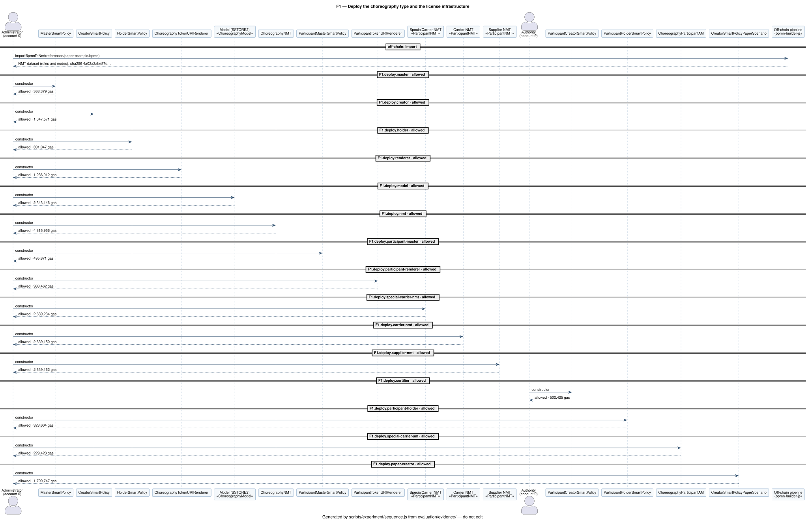
<!-- /evidence:phase:F1 -->

<!-- evidence:phase-title:F2 -->
### F2

**Mint the instance for its holder**
<!-- /evidence:phase-title:F2 -->

<!-- narrative:F2 -->
The authorized creator mints the instance for the holder; the instance decodes the model of the type in its constructor, and its roles are born without accounts; the next phase links them, because the Creator policy requires a license for each. The Master policy then faces a mint by its own administrator, which is <!-- outcome:F2.denied.master -->denied<!-- /outcome -->: administering the policy does not authorize minting. A mint by an account it does not authorize is <!-- outcome:F2.denied.unauthorized-creator -->denied<!-- /outcome -->, and a mint by the authorized creator to an ineligible holder is <!-- outcome:F2.denied.ineligible-holder -->denied<!-- /outcome -->.

<!-- evidence:phase:F2 -->
**Actors**

| Account | Index | Address | Plays |
| --- | ---: | --- | --- |
| Authorized creator | 4 | `0x15d34AAf54267DB7D7c367839AAf71A00a2C6A65` | the account the Master policy authorizes to mint an instance |
| Master | 0 | `0xf39Fd6e51aad88F6F4ce6aB8827279cffFb92266` | administrator of the Master policy, deploys the choreography type; not an authorized creator |
| Outsider | 2 | `0x3C44CdDdB6a900fa2b585dd299e03d12FA4293BC` | an account no choreography policy names |

**Transactions**

| Key | Operation | From | Call | Contract | Outcome | Reason | Gas |
| --- | --- | --- | --- | --- | --- | --- | ---: |
| `F2.mint` | the authorized creator mints the instance for the Holder, born with the model and the paper-scenario Creator policy | Authorized creator | `ChoreographyNMT.mint` | ChoreographyNMT `0x5FC8d32690cc91D4c39d9d3abcBD16989F875707` | allowed | — | 5,799,185 |
| `F2.denied.master` | the Master policy denies a mint by its own administrator | Master | `ChoreographyNMT.mint` | ChoreographyNMT `0x5FC8d32690cc91D4c39d9d3abcBD16989F875707` | denied | `MasterDenied` | 29,822 |
| `F2.denied.unauthorized-creator` | the Master policy denies a mint by an account it does not authorize | Outsider | `ChoreographyNMT.mint` | ChoreographyNMT `0x5FC8d32690cc91D4c39d9d3abcBD16989F875707` | denied | `MasterDenied` | 29,822 |
| `F2.denied.ineligible-holder` | the Master policy denies a mint to an ineligible holder | Authorized creator | `ChoreographyNMT.mint` | ChoreographyNMT `0x5FC8d32690cc91D4c39d9d3abcBD16989F875707` | denied | `MasterDenied` | 30,099 |

**Costs**

| Key | Gas | Cost (POL) | USD @100 gwei | USD @300 gwei | USD @1000 gwei |
| --- | ---: | ---: | ---: | ---: | ---: |
| `F2.mint` | 5,799,185 | 0.00023419631675475 | $0.052193 | $0.156578 | $0.521927 |
| `F2.denied.master` | 29,822 | 0.00000108290019175 | $0.000268 | $0.000805 | $0.002684 |
| `F2.denied.unauthorized-creator` | 29,822 | 0.000000947672243284 | $0.000268 | $0.000805 | $0.002684 |
| `F2.denied.ineligible-holder` | 30,099 | 0.000000837034197531 | $0.000271 | $0.000813 | $0.002709 |
| **phase total** | 5,888,928 | 0.000237063923387315 | $0.053000 | $0.159001 | $0.530004 |

**Trust-table rows**

| Key | Table | Row of docs/choreography-policies.md |
| --- | --- | --- |
| `F2.mint` | choreography | `mint` an instance of the choreography type to an eligible holder |
| `F2.denied.master` | choreography | `mint` an instance of the choreography type to an eligible holder |
| `F2.denied.unauthorized-creator` | choreography | `mint` an instance of the choreography type to an eligible holder |
| `F2.denied.ineligible-holder` | choreography | `mint` an instance of the choreography type to an eligible holder |

**The instance at the end of the phase**

| Address | Nodes | Tasks | Gateways | Edges | Messages | Roles |
| --- | ---: | ---: | ---: | ---: | ---: | ---: |
| `0x61c36a8d610163660E21a8b7359e1Cac0C9133e1` | 11 | 9 | 0 | 10 | 18 | 5 |

| Role | Played by | Address |
| --- | --- | --- |
| Bulk Buyer | none | `0x0000000000000000000000000000000000000000` |
| Manufacturer | none | `0x0000000000000000000000000000000000000000` |
| Middleman | none | `0x0000000000000000000000000000000000000000` |
| Supplier | none | `0x0000000000000000000000000000000000000000` |
| Special Carrier | none | `0x0000000000000000000000000000000000000000` |

**Policies in force at the end of the phase**

| Resource | Layer | Contract | Address | Source | Bytecode keccak256 |
| --- | --- | --- | --- | --- | --- |
| choreography type | Master | MasterSmartPolicy | `0x5FbDB2315678afecb367f032d93F642f64180aa3` | [MasterSmartPolicy.sol](../contracts/choreography/MasterSmartPolicy.sol) | `0xd571f41296cdf988da3971e854c0c081d2fd28daac670078e4407fbc62fd9b17` |
| instance | Creator | CreatorSmartPolicyPaperScenario | `0x9A676e781A523b5d0C0e43731313A708CB607508` | [CreatorSmartPolicyPaperScenario.sol](../contracts/choreography/CreatorSmartPolicyPaperScenario.sol) | `0x27aa6788c2d8e3cc7bbe0ce7da6e1da89558fa15c575f2962a79978edd971d3e` |
| instance | Holder | HolderSmartPolicy | `0x9fE46736679d2D9a65F0992F2272dE9f3c7fa6e0` | [HolderSmartPolicy.sol](../contracts/choreography/HolderSmartPolicy.sol) | `0x64f3e21bf63e229868d575e36b6dfdafb0a11d8ed37cf63bf59858a08474030b` |
| license type | Master | ParticipantMasterSmartPolicy | `0x0165878A594ca255338adfa4d48449f69242Eb8F` | [ParticipantMasterSmartPolicy.sol](../contracts/participant/ParticipantMasterSmartPolicy.sol) | `0x6f94394a8c6d8dbbf49ce900a99d978a7cd350f943337eab18634746911196a8` |

**Duration (ms)**

| Measured | Median | Min | Max | Std dev |
| --- | ---: | ---: | ---: | ---: |
| phase F2 | 10.846 | 10.495 | 14.555 | 1.272 |

**Sequence diagram** (filtered; [complete](../evaluation/evidence/uml/F2-full.svg))

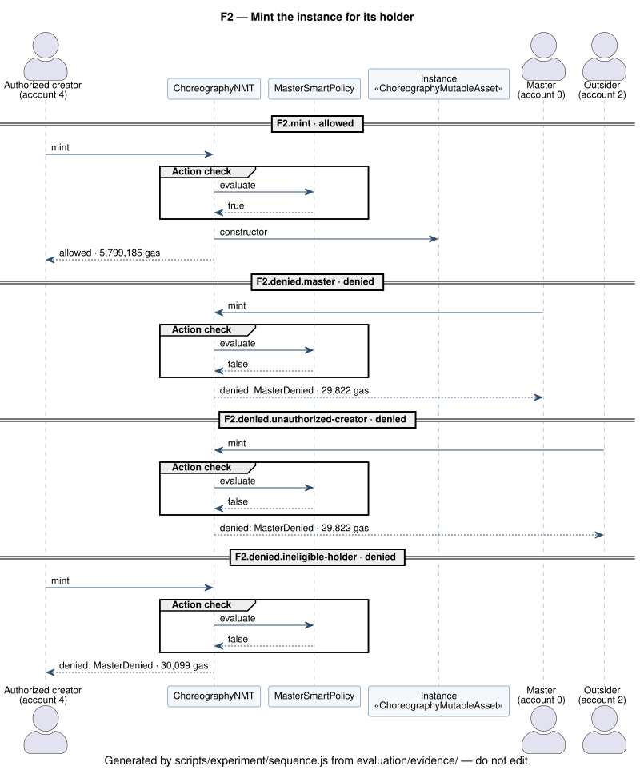
<!-- /evidence:phase:F2 -->

<!-- evidence:phase-title:F3 -->
### F3

**Issue the participant licenses and link every role to its license**
<!-- /evidence:phase-title:F3 -->

<!-- narrative:F3 -->
Each authority issues the licenses of its types by calling `mint` on the NMT of the type: the transport authority a SpecialCarrier license to Carrier A and a Carrier license to Carrier C, and the other four authorities a Supplier, a BulkBuyer, a Manufacturer, and a Middleman license to the company that plays that role. The participant Master policy lets an authority mint only on the NMT of a type it issues: the supplier authority issuing a SpecialCarrier license is <!-- outcome:F3.denied.foreign-authority -->denied<!-- /outcome -->. The holder of the instance then links the roles. Linking the Special Carrier role to a plain account is <!-- outcome:F3.denied.plain-account -->denied<!-- /outcome -->. Linking it to the Carrier license is <!-- outcome:F3.denied.carrier-license -->denied<!-- /outcome -->, and so is linking it to the Supplier license (<!-- outcome:F3.denied.supplier-license -->denied<!-- /outcome -->): both were minted by another NMT, and an attribute manager recognizes a license only if the NMT of its type minted it and it carries the certifier of its authority, so the attribute manager of the SpecialCarrier licenses does not recognize them, and the Creator policy sees no SpecialCarrier license. Linking every role to the license of the type it requires, in one update, is <!-- outcome:F3.link -->allowed<!-- /outcome -->: the Supplier license refused for the Special Carrier is the right one for the Supplier. A new role outside the model is <!-- outcome:F3.denied.new-role -->denied<!-- /outcome -->. Carrier A then writes its name on its license and declares the messages the Special Carrier sends in its tasks, the message on its band of each task; the task the delta adds later is one-way, sent by the Middleman, so it adds no message of this role. The certifier accepts a message only if its name is on the list the policy writes for the license type, so a message of another role is <!-- outcome:F3.denied.foreign-message -->denied<!-- /outcome --> by the certifier.

<!-- evidence:phase:F3 -->
**Actors**

| Account | Index | Address | Plays |
| --- | ---: | --- | --- |
| Transport authority | 9 | `0xa0Ee7A142d267C1f36714E4a8F75612F20a79720` | issuer and certifier of the SpecialCarrier and Carrier licenses |
| Supplier authority | 13 | `0x1CBd3b2770909D4e10f157cABC84C7264073C9Ec` | issuer and certifier of the Supplier licenses |
| Bulk Buyer authority | 10 | `0xBcd4042DE499D14e55001CcbB24a551F3b954096` | issuer and certifier of the BulkBuyer licenses |
| Manufacturer authority | 11 | `0x71bE63f3384f5fb98995898A86B02Fb2426c5788` | issuer and certifier of the Manufacturer licenses |
| Middleman authority | 12 | `0xFABB0ac9d68B0B445fB7357272Ff202C5651694a` | issuer and certifier of the Middleman licenses |
| Holder | 1 | `0x70997970C51812dc3A010C7d01b50e0d17dc79C8` | eligible holder: holds and edits the instances |
| Carrier A | 5 | `0x9965507D1a55bcC2695C58ba16FB37d819B0A4dc` | organization qualified for SpecialCarrier, first holder of its license |

**Transactions**

| Key | Operation | From | Call | Contract | Outcome | Reason | Gas |
| --- | --- | --- | --- | --- | --- | --- | ---: |
| `F3.license.special-carrier` | the Transport authority issues a SpecialCarrier license to Carrier A | Transport authority | `ParticipantNMT.mint` | ParticipantNMT `0x700b6A60ce7EaaEA56F065753d8dcB9653dbAD35` | allowed | — | 1,196,913 |
| `F3.license.carrier` | the Transport authority issues a Carrier license to Carrier C | Transport authority | `ParticipantNMT.mint` | ParticipantNMT `0xA15BB66138824a1c7167f5E85b957d04Dd34E468` | allowed | — | 1,196,930 |
| `F3.license.supplier` | the Supplier authority issues a Supplier license to the Supplier company | Supplier authority | `ParticipantNMT.mint` | ParticipantNMT `0x17F24D3b8Bc1150553b54Da30B4d993AcB889212` | allowed | — | 1,196,959 |
| `F3.license.bulk-buyer` | the Bulk Buyer authority issues a BulkBuyer license to the Bulk Buyer company | Bulk Buyer authority | `ParticipantNMT.mint` | ParticipantNMT `0xfbfbfDdd6e35dA57b7B0F9a2C10E34Be70B3A4E9` | allowed | — | 1,196,988 |
| `F3.license.manufacturer` | the Manufacturer authority issues a Manufacturer license to the Manufacturer company | Manufacturer authority | `ParticipantNMT.mint` | ParticipantNMT `0x72bb9c7ffbE2Ed234e53bc64862DdA6d9fFF333b` | allowed | — | 1,197,017 |
| `F3.license.middleman` | the Middleman authority issues a Middleman license to the Middleman company | Middleman authority | `ParticipantNMT.mint` | ParticipantNMT `0x6BdBb69660E6849b98e8C524d266a0005D3655F7` | allowed | — | 1,197,034 |
| `F3.denied.foreign-authority` | the participant Master policy denies the Supplier authority issuing a SpecialCarrier license | Supplier authority | `ParticipantNMT.mint` | ParticipantNMT `0x700b6A60ce7EaaEA56F065753d8dcB9653dbAD35` | denied | `MasterDenied` | 30,523 |
| `F3.denied.plain-account` | the Creator policy denies linking Special Carrier to a plain account | Holder | `ChoreographyMutableAsset.setRoles` | ChoreographyMutableAsset `0x61c36a8d610163660E21a8b7359e1Cac0C9133e1` | denied | `OperationDenied(CREATOR)` | 63,953 |
| `F3.denied.carrier-license` | the Creator policy denies linking Special Carrier to a Carrier license | Holder | `ChoreographyMutableAsset.setRoles` | ChoreographyMutableAsset `0x61c36a8d610163660E21a8b7359e1Cac0C9133e1` | denied | `OperationDenied(CREATOR)` | 63,953 |
| `F3.denied.supplier-license` | the Creator policy denies linking Special Carrier to a Supplier license | Holder | `ChoreographyMutableAsset.setRoles` | ChoreographyMutableAsset `0x61c36a8d610163660E21a8b7359e1Cac0C9133e1` | denied | `OperationDenied(CREATOR)` | 63,953 |
| `F3.link` | the Holder links every role to the license of the type it requires | Holder | `ChoreographyMutableAsset.setRoles` | ChoreographyMutableAsset `0x61c36a8d610163660E21a8b7359e1Cac0C9133e1` | allowed | — | 284,148 |
| `F3.denied.new-role` | the Creator policy denies a new Backup Carrier role | Holder | `ChoreographyMutableAsset.setRoles` | ChoreographyMutableAsset `0x61c36a8d610163660E21a8b7359e1Cac0C9133e1` | denied | `OperationDenied(CREATOR)` | 54,893 |
| `F3.license.name` | Carrier A updates the name on its license | Carrier A | `ParticipantMutableAsset.setName` | ParticipantMutableAsset `0xA44B9f3F5Bb8C278c1ee85D8F32517c6EFa64B0D` | allowed | — | 66,674 |
| `F3.license.messages` | Carrier A declares the Special Carrier messages on its license | Carrier A | `ParticipantMutableAsset.setMessages` | ParticipantMutableAsset `0xA44B9f3F5Bb8C278c1ee85D8F32517c6EFa64B0D` | allowed | — | 209,075 |
| `F3.denied.foreign-message` | the certifier denies a message of another role | Carrier A | `ParticipantMutableAsset.setMessages` | ParticipantMutableAsset `0xA44B9f3F5Bb8C278c1ee85D8F32517c6EFa64B0D` | denied | `OperationDenied(CREATOR)` | 46,668 |

**Costs**

| Key | Gas | Cost (POL) | USD @100 gwei | USD @300 gwei | USD @1000 gwei |
| --- | ---: | ---: | ---: | ---: | ---: |
| `F3.license.special-carrier` | 1,196,913 | 0.000029128895850318 | $0.010772 | $0.032317 | $0.107722 |
| `F3.license.carrier` | 1,196,930 | 0.00002563341936596 | $0.010772 | $0.032317 | $0.107724 |
| `F3.license.supplier` | 1,196,959 | 0.000022557628376938 | $0.010773 | $0.032318 | $0.107726 |
| `F3.license.bulk-buyer` | 1,196,988 | 0.0000198509088414 | $0.010773 | $0.032319 | $0.107729 |
| `F3.license.manufacturer` | 1,197,017 | 0.000017468974025852 | $0.010773 | $0.032319 | $0.107732 |
| `F3.license.middleman` | 1,197,034 | 0.000015372698467016 | $0.010773 | $0.032320 | $0.107733 |
| `F3.denied.foreign-authority` | 30,523 | 0.000000344943078501 | $0.000275 | $0.000824 | $0.002747 |
| `F3.denied.plain-account` | 63,953 | 0.000000632488007264 | $0.000576 | $0.001727 | $0.005756 |
| `F3.denied.carrier-license` | 63,953 | 0.000000553595650417 | $0.000576 | $0.001727 | $0.005756 |
| `F3.denied.supplier-license` | 63,953 | 0.00000048454374168 | $0.000576 | $0.001727 | $0.005756 |
| `F3.link` | 284,148 | 0.000001884330019332 | $0.002557 | $0.007672 | $0.025573 |
| `F3.denied.new-role` | 54,893 | 0.000000318951494846 | $0.000494 | $0.001482 | $0.004940 |
| `F3.license.name` | 66,674 | 0.000000339067226626 | $0.000600 | $0.001800 | $0.006001 |
| `F3.license.messages` | 209,075 | 0.000000930630667575 | $0.001882 | $0.005645 | $0.018817 |
| `F3.denied.foreign-message` | 46,668 | 0.000000181942711548 | $0.000420 | $0.001260 | $0.004200 |
| **phase total** | 8,065,681 | 0.000135683017525273 | $0.072591 | $0.217773 | $0.725911 |

**Trust-table rows**

| Key | Table | Row of docs/choreography-policies.md |
| --- | --- | --- |
| `F3.license.special-carrier` | licenses | Mint a license (`mint` on the `ParticipantNMT` of its type) |
| `F3.license.carrier` | licenses | Mint a license (`mint` on the `ParticipantNMT` of its type) |
| `F3.license.supplier` | licenses | Mint a license (`mint` on the `ParticipantNMT` of its type) |
| `F3.license.bulk-buyer` | licenses | Mint a license (`mint` on the `ParticipantNMT` of its type) |
| `F3.license.manufacturer` | licenses | Mint a license (`mint` on the `ParticipantNMT` of its type) |
| `F3.license.middleman` | licenses | Mint a license (`mint` on the `ParticipantNMT` of its type) |
| `F3.denied.foreign-authority` | licenses | Mint a license (`mint` on the `ParticipantNMT` of its type) |
| `F3.denied.plain-account` | choreography | `setRoles` |
| `F3.denied.carrier-license` | choreography | `setRoles` |
| `F3.denied.supplier-license` | choreography | `setRoles` |
| `F3.link` | choreography | `setRoles` |
| `F3.denied.new-role` | choreography | `setRoles` |
| `F3.license.name` | licenses | Update the organization data (`setName`, `setProfile`, `setLinked`) |
| `F3.license.messages` | licenses | Declare messages (`setMessages`) allowed for the license type |
| `F3.denied.foreign-message` | licenses | Declare messages (`setMessages`) allowed for the license type |

**The instance at the end of the phase**

| Address | Nodes | Tasks | Gateways | Edges | Messages | Roles |
| --- | ---: | ---: | ---: | ---: | ---: | ---: |
| `0x61c36a8d610163660E21a8b7359e1Cac0C9133e1` | 11 | 9 | 0 | 10 | 18 | 5 |

| Role | Played by | Address |
| --- | --- | --- |
| Bulk Buyer | ParticipantMutableAsset | `0x0214919f0E8889b55d6dd69f1341B4947453458B` |
| Manufacturer | ParticipantMutableAsset | `0xD5B9B99c015C86F4a44122b9EB8e5c8AF0AC3F16` |
| Middleman | ParticipantMutableAsset | `0xb008fcD5ce8D04C68f62D240A1b4907dEBb12732` |
| Supplier | ParticipantMutableAsset | `0x611cA715eae6F4BBa9e4442a379C206072655759` |
| Special Carrier | ParticipantMutableAsset | `0xA44B9f3F5Bb8C278c1ee85D8F32517c6EFa64B0D` |

**Policies in force at the end of the phase**

| Resource | Layer | Contract | Address | Source | Bytecode keccak256 |
| --- | --- | --- | --- | --- | --- |
| choreography type | Master | MasterSmartPolicy | `0x5FbDB2315678afecb367f032d93F642f64180aa3` | [MasterSmartPolicy.sol](../contracts/choreography/MasterSmartPolicy.sol) | `0xd571f41296cdf988da3971e854c0c081d2fd28daac670078e4407fbc62fd9b17` |
| instance | Creator | CreatorSmartPolicyPaperScenario | `0x9A676e781A523b5d0C0e43731313A708CB607508` | [CreatorSmartPolicyPaperScenario.sol](../contracts/choreography/CreatorSmartPolicyPaperScenario.sol) | `0x27aa6788c2d8e3cc7bbe0ce7da6e1da89558fa15c575f2962a79978edd971d3e` |
| instance | Holder | HolderSmartPolicy | `0x9fE46736679d2D9a65F0992F2272dE9f3c7fa6e0` | [HolderSmartPolicy.sol](../contracts/choreography/HolderSmartPolicy.sol) | `0x64f3e21bf63e229868d575e36b6dfdafb0a11d8ed37cf63bf59858a08474030b` |
| license type | Master | ParticipantMasterSmartPolicy | `0x0165878A594ca255338adfa4d48449f69242Eb8F` | [ParticipantMasterSmartPolicy.sol](../contracts/participant/ParticipantMasterSmartPolicy.sol) | `0x6f94394a8c6d8dbbf49ce900a99d978a7cd350f943337eab18634746911196a8` |
| licensed role | Creator | ParticipantCreatorSmartPolicy | `0xb19b36b1456E65E3A6D514D3F715f204BD59f431` | [CreatorSmartPolicy.sol](../contracts/participant/CreatorSmartPolicy.sol) | `0x30fbe346110963427ac9f7af7454a7b2ea44e2c474db2a2359a0c4c52ca5ce15` |
| licensed role | Holder | ParticipantHolderSmartPolicy | `0x2279B7A0a67DB372996a5FaB50D91eAA73d2eBe6` | [HolderSmartPolicy.sol](../contracts/participant/HolderSmartPolicy.sol) | `0x29c7f6744db23d0f03ec3cd9c5c8cd4b279ba4324371e80d432e259078e2c57b` |

**Duration (ms)**

| Measured | Median | Min | Max | Std dev |
| --- | ---: | ---: | ---: | ---: |
| phase F3 | 22.338 | 20.820 | 34.541 | 3.989 |

**Sequence diagram** (filtered; [complete](../evaluation/evidence/uml/F3-full.svg))

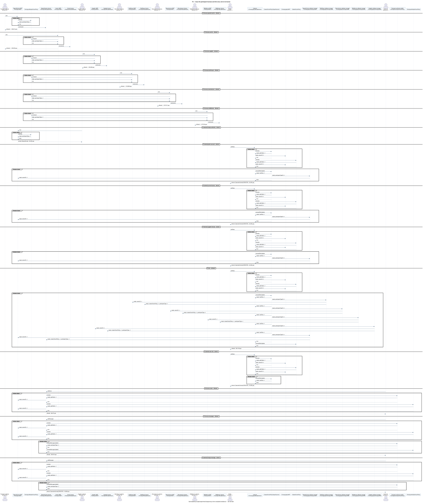
<!-- /evidence:phase:F3 -->

<!-- evidence:phase-title:F4 -->
### F4

**Render the baseline model from the chain**
<!-- /evidence:phase-title:F4 -->

<!-- narrative:F4 -->
Anyone can read the model: the render reads the instance the ERC-721 way, with one `tokenURI` call on the NMT that minted it, which the renderer computes from the asset state, and regenerates the BPMN XML off-chain. Nothing is stored and no transaction is sent; the run traces the call and hashes what each off-chain step writes.

<!-- evidence:phase:F4 -->
**Actors**

| Account | Index | Address | Plays |
| --- | ---: | --- | --- |

**Off-chain steps**

| Step | Function | Output | SHA-256 |
| --- | --- | --- | --- |
| export | `exportContractToJson` | raw JSON (hashed without `contractExport.exportedAt`, `contractExport.rpcUrl`) | `c409510549bbc27a8ac8b6c3960b70e915a48a750ed9b68124c9ce75b1f5c41b` |
| normalize | `normalizeInput` | normalized JSON (hashed without `contractExport.exportedAt`, `contractExport.rpcUrl`) | `8662cdf6a8b83c62dbe90e8d46127c95016df299e379c6232a5b340e1a0e9753` |
| generate | `generateBpmnXml` | BPMN XML | `11001e7089942298911795381a201d6397d421d8888887a04aebc02ea428bc44` |

**Reads**

| Key | Call | By | Gas |
| --- | --- | --- | ---: |
| `F4.tokenURI` | `ChoreographyNMT.tokenURI` | eth_call (any account) | 1,283,613 |

**The instance at the end of the phase**

| Address | Nodes | Tasks | Gateways | Edges | Messages | Roles |
| --- | ---: | ---: | ---: | ---: | ---: | ---: |
| `0x61c36a8d610163660E21a8b7359e1Cac0C9133e1` | 11 | 9 | 0 | 10 | 18 | 5 |

| Role | Played by | Address |
| --- | --- | --- |
| Bulk Buyer | ParticipantMutableAsset | `0x0214919f0E8889b55d6dd69f1341B4947453458B` |
| Manufacturer | ParticipantMutableAsset | `0xD5B9B99c015C86F4a44122b9EB8e5c8AF0AC3F16` |
| Middleman | ParticipantMutableAsset | `0xb008fcD5ce8D04C68f62D240A1b4907dEBb12732` |
| Supplier | ParticipantMutableAsset | `0x611cA715eae6F4BBa9e4442a379C206072655759` |
| Special Carrier | ParticipantMutableAsset | `0xA44B9f3F5Bb8C278c1ee85D8F32517c6EFa64B0D` |

**Policies in force at the end of the phase**

| Resource | Layer | Contract | Address | Source | Bytecode keccak256 |
| --- | --- | --- | --- | --- | --- |
| choreography type | Master | MasterSmartPolicy | `0x5FbDB2315678afecb367f032d93F642f64180aa3` | [MasterSmartPolicy.sol](../contracts/choreography/MasterSmartPolicy.sol) | `0xd571f41296cdf988da3971e854c0c081d2fd28daac670078e4407fbc62fd9b17` |
| instance | Creator | CreatorSmartPolicyPaperScenario | `0x9A676e781A523b5d0C0e43731313A708CB607508` | [CreatorSmartPolicyPaperScenario.sol](../contracts/choreography/CreatorSmartPolicyPaperScenario.sol) | `0x27aa6788c2d8e3cc7bbe0ce7da6e1da89558fa15c575f2962a79978edd971d3e` |
| instance | Holder | HolderSmartPolicy | `0x9fE46736679d2D9a65F0992F2272dE9f3c7fa6e0` | [HolderSmartPolicy.sol](../contracts/choreography/HolderSmartPolicy.sol) | `0x64f3e21bf63e229868d575e36b6dfdafb0a11d8ed37cf63bf59858a08474030b` |
| license type | Master | ParticipantMasterSmartPolicy | `0x0165878A594ca255338adfa4d48449f69242Eb8F` | [ParticipantMasterSmartPolicy.sol](../contracts/participant/ParticipantMasterSmartPolicy.sol) | `0x6f94394a8c6d8dbbf49ce900a99d978a7cd350f943337eab18634746911196a8` |
| licensed role | Creator | ParticipantCreatorSmartPolicy | `0xb19b36b1456E65E3A6D514D3F715f204BD59f431` | [CreatorSmartPolicy.sol](../contracts/participant/CreatorSmartPolicy.sol) | `0x30fbe346110963427ac9f7af7454a7b2ea44e2c474db2a2359a0c4c52ca5ce15` |
| licensed role | Holder | ParticipantHolderSmartPolicy | `0x2279B7A0a67DB372996a5FaB50D91eAA73d2eBe6` | [HolderSmartPolicy.sol](../contracts/participant/HolderSmartPolicy.sol) | `0x29c7f6744db23d0f03ec3cd9c5c8cd4b279ba4324371e80d432e259078e2c57b` |

**Duration (ms)**

| Measured | Median | Min | Max | Std dev |
| --- | ---: | ---: | ---: | ---: |
| phase F4 | 15.203 | 14.592 | 15.801 | 0.421 |
| step `F4.render` | 14.800 | 14.189 | 15.355 | 0.435 |

**Sequence diagram** (filtered; [complete](../evaluation/evidence/uml/F4-full.svg))

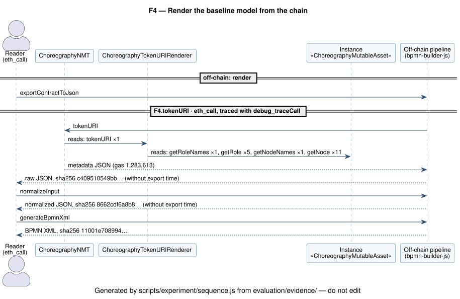
<!-- /evidence:phase:F4 -->

<!-- evidence:phase-title:F5 -->
### F5

**Apply the delta: one allowed update and seven denied ones**
<!-- /evidence:phase-title:F5 -->

<!-- narrative:F5 -->
The holder applies the delta with one `setNodes` call, through the function of the `modify:asset` command: every changed node is written whole, and both endpoints of every changed flow are in the delta. The update is <!-- outcome:F5.delta -->allowed<!-- /outcome -->. Five well-formed updates follow, each breaking one rule of the paper-scenario Creator policy: one task too many (<!-- outcome:F5.denied.task-limit -->denied<!-- /outcome -->), flows above the limit (<!-- outcome:F5.denied.flow-limit -->denied<!-- /outcome -->), a task name outside the allowlist (<!-- outcome:F5.denied.task-name -->denied<!-- /outcome -->), a flow to an unknown node (<!-- outcome:F5.denied.unknown-target -->denied<!-- /outcome -->), and a change to the protected `Order` task (<!-- outcome:F5.denied.protected-node -->denied<!-- /outcome -->). The sequence diagram shows where each one stops: both action checks pass, the Creator policy and then the Holder policy, and the domain check of the Creator policy refuses the update, so the domain check of the Holder policy is never asked. Last, the delta the holder applied is sent again, unchanged, by two accounts that do not hold the instance: by the outsider it is <!-- outcome:F5.denied.outsider -->denied<!-- /outcome -->, and by the authorized creator, who minted the instance, it is <!-- outcome:F5.denied.creator -->denied<!-- /outcome --> as well. Both stop at the first action check, where the Creator policy accepts only the holder: minting an instance gives no right to edit it.

<!-- evidence:phase:F5 -->
**Actors**

| Account | Index | Address | Plays |
| --- | ---: | --- | --- |
| Holder | 1 | `0x70997970C51812dc3A010C7d01b50e0d17dc79C8` | eligible holder: holds and edits the instances |
| Outsider | 2 | `0x3C44CdDdB6a900fa2b585dd299e03d12FA4293BC` | an account no choreography policy names |
| Authorized creator | 4 | `0x15d34AAf54267DB7D7c367839AAf71A00a2C6A65` | the account the Master policy authorizes to mint an instance |

**Inputs**

| File | SHA-256 |
| --- | --- |
| [scripts/data/paper-example-parallel-transport-preparation.delta.json](../scripts/data/paper-example-parallel-transport-preparation.delta.json) | `43416b130a769acca4ea93a75afdcb827e9f69d548bdb2a8307987c1e22cb490` |

**The delta**

Split transport preparation into parallel detail collection and documentation preparation, then join before the waybill. Nodes it writes, each in its final state: `Order Special Transport`, `Parallel Transport Preparation Split`, `Request Details`, `Transport Details`, `Prepare Transport Documentation`, `Parallel Transport Preparation Join`, `Waybill for Intermediate`.

**Transactions**

| Key | Operation | From | Call | Contract | Outcome | Reason | Gas |
| --- | --- | --- | --- | --- | --- | --- | ---: |
| `F5.delta` | the Holder applies the parallel transport preparation delta | Holder | `ChoreographyMutableAsset.setNodes` | ChoreographyMutableAsset `0x61c36a8d610163660E21a8b7359e1Cac0C9133e1` | allowed | — | 1,867,847 |
| `F5.denied.task-limit` | the Creator policy denies an update above the task limit | Holder | `ChoreographyMutableAsset.setNodes` | ChoreographyMutableAsset `0x61c36a8d610163660E21a8b7359e1Cac0C9133e1` | denied | `OperationDenied(CREATOR)` | 318,816 |
| `F5.denied.flow-limit` | the Creator policy denies an update above the sequence-flow limit | Holder | `ChoreographyMutableAsset.setNodes` | ChoreographyMutableAsset `0x61c36a8d610163660E21a8b7359e1Cac0C9133e1` | denied | `OperationDenied(CREATOR)` | 547,912 |
| `F5.denied.task-name` | the Creator policy denies a task name outside the allowlist | Holder | `ChoreographyMutableAsset.setNodes` | ChoreographyMutableAsset `0x61c36a8d610163660E21a8b7359e1Cac0C9133e1` | denied | `OperationDenied(CREATOR)` | 298,426 |
| `F5.denied.unknown-target` | the Creator policy denies a flow to an unknown node | Holder | `ChoreographyMutableAsset.setNodes` | ChoreographyMutableAsset `0x61c36a8d610163660E21a8b7359e1Cac0C9133e1` | denied | `OperationDenied(CREATOR)` | 76,933 |
| `F5.denied.protected-node` | the Creator policy denies a change to the protected Order task | Holder | `ChoreographyMutableAsset.setNodes` | ChoreographyMutableAsset `0x61c36a8d610163660E21a8b7359e1Cac0C9133e1` | denied | `OperationDenied(CREATOR)` | 340,785 |
| `F5.denied.outsider` | an account that does not hold the instance cannot update it | Outsider | `ChoreographyMutableAsset.setNodes` | ChoreographyMutableAsset `0x61c36a8d610163660E21a8b7359e1Cac0C9133e1` | denied | `OperationDenied(CREATOR)` | 129,075 |
| `F5.denied.creator` | the authorized creator cannot update the instance it minted for the Holder | Authorized creator | `ChoreographyMutableAsset.setNodes` | ChoreographyMutableAsset `0x61c36a8d610163660E21a8b7359e1Cac0C9133e1` | denied | `OperationDenied(CREATOR)` | 129,075 |

**Costs**

| Key | Gas | Cost (POL) | USD @100 gwei | USD @300 gwei | USD @1000 gwei |
| --- | ---: | ---: | ---: | ---: | ---: |
| `F5.delta` | 1,867,847 | 0.000006373256466689 | $0.016811 | $0.050432 | $0.168106 |
| `F5.denied.task-limit` | 318,816 | 0.000000960315556896 | $0.002869 | $0.008608 | $0.028693 |
| `F5.denied.flow-limit` | 547,912 | 0.000001446277829704 | $0.004931 | $0.014794 | $0.049312 |
| `F5.denied.task-name` | 298,426 | 0.000000691062700792 | $0.002686 | $0.008058 | $0.026858 |
| `F5.denied.unknown-target` | 76,933 | 0.00000015610551963 | $0.000692 | $0.002077 | $0.006924 |
| `F5.denied.protected-node` | 340,785 | 0.00000060527573577 | $0.003067 | $0.009201 | $0.030671 |
| `F5.denied.outsider` | 129,075 | 0.00000020092201725 | $0.001162 | $0.003485 | $0.011617 |
| `F5.denied.creator` | 129,075 | 0.000000175914897675 | $0.001162 | $0.003485 | $0.011617 |
| **phase total** | 3,708,869 | 0.000010609130724406 | $0.033380 | $0.100139 | $0.333798 |

**Trust-table rows**

| Key | Table | Row of docs/choreography-policies.md |
| --- | --- | --- |
| `F5.delta` | choreography | `setNodes` |
| `F5.denied.task-limit` | choreography | `setNodes` |
| `F5.denied.flow-limit` | choreography | `setNodes` |
| `F5.denied.task-name` | choreography | `setNodes` |
| `F5.denied.unknown-target` | choreography | `setNodes` |
| `F5.denied.protected-node` | choreography | `setNodes` |
| `F5.denied.outsider` | choreography | `setNodes` |
| `F5.denied.creator` | choreography | `setNodes` |

**The instance at the end of the phase**

| Address | Nodes | Tasks | Gateways | Edges | Messages | Roles |
| --- | ---: | ---: | ---: | ---: | ---: | ---: |
| `0x61c36a8d610163660E21a8b7359e1Cac0C9133e1` | 14 | 10 | 2 | 14 | 19 | 5 |

| Role | Played by | Address |
| --- | --- | --- |
| Bulk Buyer | ParticipantMutableAsset | `0x0214919f0E8889b55d6dd69f1341B4947453458B` |
| Manufacturer | ParticipantMutableAsset | `0xD5B9B99c015C86F4a44122b9EB8e5c8AF0AC3F16` |
| Middleman | ParticipantMutableAsset | `0xb008fcD5ce8D04C68f62D240A1b4907dEBb12732` |
| Supplier | ParticipantMutableAsset | `0x611cA715eae6F4BBa9e4442a379C206072655759` |
| Special Carrier | ParticipantMutableAsset | `0xA44B9f3F5Bb8C278c1ee85D8F32517c6EFa64B0D` |

**Policies in force at the end of the phase**

| Resource | Layer | Contract | Address | Source | Bytecode keccak256 |
| --- | --- | --- | --- | --- | --- |
| choreography type | Master | MasterSmartPolicy | `0x5FbDB2315678afecb367f032d93F642f64180aa3` | [MasterSmartPolicy.sol](../contracts/choreography/MasterSmartPolicy.sol) | `0xd571f41296cdf988da3971e854c0c081d2fd28daac670078e4407fbc62fd9b17` |
| instance | Creator | CreatorSmartPolicyPaperScenario | `0x9A676e781A523b5d0C0e43731313A708CB607508` | [CreatorSmartPolicyPaperScenario.sol](../contracts/choreography/CreatorSmartPolicyPaperScenario.sol) | `0x27aa6788c2d8e3cc7bbe0ce7da6e1da89558fa15c575f2962a79978edd971d3e` |
| instance | Holder | HolderSmartPolicy | `0x9fE46736679d2D9a65F0992F2272dE9f3c7fa6e0` | [HolderSmartPolicy.sol](../contracts/choreography/HolderSmartPolicy.sol) | `0x64f3e21bf63e229868d575e36b6dfdafb0a11d8ed37cf63bf59858a08474030b` |
| license type | Master | ParticipantMasterSmartPolicy | `0x0165878A594ca255338adfa4d48449f69242Eb8F` | [ParticipantMasterSmartPolicy.sol](../contracts/participant/ParticipantMasterSmartPolicy.sol) | `0x6f94394a8c6d8dbbf49ce900a99d978a7cd350f943337eab18634746911196a8` |
| licensed role | Creator | ParticipantCreatorSmartPolicy | `0xb19b36b1456E65E3A6D514D3F715f204BD59f431` | [CreatorSmartPolicy.sol](../contracts/participant/CreatorSmartPolicy.sol) | `0x30fbe346110963427ac9f7af7454a7b2ea44e2c474db2a2359a0c4c52ca5ce15` |
| licensed role | Holder | ParticipantHolderSmartPolicy | `0x2279B7A0a67DB372996a5FaB50D91eAA73d2eBe6` | [HolderSmartPolicy.sol](../contracts/participant/HolderSmartPolicy.sol) | `0x29c7f6744db23d0f03ec3cd9c5c8cd4b279ba4324371e80d432e259078e2c57b` |

**Duration (ms)**

| Measured | Median | Min | Max | Std dev |
| --- | ---: | ---: | ---: | ---: |
| phase F5 | 116.042 | 110.633 | 138.414 | 7.900 |
| step `F5.delta` | 62.962 | 59.863 | 65.062 | 1.718 |

**Sequence diagram** (filtered; [complete](../evaluation/evidence/uml/F5-full.svg))

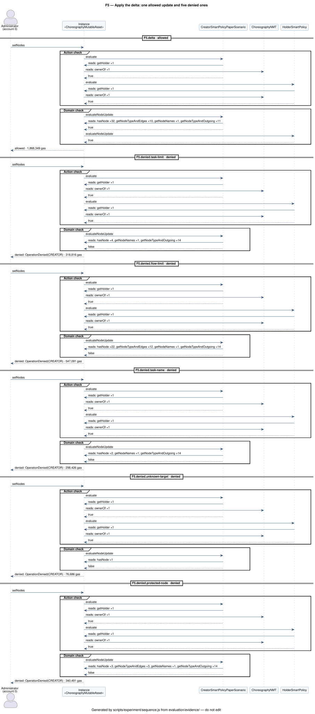
<!-- /evidence:phase:F5 -->

<!-- evidence:phase-title:F6 -->
### F6

**Sell the Special Carrier role: Carrier A to Carrier B**
<!-- /evidence:phase-title:F6 -->

<!-- narrative:F6 -->
The organization behind the Special Carrier role changes by selling the license, not by editing the choreography. The participant Master policy checks the buyer: a sale to Carrier C, qualified only for Carrier, is <!-- outcome:F6.denied.carrier-buyer -->denied<!-- /outcome -->, a sale to the supplier company is <!-- outcome:F6.denied.supplier-buyer -->denied<!-- /outcome -->, and Carrier B taking the license without the seller is <!-- outcome:F6.denied.without-seller -->denied<!-- /outcome -->. The sale from Carrier A to Carrier B is <!-- outcome:F6.sale -->allowed<!-- /outcome -->. The sale resets the license Holder policy and clears the seller's name and profile, while the messages stay, marked as written by Carrier A: Carrier B updating the license before installing its own Holder policy is <!-- outcome:F6.denied.buyer-without-policy -->denied<!-- /outcome -->, and after it does, Carrier A updating the license is <!-- outcome:F6.denied.former-holder -->denied<!-- /outcome --> while Carrier B updates its data and confirms the messages. The choreography role keeps pointing at the same license throughout.

<!-- evidence:phase:F6 -->
**Actors**

| Account | Index | Address | Plays |
| --- | ---: | --- | --- |
| Carrier A | 5 | `0x9965507D1a55bcC2695C58ba16FB37d819B0A4dc` | organization qualified for SpecialCarrier, first holder of its license |
| Carrier B | 6 | `0x976EA74026E726554dB657fA54763abd0C3a0aa9` | organization qualified for SpecialCarrier, buyer of the license |

**Transactions**

| Key | Operation | From | Call | Contract | Outcome | Reason | Gas |
| --- | --- | --- | --- | --- | --- | --- | ---: |
| `F6.denied.carrier-buyer` | the participant Master policy denies selling to Carrier C, not qualified for SpecialCarrier | Carrier A | `ParticipantNMT.transferFrom` | ParticipantNMT `0x700b6A60ce7EaaEA56F065753d8dcB9653dbAD35` | denied | `MasterDenied` | 37,297 |
| `F6.denied.supplier-buyer` | the participant Master policy denies selling to the Supplier company | Carrier A | `ParticipantNMT.transferFrom` | ParticipantNMT `0x700b6A60ce7EaaEA56F065753d8dcB9653dbAD35` | denied | `MasterDenied` | 37,297 |
| `F6.denied.without-seller` | the participant Master policy denies Carrier B taking the license without the seller | Carrier B | `ParticipantNMT.transferFrom` | ParticipantNMT `0x700b6A60ce7EaaEA56F065753d8dcB9653dbAD35` | denied | `MasterDenied` | 30,226 |
| `F6.sale` | Carrier A sells the SpecialCarrier license to Carrier B | Carrier A | `ParticipantNMT.transferFrom` | ParticipantNMT `0x700b6A60ce7EaaEA56F065753d8dcB9653dbAD35` | allowed | — | 108,998 |
| `F6.denied.buyer-without-policy` | Carrier B cannot update the license before installing a Holder policy | Carrier B | `ParticipantMutableAsset.setName` | ParticipantMutableAsset `0xA44B9f3F5Bb8C278c1ee85D8F32517c6EFa64B0D` | denied | `HolderPolicyDisabled` | 37,003 |
| `F6.buyer.holder-policy` | Carrier B installs its Holder policy on the license | Carrier B | `ParticipantMutableAsset.setHolderSmartPolicy` | ParticipantMutableAsset `0xA44B9f3F5Bb8C278c1ee85D8F32517c6EFa64B0D` | allowed | — | 49,611 |
| `F6.denied.former-holder` | Carrier A can no longer update the license | Carrier A | `ParticipantMutableAsset.setName` | ParticipantMutableAsset `0xA44B9f3F5Bb8C278c1ee85D8F32517c6EFa64B0D` | denied | `OperationDenied(CREATOR)` | 34,894 |
| `F6.buyer.name` | Carrier B updates the name on the license | Carrier B | `ParticipantMutableAsset.setName` | ParticipantMutableAsset `0xA44B9f3F5Bb8C278c1ee85D8F32517c6EFa64B0D` | allowed | — | 66,674 |
| `F6.buyer.profile` | Carrier B links its organization profile | Carrier B | `ParticipantMutableAsset.setProfile` | ParticipantMutableAsset `0xA44B9f3F5Bb8C278c1ee85D8F32517c6EFa64B0D` | allowed | — | 67,102 |
| `F6.buyer.messages` | Carrier B confirms the Special Carrier messages | Carrier B | `ParticipantMutableAsset.setMessages` | ParticipantMutableAsset `0xA44B9f3F5Bb8C278c1ee85D8F32517c6EFa64B0D` | allowed | — | 72,575 |

**Costs**

| Key | Gas | Cost (POL) | USD @100 gwei | USD @300 gwei | USD @1000 gwei |
| --- | ---: | ---: | ---: | ---: | ---: |
| `F6.denied.carrier-buyer` | 37,297 | 0.000000044505055517 | $0.000336 | $0.001007 | $0.003357 |
| `F6.denied.supplier-buyer` | 37,297 | 0.000000038948846833 | $0.000336 | $0.001007 | $0.003357 |
| `F6.denied.without-seller` | 30,226 | 0.000000027624025016 | $0.000272 | $0.000816 | $0.002720 |
| `F6.sale` | 108,998 | 0.000000087175728416 | $0.000981 | $0.002943 | $0.009810 |
| `F6.denied.buyer-without-policy` | 37,003 | 0.000000025908834546 | $0.000333 | $0.000999 | $0.003330 |
| `F6.buyer.holder-policy` | 49,611 | 0.000000030400033248 | $0.000446 | $0.001339 | $0.004465 |
| `F6.denied.former-holder` | 34,894 | 0.000000018713617306 | $0.000314 | $0.000942 | $0.003140 |
| `F6.buyer.name` | 66,674 | 0.00000003129277516 | $0.000600 | $0.001800 | $0.006001 |
| `F6.buyer.profile` | 67,102 | 0.000000027565770008 | $0.000604 | $0.001812 | $0.006039 |
| `F6.buyer.messages` | 72,575 | 0.000000026095720175 | $0.000653 | $0.001960 | $0.006532 |
| **phase total** | 541,677 | 0.000000358230406225 | $0.004875 | $0.014625 | $0.048751 |

**Trust-table rows**

| Key | Table | Row of docs/choreography-policies.md |
| --- | --- | --- |
| `F6.denied.carrier-buyer` | licenses | Sell the license (`transferFrom`) to an organization qualified for its type |
| `F6.denied.supplier-buyer` | licenses | Sell the license (`transferFrom`) to an organization qualified for its type |
| `F6.denied.without-seller` | licenses | Sell the license (`transferFrom`) to an organization qualified for its type |
| `F6.sale` | licenses | Sell the license (`transferFrom`) to an organization qualified for its type |
| `F6.denied.buyer-without-policy` | licenses | Update the organization data (`setName`, `setProfile`, `setLinked`) |
| `F6.buyer.holder-policy` | licenses | Install a Holder policy on the license (`setHolderSmartPolicy`; not a policy decision, only the current holder) |
| `F6.denied.former-holder` | licenses | Update the organization data (`setName`, `setProfile`, `setLinked`) |
| `F6.buyer.name` | licenses | Update the organization data (`setName`, `setProfile`, `setLinked`) |
| `F6.buyer.profile` | licenses | Update the organization data (`setName`, `setProfile`, `setLinked`) |
| `F6.buyer.messages` | licenses | Declare messages (`setMessages`) allowed for the license type |

**Transfers**

| Key | From | To | Sent by | Outcome |
| --- | --- | --- | --- | --- |
| `F6.denied.carrier-buyer` | Carrier A | Carrier C | Carrier A | denied |
| `F6.denied.supplier-buyer` | Carrier A | Supplier company | Carrier A | denied |
| `F6.denied.without-seller` | Carrier A | Carrier B | Carrier B | denied |
| `F6.sale` | Carrier A | Carrier B | Carrier A | allowed |

**The license before and after the sale**

| Field | Before the sale | After the sale | After the buyer's updates |
| --- | --- | --- | --- |
| licenseHolder | Carrier A | Carrier B | Carrier B |
| roleLinkedTo | ParticipantMutableAsset | ParticipantMutableAsset | ParticipantMutableAsset |
| roleLicense | `0xA44B9f3F5Bb8C278c1ee85D8F32517c6EFa64B0D` | `0xA44B9f3F5Bb8C278c1ee85D8F32517c6EFa64B0D` | `0xA44B9f3F5Bb8C278c1ee85D8F32517c6EFa64B0D` |
| licenseName | Carrier A | (empty) | Carrier B |
| messagesWriter | Carrier A | Carrier A | Carrier B |
| holderPolicy | ParticipantHolderSmartPolicy | none | ParticipantHolderSmartPolicy |

Tasks of `Special Carrier`, which keep the role through the sale: `Order Special Transport`, `Request Details`, `Transport Details`, `Waybill for Intermediate`, `Arrival Intermediate`, `Prepare Transport Documentation`.

Messages declared on the license: `Pickup Schedule`, `Cargo Details Request`, `Vehicle Assignment`, `Signed Waybill`, `Arrival Notice`.

**The instance at the end of the phase**

| Address | Nodes | Tasks | Gateways | Edges | Messages | Roles |
| --- | ---: | ---: | ---: | ---: | ---: | ---: |
| `0x61c36a8d610163660E21a8b7359e1Cac0C9133e1` | 14 | 10 | 2 | 14 | 19 | 5 |

| Role | Played by | Address |
| --- | --- | --- |
| Bulk Buyer | ParticipantMutableAsset | `0x0214919f0E8889b55d6dd69f1341B4947453458B` |
| Manufacturer | ParticipantMutableAsset | `0xD5B9B99c015C86F4a44122b9EB8e5c8AF0AC3F16` |
| Middleman | ParticipantMutableAsset | `0xb008fcD5ce8D04C68f62D240A1b4907dEBb12732` |
| Supplier | ParticipantMutableAsset | `0x611cA715eae6F4BBa9e4442a379C206072655759` |
| Special Carrier | ParticipantMutableAsset | `0xA44B9f3F5Bb8C278c1ee85D8F32517c6EFa64B0D` |

**Policies in force at the end of the phase**

| Resource | Layer | Contract | Address | Source | Bytecode keccak256 |
| --- | --- | --- | --- | --- | --- |
| choreography type | Master | MasterSmartPolicy | `0x5FbDB2315678afecb367f032d93F642f64180aa3` | [MasterSmartPolicy.sol](../contracts/choreography/MasterSmartPolicy.sol) | `0xd571f41296cdf988da3971e854c0c081d2fd28daac670078e4407fbc62fd9b17` |
| instance | Creator | CreatorSmartPolicyPaperScenario | `0x9A676e781A523b5d0C0e43731313A708CB607508` | [CreatorSmartPolicyPaperScenario.sol](../contracts/choreography/CreatorSmartPolicyPaperScenario.sol) | `0x27aa6788c2d8e3cc7bbe0ce7da6e1da89558fa15c575f2962a79978edd971d3e` |
| instance | Holder | HolderSmartPolicy | `0x9fE46736679d2D9a65F0992F2272dE9f3c7fa6e0` | [HolderSmartPolicy.sol](../contracts/choreography/HolderSmartPolicy.sol) | `0x64f3e21bf63e229868d575e36b6dfdafb0a11d8ed37cf63bf59858a08474030b` |
| license type | Master | ParticipantMasterSmartPolicy | `0x0165878A594ca255338adfa4d48449f69242Eb8F` | [ParticipantMasterSmartPolicy.sol](../contracts/participant/ParticipantMasterSmartPolicy.sol) | `0x6f94394a8c6d8dbbf49ce900a99d978a7cd350f943337eab18634746911196a8` |
| licensed role | Creator | ParticipantCreatorSmartPolicy | `0xb19b36b1456E65E3A6D514D3F715f204BD59f431` | [CreatorSmartPolicy.sol](../contracts/participant/CreatorSmartPolicy.sol) | `0x30fbe346110963427ac9f7af7454a7b2ea44e2c474db2a2359a0c4c52ca5ce15` |
| licensed role | Holder | ParticipantHolderSmartPolicy | `0x2279B7A0a67DB372996a5FaB50D91eAA73d2eBe6` | [HolderSmartPolicy.sol](../contracts/participant/HolderSmartPolicy.sol) | `0x29c7f6744db23d0f03ec3cd9c5c8cd4b279ba4324371e80d432e259078e2c57b` |

**Duration (ms)**

| Measured | Median | Min | Max | Std dev |
| --- | ---: | ---: | ---: | ---: |
| phase F6 | 13.677 | 11.711 | 19.938 | 2.245 |

**Sequence diagram** (filtered; [complete](../evaluation/evidence/uml/F6-full.svg))

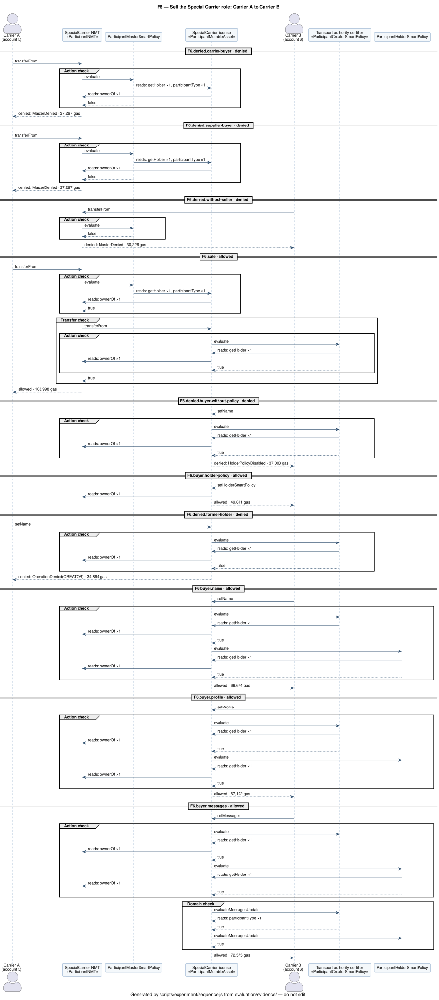
<!-- /evidence:phase:F6 -->

<!-- evidence:phase-title:F7 -->
### F7

**Restrict a second instance through its Holder policy**
<!-- /evidence:phase-title:F7 -->

<!-- narrative:F7 -->
A second instance, minted by the authorized creator for the same holder with the default policies, shows the Holder layer without touching the first one. The holder deploys and installs `DenyAllSmartPolicy` as its Holder policy, and the delta on this instance is <!-- outcome:F7.denied.delta -->denied<!-- /outcome --> at the Holder action check. The experiment does not transfer a choreography instance: the transfer rules of the Master policy are exercised only by the policy test matrix.

<!-- evidence:phase:F7 -->
**Actors**

| Account | Index | Address | Plays |
| --- | ---: | --- | --- |
| Holder | 1 | `0x70997970C51812dc3A010C7d01b50e0d17dc79C8` | eligible holder: holds and edits the instances |
| Authorized creator | 4 | `0x15d34AAf54267DB7D7c367839AAf71A00a2C6A65` | the account the Master policy authorizes to mint an instance |

**Inputs**

| File | SHA-256 |
| --- | --- |
| [scripts/data/paper-example-parallel-transport-preparation.delta.json](../scripts/data/paper-example-parallel-transport-preparation.delta.json) | `43416b130a769acca4ea93a75afdcb827e9f69d548bdb2a8307987c1e22cb490` |

**Transactions**

| Key | Operation | From | Call | Contract | Outcome | Reason | Gas |
| --- | --- | --- | --- | --- | --- | --- | ---: |
| `F7.deploy.deny-all` | the Holder deploys the deny-all policy | Holder | `DenyAllSmartPolicy.constructor` | DenyAllSmartPolicy `0x90118d110B07ABB82Ba8980D1c5cC96EeA810d2C` | allowed | — | 335,458 |
| `F7.mint` | the authorized creator mints a second instance for the Holder, with the default policies | Authorized creator | `ChoreographyNMT.mint` | ChoreographyNMT `0x5FC8d32690cc91D4c39d9d3abcBD16989F875707` | allowed | — | 5,804,785 |
| `F7.holder.deny-all` | the Holder installs the deny-all policy | Holder | `ChoreographyMutableAsset.setHolderSmartPolicy` | ChoreographyMutableAsset `0x23dB4a08f2272df049a4932a4Cc3A6Dc1002B33E` | allowed | — | 32,533 |
| `F7.denied.delta` | the Holder policy denies the delta | Holder | `ChoreographyMutableAsset.setNodes` | ChoreographyMutableAsset `0x23dB4a08f2272df049a4932a4Cc3A6Dc1002B33E` | denied | `OperationDenied(HOLDER)` | 137,644 |

**Costs**

| Key | Gas | Cost (POL) | USD @100 gwei | USD @300 gwei | USD @1000 gwei |
| --- | ---: | ---: | ---: | ---: | ---: |
| `F7.deploy.deny-all` | 335,458 | 0.000000105579031798 | $0.003019 | $0.009057 | $0.030191 |
| `F7.mint` | 5,804,785 | 0.00000160113384655 | $0.052243 | $0.156729 | $0.522431 |
| `F7.holder.deny-all` | 32,533 | 0.000000008068932259 | $0.000293 | $0.000878 | $0.002928 |
| `F7.denied.delta` | 137,644 | 0.000000029876180776 | $0.001239 | $0.003716 | $0.012388 |
| **phase total** | 6,310,420 | 0.000001744657991383 | $0.056794 | $0.170381 | $0.567938 |

**Trust-table rows**

| Key | Table | Row of docs/choreography-policies.md |
| --- | --- | --- |
| `F7.mint` | choreography | `mint` an instance of the choreography type to an eligible holder |
| `F7.holder.deny-all` | choreography | `setHolderSmartPolicy` |
| `F7.denied.delta` | choreography | `setNodes` |

**The second instance at the end of the phase**

| Address | Nodes | Tasks | Gateways | Edges | Messages | Roles |
| --- | ---: | ---: | ---: | ---: | ---: | ---: |
| `0x23dB4a08f2272df049a4932a4Cc3A6Dc1002B33E` | 11 | 9 | 0 | 10 | 18 | 5 |

| Role | Played by | Address |
| --- | --- | --- |
| Bulk Buyer | none | `0x0000000000000000000000000000000000000000` |
| Manufacturer | none | `0x0000000000000000000000000000000000000000` |
| Middleman | none | `0x0000000000000000000000000000000000000000` |
| Supplier | none | `0x0000000000000000000000000000000000000000` |
| Special Carrier | none | `0x0000000000000000000000000000000000000000` |

Holder: Holder.

**Policies in force at the end of the phase**

| Resource | Layer | Contract | Address | Source | Bytecode keccak256 |
| --- | --- | --- | --- | --- | --- |
| choreography type | Master | MasterSmartPolicy | `0x5FbDB2315678afecb367f032d93F642f64180aa3` | [MasterSmartPolicy.sol](../contracts/choreography/MasterSmartPolicy.sol) | `0xd571f41296cdf988da3971e854c0c081d2fd28daac670078e4407fbc62fd9b17` |
| restricted instance | Creator | CreatorSmartPolicy | `0xe7f1725E7734CE288F8367e1Bb143E90bb3F0512` | [CreatorSmartPolicy.sol](../contracts/choreography/CreatorSmartPolicy.sol) | `0x43492bed290349b36ee4209e036f71822a65418023ba5edd9e222d5e13406330` |
| restricted instance | Holder | DenyAllSmartPolicy | `0x90118d110B07ABB82Ba8980D1c5cC96EeA810d2C` | [DenyAllSmartPolicy.sol](../contracts/choreography/DenyAllSmartPolicy.sol) | `0x9f03a9ce484e3bd5888dbcdf647bf64f9b80a32025b7548177e9283f625f21f1` |

**Duration (ms)**

| Measured | Median | Min | Max | Std dev |
| --- | ---: | ---: | ---: | ---: |
| phase F7 | 14.832 | 14.180 | 22.395 | 2.484 |

**Sequence diagram** (filtered; [complete](../evaluation/evidence/uml/F7-full.svg))

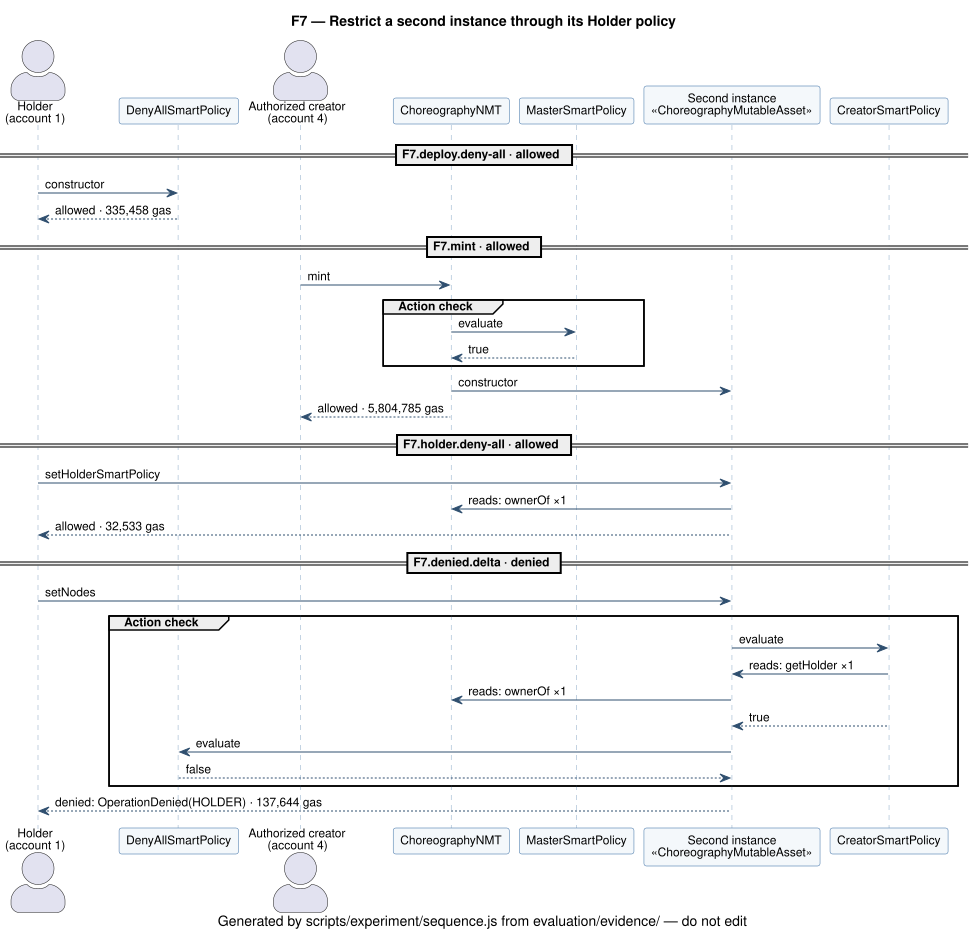
<!-- /evidence:phase:F7 -->

<!-- evidence:phase-title:F8 -->
### F8

**Render the final model from the chain**
<!-- /evidence:phase-title:F8 -->

<!-- narrative:F8 -->
The render reads the instance again and regenerates the BPMN of the changed model, the same way as the baseline: no transaction is sent.

<!-- evidence:phase:F8 -->
**Actors**

| Account | Index | Address | Plays |
| --- | ---: | --- | --- |

**Off-chain steps**

| Step | Function | Output | SHA-256 |
| --- | --- | --- | --- |
| export | `exportContractToJson` | raw JSON (hashed without `contractExport.exportedAt`, `contractExport.rpcUrl`) | `7215b0be91a45605363d798ad28914ed1c5c206656cc98fbf59c2af17df08e26` |
| normalize | `normalizeInput` | normalized JSON (hashed without `contractExport.exportedAt`, `contractExport.rpcUrl`) | `054c14dcad1d466000145e7395f1ca9d79026f9fcf136cc6e057f1b21cb5412e` |
| generate | `generateBpmnXml` | BPMN XML | `6747cc3eda738c9ebfdc6c9a5e3aca2d113b48c4276ddfed1588f63d7aeb1e75` |

**Reads**

| Key | Call | By | Gas |
| --- | --- | --- | ---: |
| `F8.tokenURI` | `ChoreographyNMT.tokenURI` | eth_call (any account) | 1,682,131 |

**The instance at the end of the phase**

| Address | Nodes | Tasks | Gateways | Edges | Messages | Roles |
| --- | ---: | ---: | ---: | ---: | ---: | ---: |
| `0x61c36a8d610163660E21a8b7359e1Cac0C9133e1` | 14 | 10 | 2 | 14 | 19 | 5 |

| Role | Played by | Address |
| --- | --- | --- |
| Bulk Buyer | ParticipantMutableAsset | `0x0214919f0E8889b55d6dd69f1341B4947453458B` |
| Manufacturer | ParticipantMutableAsset | `0xD5B9B99c015C86F4a44122b9EB8e5c8AF0AC3F16` |
| Middleman | ParticipantMutableAsset | `0xb008fcD5ce8D04C68f62D240A1b4907dEBb12732` |
| Supplier | ParticipantMutableAsset | `0x611cA715eae6F4BBa9e4442a379C206072655759` |
| Special Carrier | ParticipantMutableAsset | `0xA44B9f3F5Bb8C278c1ee85D8F32517c6EFa64B0D` |

**Policies in force at the end of the phase**

| Resource | Layer | Contract | Address | Source | Bytecode keccak256 |
| --- | --- | --- | --- | --- | --- |
| choreography type | Master | MasterSmartPolicy | `0x5FbDB2315678afecb367f032d93F642f64180aa3` | [MasterSmartPolicy.sol](../contracts/choreography/MasterSmartPolicy.sol) | `0xd571f41296cdf988da3971e854c0c081d2fd28daac670078e4407fbc62fd9b17` |
| instance | Creator | CreatorSmartPolicyPaperScenario | `0x9A676e781A523b5d0C0e43731313A708CB607508` | [CreatorSmartPolicyPaperScenario.sol](../contracts/choreography/CreatorSmartPolicyPaperScenario.sol) | `0x27aa6788c2d8e3cc7bbe0ce7da6e1da89558fa15c575f2962a79978edd971d3e` |
| instance | Holder | HolderSmartPolicy | `0x9fE46736679d2D9a65F0992F2272dE9f3c7fa6e0` | [HolderSmartPolicy.sol](../contracts/choreography/HolderSmartPolicy.sol) | `0x64f3e21bf63e229868d575e36b6dfdafb0a11d8ed37cf63bf59858a08474030b` |
| license type | Master | ParticipantMasterSmartPolicy | `0x0165878A594ca255338adfa4d48449f69242Eb8F` | [ParticipantMasterSmartPolicy.sol](../contracts/participant/ParticipantMasterSmartPolicy.sol) | `0x6f94394a8c6d8dbbf49ce900a99d978a7cd350f943337eab18634746911196a8` |
| licensed role | Creator | ParticipantCreatorSmartPolicy | `0xb19b36b1456E65E3A6D514D3F715f204BD59f431` | [CreatorSmartPolicy.sol](../contracts/participant/CreatorSmartPolicy.sol) | `0x30fbe346110963427ac9f7af7454a7b2ea44e2c474db2a2359a0c4c52ca5ce15` |
| licensed role | Holder | ParticipantHolderSmartPolicy | `0x2279B7A0a67DB372996a5FaB50D91eAA73d2eBe6` | [HolderSmartPolicy.sol](../contracts/participant/HolderSmartPolicy.sol) | `0x29c7f6744db23d0f03ec3cd9c5c8cd4b279ba4324371e80d432e259078e2c57b` |

**Duration (ms)**

| Measured | Median | Min | Max | Std dev |
| --- | ---: | ---: | ---: | ---: |
| phase F8 | 20.121 | 19.166 | 21.695 | 0.816 |
| step `F8.render` | 19.550 | 18.548 | 21.176 | 0.842 |

**Sequence diagram** (filtered; [complete](../evaluation/evidence/uml/F8-full.svg))


<!-- /evidence:phase:F8 -->

## Public-network cost scenarios

The measured gas of a choreography type and its first instance, priced on Polygon at the gas prices of a sensitivity analysis.

<!-- evidence:scenarios -->
The gas of a choreography type and its first complete instance: `F1.deploy.master`, `F1.deploy.creator`, `F1.deploy.holder`, `F1.deploy.renderer`, `F1.deploy.model`, `F1.deploy.nmt`, `F2.mint`, `F3.link`, 16,345,600 gas in all, 0.00730950388369159 POL at the local gas price of the receipts.

The costs on Polygon are estimated at three overall gas prices: 100, 300, 1,000 gwei. The central value comes from a reading of the Polygon Gas Station, about 271 gwei, rounded up to 300 gwei; the lower and the upper value are sensitivity scenarios, which show the effect of fee variability on the cost of the operations. They are assumptions to compare costs, not historical averages or official congestion thresholds; the POL/USD price, $0.090, is a calculation assumption too.

| Scenario | Gas price | Meaning | Gas | Estimated POL cost | Estimated USD cost |
| --- | ---: | --- | ---: | --- | --- |
| Economical | 100 gwei | fees below the reading consulted | 16,345,600 | 1.634560 | $0.1471 |
| Reference | 300 gwei | the Polygon Gas Station reading of about 271 gwei, rounded up | 16,345,600 | 4.903680 | $0.4413 |
| Costly | 1,000 gwei | fees markedly above the reading, to see how far the costs grow | 16,345,600 | 16.345600 | $1.4711 |
<!-- /evidence:scenarios -->

## Charts

<!-- evidence:charts -->
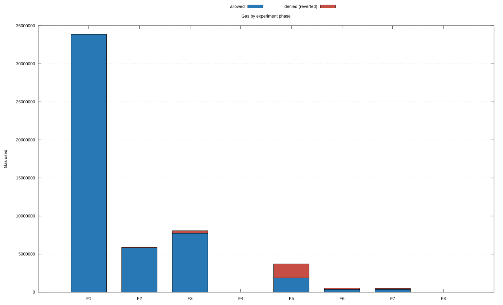

*Gas by phase, allowed and denied transactions stacked.* Data: [phase-gas.dat](../evaluation/evidence/charts/phase-gas.dat).

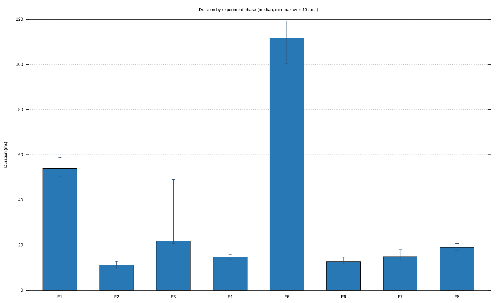

*Median duration by phase over 10 runs, with min–max bars.* Data: [phase-duration.dat](../evaluation/evidence/charts/phase-duration.dat).

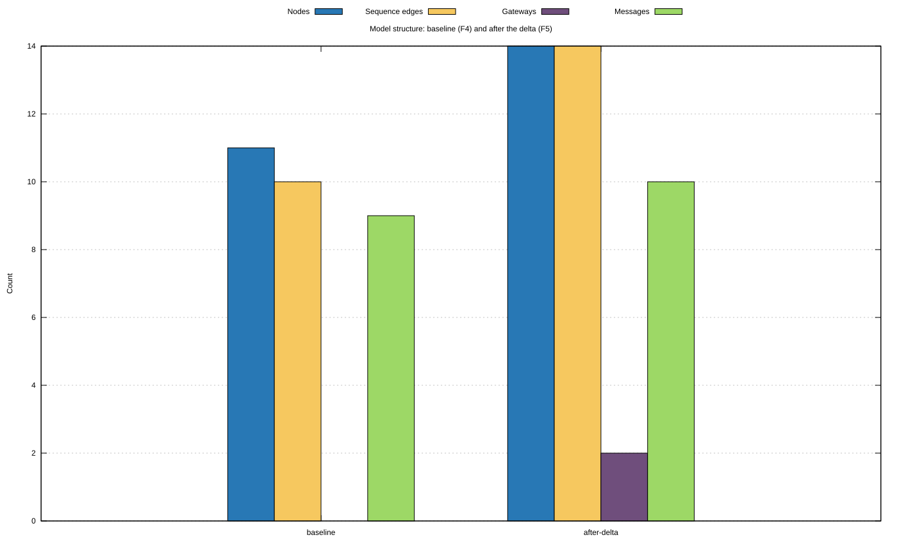

*Model structure read from the chain: baseline (F4) and after the delta (F5).* Data: [model-comparison.dat](../evaluation/evidence/charts/model-comparison.dat).

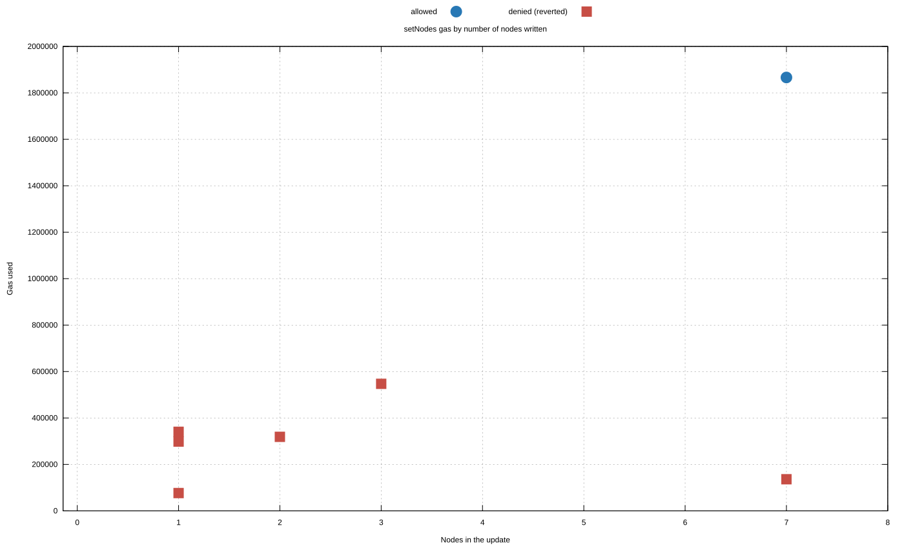

*Gas of every setNodes by the number of nodes it writes.* Data: [gas-by-changed-nodes.dat](../evaluation/evidence/charts/gas-by-changed-nodes.dat).

<!-- /evidence:charts -->

## BPMN models

<!-- evidence:bpmn -->
**Baseline (F4)**: [XML](../evaluation/evidence/bpmn/baseline.bpmn.xml), SHA-256 `11001e7089942298911795381a201d6397d421d8888887a04aebc02ea428bc44`, 34 names drawn.

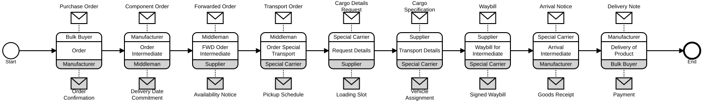

**After the delta (F8)**: [XML](../evaluation/evidence/bpmn/final.bpmn.xml), SHA-256 `6747cc3eda738c9ebfdc6c9a5e3aca2d113b48c4276ddfed1588f63d7aeb1e75`, 38 names drawn.

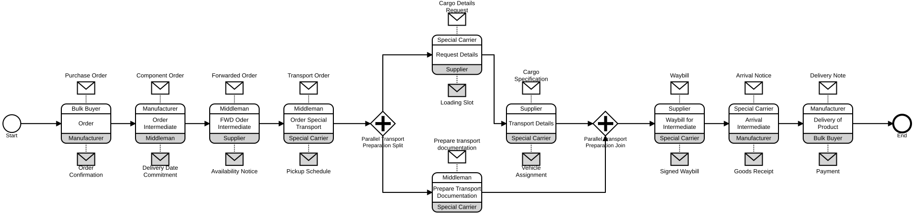

Checked before drawing: the baseline XML is equivalent to the source BPMN, the final XML is the baseline with the delta written over it, both equal the model the chain returned to their render, and each drawing shows exactly the names of its XML.
<!-- /evidence:bpmn -->

## UML diagrams

The use case diagrams are written by hand and checked by `npm run check:use-cases` against the trust tables, the test cases, and this evidence; the sequence diagrams are generated from the call traces of each phase. All of them are in [UML diagrams](uml.md).

<!-- evidence:uml-guide -->
| Diagram | Shows |
| --- | --- |
| [Choreography use cases](uml/use-case-choreography.svg) | who may mint, transfer, edit the model, assign and link roles, and install a Holder policy; checked against the trust table, the tests, and this evidence |
| [Participant license use cases](uml/use-case-participant-license.svg) | issuing, declaring messages, updating organization data, selling, and linking a role to a license |
| [F1](../evaluation/evidence/uml/F1.svg) · [complete](../evaluation/evidence/uml/F1-full.svg) | Deploy the choreography type and the license infrastructure |
| [F2](../evaluation/evidence/uml/F2.svg) · [complete](../evaluation/evidence/uml/F2-full.svg) | Mint the instance for its holder |
| [F3](../evaluation/evidence/uml/F3.svg) · [complete](../evaluation/evidence/uml/F3-full.svg) | Issue the participant licenses and link every role to its license |
| [F4](../evaluation/evidence/uml/F4.svg) · [complete](../evaluation/evidence/uml/F4-full.svg) | Render the baseline model from the chain |
| [F5](../evaluation/evidence/uml/F5.svg) · [complete](../evaluation/evidence/uml/F5-full.svg) | Apply the delta: one allowed update and seven denied ones |
| [F6](../evaluation/evidence/uml/F6.svg) · [complete](../evaluation/evidence/uml/F6-full.svg) | Sell the Special Carrier role: Carrier A to Carrier B |
| [F7](../evaluation/evidence/uml/F7.svg) · [complete](../evaluation/evidence/uml/F7-full.svg) | Restrict a second instance through its Holder policy |
| [F8](../evaluation/evidence/uml/F8.svg) · [complete](../evaluation/evidence/uml/F8-full.svg) | Render the final model from the chain |
<!-- /evidence:uml-guide -->

<!-- narrative:tests -->
## Cross-check: the policy test matrix

The experiment exercises the policies on the paper example; `npm test` exercises them on a small fixture, with the semantics and the mapping to test cases in [Policy and test specification](policy-test-specification.md), case by case: the Master mint and eligibility controls, the Creator constraints and the attempts to bypass them, role licenses and their sale, the Holder restrictions, the replacement of the Master policy, and the transfer of an instance. Its results are kept with the evidence.

<!-- evidence:tests -->
| Test matrix | Value |
| --- | --- |
| Cases | 61 |
| Gas of the allowed cases | 12,609,330 |
| Gas of the denied cases | 2,451,785 |

| Case | Outcome | Gas | Cost (wei) | USD @100 gwei | USD @300 gwei | USD @1000 gwei |
| --- | --- | ---: | ---: | ---: | ---: | ---: |
| authorized creator mints eligible holder | allowed | 3,173,819 | 1,642,656,922,973,363 | $0.028564 | $0.085693 | $0.285644 |
| creator and holder update roles | allowed | 109,294 | 50,243,936,558,990 | $0.000984 | $0.002951 | $0.009836 |
| creator and holder update nodes | allowed | 224,844 | 90,490,432,262,028 | $0.002024 | $0.006071 | $0.020236 |
| creator policy denies a flow declared on one endpoint | denied | 121,951 | 42,991,195,664,489 | $0.001098 | $0.003293 | $0.010976 |
| authorized creator mints with the test-scenario creator policy | allowed | 3,179,419 | 191,647,733,996,724 | $0.028615 | $0.085844 | $0.286148 |
| creator policy allows approved task within limits | allowed | 609,279 | 32,621,668,928,970 | $0.005484 | $0.016451 | $0.054835 |
| creator policy allows second approved task within limits | allowed | 601,451 | 28,258,979,763,425 | $0.005413 | $0.016239 | $0.054131 |
| creator policy denies task count above limit | denied | 164,755 | 6,792,739,252,680 | $0.001483 | $0.004448 | $0.014828 |
| creator policy denies sequence flow count above limit | denied | 324,233 | 11,706,099,477,709 | $0.002918 | $0.008754 | $0.029181 |
| creator policy denies task outside name allowlist | denied | 144,822 | 4,582,132,164,144 | $0.001303 | $0.003910 | $0.013034 |
| creator policy denies flow to unknown node | denied | 76,086 | 2,107,877,109,336 | $0.000685 | $0.002054 | $0.006848 |
| creator policy denies protected node update | denied | 167,677 | 4,066,112,922,652 | $0.001509 | $0.004527 | $0.015091 |
| creator policy denies flow from unknown node | denied | 93,939 | 1,994,833,086,051 | $0.000845 | $0.002536 | $0.008455 |
| creator policy allows update keeping protected node links | allowed | 231,955 | 4,311,879,689,770 | $0.002088 | $0.006263 | $0.020876 |
| creator policy denies unlinking protected node | denied | 127,358 | 2,073,846,601,442 | $0.001146 | $0.003439 | $0.011462 |
| creator policy denies new link to protected node | denied | 134,415 | 1,916,326,562,265 | $0.001210 | $0.003629 | $0.012097 |
| creator policy allows unprotected role update | allowed | 97,958 | 1,222,778,073,566 | $0.000882 | $0.002645 | $0.008816 |
| creator policy allows the first assignment of a protected role | allowed | 99,718 | 1,089,662,162,766 | $0.000897 | $0.002692 | $0.008975 |
| creator policy denies protected role update | denied | 58,627 | 560,828,754,723 | $0.000528 | $0.001583 | $0.005276 |
| unauthorized issuer cannot mint a participant license | denied | 30,523 | 174,150,227,943 | $0.000275 | $0.000824 | $0.002747 |
| authority cannot issue a license type of another authority | denied | 30,523 | 152,403,628,225 | $0.000275 | $0.000824 | $0.002747 |
| issuer cannot mint a license of a type the Master does not define | denied | 30,621 | 133,800,786,696 | $0.000276 | $0.000827 | $0.002756 |
| license holder declares messages allowed for its type | allowed | 139,774 | 534,486,970,238 | $0.001258 | $0.003774 | $0.012580 |
| creator policy denies a message not allowed for the license type | denied | 46,675 | 156,275,928,100 | $0.000420 | $0.001260 | $0.004201 |
| license holder updates its organization data | allowed | 66,674 | 195,374,955,548 | $0.000600 | $0.001800 | $0.006001 |
| authorized creator mints a model whose Carrier role requires a SpecialCarrier license | allowed | 3,223,648 | 5,687,843,214,976 | $0.029013 | $0.087038 | $0.290128 |
| holder assigns the accounts of the new instance | allowed | 135,868 | 212,981,377,948 | $0.001223 | $0.003668 | $0.012228 |
| creator policy denies a plain account for a licensed role | denied | 63,657 | 87,369,487,128 | $0.000573 | $0.001719 | $0.005729 |
| creator policy denies a license of another type | denied | 63,657 | 76,471,472,385 | $0.000573 | $0.001719 | $0.005729 |
| creator policy denies a license from an untrusted certifier | denied | 69,240 | 72,803,228,880 | $0.000623 | $0.001869 | $0.006232 |
| creator policy denies new role when known roles are enforced | denied | 54,893 | 50,519,839,369 | $0.000494 | $0.001482 | $0.004940 |
| creator policy denies account already holding another role | denied | 73,824 | 59,465,453,472 | $0.000664 | $0.001993 | $0.006644 |
| holder links a role to a certified license | allowed | 120,833 | 85,194,877,479 | $0.001087 | $0.003262 | $0.010875 |
| participant master denies selling a license to an unqualified buyer | denied | 37,297 | 23,022,878,645 | $0.000336 | $0.001007 | $0.003357 |
| buyer cannot take a license without the seller | denied | 30,226 | 16,328,719,946 | $0.000272 | $0.000816 | $0.002720 |
| holder sells a license to a qualified buyer | allowed | 106,998 | 50,584,588,476 | $0.000963 | $0.002889 | $0.009630 |
| former license holder cannot install a Holder policy | denied | 27,477 | 11,372,125,806 | $0.000247 | $0.000742 | $0.002473 |
| new license holder installs its Holder policy | allowed | 49,611 | 17,968,657,701 | $0.000446 | $0.001339 | $0.004465 |
| former license holder cannot update the license | denied | 34,894 | 11,061,153,742 | $0.000314 | $0.000942 | $0.003140 |
| new license holder updates its data | allowed | 66,674 | 18,496,434,384 | $0.000600 | $0.001800 | $0.006001 |
| new license holder rewrites the messages | allowed | 62,974 | 15,291,094,784 | $0.000567 | $0.001700 | $0.005668 |
| unauthorized creator cannot mint | denied | 29,810 | 6,335,459,680 | $0.000268 | $0.000805 | $0.002683 |
| master administrator cannot mint | denied | 29,822 | 5,546,563,958 | $0.000268 | $0.000805 | $0.002684 |
| authorized creator cannot assign an ineligible holder | denied | 30,099 | 4,899,033,636 | $0.000271 | $0.000813 | $0.002709 |
| non-holder cannot update choreography | denied | 39,477 | 5,623,064,403 | $0.000355 | $0.001066 | $0.003553 |
| holder links the asset | allowed | 66,238 | 8,257,162,842 | $0.000596 | $0.001788 | $0.005961 |
| non-holder cannot link the asset | denied | 35,225 | 3,843,470,200 | $0.000317 | $0.000951 | $0.003170 |
| holder transfers to eligible holder | allowed | 113,970 | 10,882,995,300 | $0.001026 | $0.003077 | $0.010257 |
| holder cannot transfer to an ineligible holder | denied | 30,322 | 2,534,888,878 | $0.000273 | $0.000819 | $0.002729 |
| holder cannot replace creator policy | denied | 28,929 | 1,647,622,266 | $0.000260 | $0.000781 | $0.002604 |
| creator policy administrator replaces creator policy | allowed | 29,146 | 1,452,694,932 | $0.000262 | $0.000787 | $0.002623 |
| holder installs restrictive policy | allowed | 32,533 | 1,260,491,085 | $0.000293 | $0.000878 | $0.002928 |
| holder policy can deny further updates | denied | 45,904 | 1,556,512,832 | $0.000413 | $0.001239 | $0.004131 |
| holder cannot replace master policy | denied | 28,800 | 854,697,600 | $0.000259 | $0.000778 | $0.002592 |
| master administrator cannot remove master policy | denied | 28,595 | 742,640,745 | $0.000257 | $0.000772 | $0.002574 |
| master administrator replaces master policy | allowed | 32,920 | 748,238,680 | $0.000296 | $0.000889 | $0.002963 |
| replaced master policy governs minting | denied | 29,136 | 579,544,176 | $0.000262 | $0.000787 | $0.002622 |
| license holder cannot replace participant master policy | denied | 29,612 | 515,485,696 | $0.000267 | $0.000800 | $0.002665 |
| authority cannot replace the participant master policy of another authority's license type | denied | 29,612 | 451,138,820 | $0.000267 | $0.000800 | $0.002665 |
| participant master administrator replaces participant master policy | allowed | 33,732 | 449,748,756 | $0.000304 | $0.000911 | $0.003036 |
| replaced participant master policy governs sales | denied | 29,072 | 339,241,168 | $0.000262 | $0.000785 | $0.002616 |
<!-- /evidence:tests -->

## Evidence files

<!-- evidence:artifacts -->
- [bpmn/baseline.bpmn.xml](../evaluation/evidence/bpmn/baseline.bpmn.xml)
- [bpmn/baseline.svg](../evaluation/evidence/bpmn/baseline.svg)
- [bpmn/final.bpmn.xml](../evaluation/evidence/bpmn/final.bpmn.xml)
- [bpmn/final.svg](../evaluation/evidence/bpmn/final.svg)
- [bpmn/images.json](../evaluation/evidence/bpmn/images.json)
- [charts/gas-by-changed-nodes.dat](../evaluation/evidence/charts/gas-by-changed-nodes.dat)
- [charts/gas-by-changed-nodes.svg](../evaluation/evidence/charts/gas-by-changed-nodes.svg)
- [charts/model-comparison.dat](../evaluation/evidence/charts/model-comparison.dat)
- [charts/model-comparison.svg](../evaluation/evidence/charts/model-comparison.svg)
- [charts/phase-duration.dat](../evaluation/evidence/charts/phase-duration.dat)
- [charts/phase-duration.svg](../evaluation/evidence/charts/phase-duration.svg)
- [charts/phase-gas.dat](../evaluation/evidence/charts/phase-gas.dat)
- [charts/phase-gas.svg](../evaluation/evidence/charts/phase-gas.svg)
- [experiment.json](../evaluation/evidence/experiment.json)
- [tests.json](../evaluation/evidence/tests.json)
- [timings.json](../evaluation/evidence/timings.json)
- [traces.json](../evaluation/evidence/traces.json)
- [transactions.csv](../evaluation/evidence/transactions.csv)
- [uml/F1-full.puml](../evaluation/evidence/uml/F1-full.puml)
- [uml/F1-full.svg](../evaluation/evidence/uml/F1-full.svg)
- [uml/F1.puml](../evaluation/evidence/uml/F1.puml)
- [uml/F1.svg](../evaluation/evidence/uml/F1.svg)
- [uml/F2-full.puml](../evaluation/evidence/uml/F2-full.puml)
- [uml/F2-full.svg](../evaluation/evidence/uml/F2-full.svg)
- [uml/F2.puml](../evaluation/evidence/uml/F2.puml)
- [uml/F2.svg](../evaluation/evidence/uml/F2.svg)
- [uml/F3-full.puml](../evaluation/evidence/uml/F3-full.puml)
- [uml/F3-full.svg](../evaluation/evidence/uml/F3-full.svg)
- [uml/F3.puml](../evaluation/evidence/uml/F3.puml)
- [uml/F3.svg](../evaluation/evidence/uml/F3.svg)
- [uml/F4-full.puml](../evaluation/evidence/uml/F4-full.puml)
- [uml/F4-full.svg](../evaluation/evidence/uml/F4-full.svg)
- [uml/F4.puml](../evaluation/evidence/uml/F4.puml)
- [uml/F4.svg](../evaluation/evidence/uml/F4.svg)
- [uml/F5-full.puml](../evaluation/evidence/uml/F5-full.puml)
- [uml/F5-full.svg](../evaluation/evidence/uml/F5-full.svg)
- [uml/F5.puml](../evaluation/evidence/uml/F5.puml)
- [uml/F5.svg](../evaluation/evidence/uml/F5.svg)
- [uml/F6-full.puml](../evaluation/evidence/uml/F6-full.puml)
- [uml/F6-full.svg](../evaluation/evidence/uml/F6-full.svg)
- [uml/F6.puml](../evaluation/evidence/uml/F6.puml)
- [uml/F6.svg](../evaluation/evidence/uml/F6.svg)
- [uml/F7-full.puml](../evaluation/evidence/uml/F7-full.puml)
- [uml/F7-full.svg](../evaluation/evidence/uml/F7-full.svg)
- [uml/F7.puml](../evaluation/evidence/uml/F7.puml)
- [uml/F7.svg](../evaluation/evidence/uml/F7.svg)
- [uml/F8-full.puml](../evaluation/evidence/uml/F8-full.puml)
- [uml/F8-full.svg](../evaluation/evidence/uml/F8-full.svg)
- [uml/F8.puml](../evaluation/evidence/uml/F8.puml)
- [uml/F8.svg](../evaluation/evidence/uml/F8.svg)
<!-- /evidence:artifacts -->
