# ChorNMT experiment protocol

This document describes the ChorNMT experiment: a BPMN choreography governed on-chain by smart policies, run end to end on a local Ethereum network. It is written for reviewers who want to know what was done, by whom, under which policies, and what came out, and who may want to run it again.

## How to read this document

The text in this document is narrative. Every number, table, outcome, chart, BPMN drawing, and sequence diagram comes from the experiment run and is inserted by `scripts/experiment/protocol.js` between `<!-- evidence:... -->` markers (decision D21 in [Design decisions](decisions.md)). `npm run check:protocol` fails if a generated block differs from the evidence in [`evaluation/evidence/`](../evaluation/evidence/), if a number or an outcome word appears in the narrative, or if the phases are not those of the [experiment specification](../scripts/experiment/phases.js). The evidence itself is regenerated by `npm run evidence:update`, which fails if any transaction differs from the specification or if two runs give different results.

<!-- narrative:purpose -->
## Purpose

The experiment shows the claims of [Requirements](requirements.md) on one choreography, from deployment to sale of a role:

- a choreography lives on-chain as the model of a choreography type, and is drawn again as BPMN from the chain (claim C1);
- every change is decided by policies at the right level: the Master policy for the type, the Creator AND the Holder policy for an instance (claim C2);
- the Creator policy sets structural limits the Holder cannot remove (claim C3);
- a role is played by a participant license that can be sold, and the organization behind the role changes with the sale (claim C4);
- the cost of every step is measured, and a delta update is compared with a new instance (hypothesis H5).

Each phase below lists its actors, the policies in force, the transactions with their outcome and gas, the state of the instance afterwards, its duration, and its sequence diagram, drawn from the call traces of the run.

## Provenance

<!-- evidence:provenance -->
| Item | Value |
| --- | --- |
| Solidity compiler | `0.8.28` |
| Optimizer | enabled, 200 runs |
| Node.js | `22.23.1` |
| Hardhat | `^3.9.0` |
| Network | hardhat (edr-simulated, ephemeral) |
| ETH/USD price of the USD columns | $3,000 (fixed, `ETH_USD_PRICE`) |
| Measured runs (timings) | 10 after 1 warm-up run, each on a fresh network; all gave the same evidence |
| Machine of the timings | Apple M3 Pro, 12 cores, 18 GiB, darwin 25.5.0 arm64 |

Gas and costs are local Hardhat measurements with the compiler and optimizer above. The USD columns price the measured gas at the public-network gas prices of the scenarios, not at the local gas price; the cost columns in ETH use the local gas price of each receipt.
<!-- /evidence:provenance -->

## Reproduction

<!-- evidence:reproduction -->
```bash
nvm use && npm install && (cd bpmn-builder-js && npm install) && npm run setup:evaluation
npm run compile
npm run evidence:update                       # the experiment, its traces, timings, diagrams, charts, and this document
EXPERIMENT_REPETITIONS=10 npm run evidence:update     # the repetitions of these timings
npm run evidence:update -- --out /tmp/run     # an exploratory run, elsewhere
npm run check:protocol                        # this document against the evidence
```

Prerequisites: Node.js 22, gnuplot, the Chromium of setup:evaluation, Java, and Graphviz.
<!-- /evidence:reproduction -->

## The case study

The model is the paper example, [`references/paper-example.bpmn`](../references/paper-example.bpmn): a supply chain choreography in which a bulk buyer orders a product from a manufacturer, who orders an intermediate product from a middleman; the middleman forwards the order to the supplier and orders a special transport from a special carrier; the special carrier requests the transport details from the supplier, who sends them and the waybill for the intermediate; the special carrier reports the arrival of the intermediate to the manufacturer, who delivers the product to the bulk buyer. Every task is an exchange between two roles: Bulk Buyer, Manufacturer, Middleman, Supplier, and Special Carrier.

The experiment deploys this model as a choreography type, mints an instance, and then changes it with a delta, [`paper-example-parallel-transport-preparation.delta.json`](../scripts/data/paper-example-parallel-transport-preparation.delta.json): the transport preparation is split into two parallel branches, the collection of the transport details and the preparation of the transport documentation, joined again before the waybill. The Special Carrier role is played by a participant license, which changes hands during the experiment.

## Actors and accounts

The accounts are the default Hardhat ones. The choreography policies name the administrator and the partner, the participant policies name the carriers, the supplier company, and the authority; the role accounts are named by no policy, so each one plays only its role.

<!-- evidence:accounts -->
| Account | Index | Address | Plays |
| --- | ---: | --- | --- |
| Administrator | 0 | `0xf39Fd6e51aad88F6F4ce6aB8827279cffFb92266` | Master administrator, authorized creator, holder of the instances |
| Partner | 1 | `0x70997970C51812dc3A010C7d01b50e0d17dc79C8` | eligible holder |
| Unauthorized creator | 2 | `0x3C44CdDdB6a900fa2b585dd299e03d12FA4293BC` | an account the Master policy does not authorize to mint |
| Ineligible holder | 3 | `0x90F79bf6EB2c4f870365E785982E1f101E93b906` | an account the Master policy does not accept as holder |
| Carrier A | 5 | `0x9965507D1a55bcC2695C58ba16FB37d819B0A4dc` | organization qualified for SpecialCarrier, first holder of its license |
| Carrier B | 6 | `0x976EA74026E726554dB657fA54763abd0C3a0aa9` | organization qualified for SpecialCarrier, buyer of the license |
| Carrier C | 7 | `0x14dC79964da2C08b23698B3D3cc7Ca32193d9955` | organization qualified only for Carrier |
| Supplier company | 8 | `0x23618e81E3f5cdF7f54C3d65f7FBc0aBf5B21E8f` | organization qualified only for Supplier |
| Authority | 9 | `0xa0Ee7A142d267C1f36714E4a8F75612F20a79720` | issuer of the license types and certifier of the licenses |
| Bulk Buyer account | 10 | `0xBcd4042DE499D14e55001CcbB24a551F3b954096` | the Bulk Buyer role |
| Manufacturer account | 11 | `0x71bE63f3384f5fb98995898A86B02Fb2426c5788` | the Manufacturer role |
| Middleman account | 12 | `0xFABB0ac9d68B0B445fB7357272Ff202C5651694a` | the Middleman role |
| Supplier account | 13 | `0x1CBd3b2770909D4e10f157cABC84C7264073C9Ec` | the Supplier role |
<!-- /evidence:accounts -->

## Inputs

<!-- evidence:inputs -->
| Input | File | SHA-256 |
| --- | --- | --- |
| bpmn | [references/paper-example.bpmn](../references/paper-example.bpmn) | `dc76537103877870ceae2e826f025dc6cebf018d46d22682d9a8c3f9776d477b` |
| delta | [scripts/data/paper-example-parallel-transport-preparation.delta.json](../scripts/data/paper-example-parallel-transport-preparation.delta.json) | `0906afd9b88d63f815eaf4d89a1bdf304ef3379d7a737731568ed717c27cab99` |
| trustTables | [docs/choreography-policies.md](../docs/choreography-policies.md) | `316ab1b2211b5cb6d4062c347079877b5a6cec1987c6b6db58c34077707f6ae1` |
<!-- /evidence:inputs -->

<!-- narrative:policies -->
## Policies

Policies stand for XACML policies translated to Solidity: their rules are literals, with no runtime configuration, and a rule change would be a new policy ([Choreography policies](choreography-policies.md) has the trust table; every transaction below names its row).

- The **Master policy** of the choreography type decides who mints an instance and to which holder, and every transfer of an instance.
- The **Creator policy** of an instance sets the outer bounds of the model. The instance of this experiment is born with `CreatorSmartPolicyPaperScenario`: a limit on tasks and on sequence flows, an allowlist of task names, flows only between known nodes, the `Order` task protected, and the Special Carrier role reserved to a license of type `SpecialCarrier`, read through `ChoreographyParticipantAM`. Every Creator policy also requires a flow to be declared on both endpoints.
- The **Holder policy** of an instance is the second approval: a change to the model passes the Creator AND the Holder policy, at the action check and at the domain check. A holder can only restrict further, for example with `DenyAllSmartPolicy`.
- The **participant Master policy** decides which authority issues each license type and which organizations may hold it, so a license can be sold only to an organization qualified for its type; the **certifier** (the license Creator policy) decides which messages each type may declare.

By rule the Master and the Creator policies are never replaced: their setters stay in the contracts and in the tests, but the experiment never calls them (an open question in [Design decisions](decisions.md#open-questions)).

<!-- narrative:outcomes -->
## Outcomes and their cost

An operation the policies refuse is a real transaction that the chain mines and rolls back: it has a receipt with a failed status, the decoded error the contract raised, and the gas spent until the policy check refused it. The run sends every such transaction with a fixed gas limit and records its receipt, so a refusal by a policy is never confused with a client-side simulation error. Each transaction names its expected outcome in the specification, and the run stops if the chain gives another one.

<!-- narrative:phases -->
## Phases

The experiment is one run, on one ephemeral network, through the same functions as the command-line tools (`deploy:asset`, `modify:asset`, `render:asset`). The phases follow the life of the choreography.

<!-- evidence:phases-overview -->
| Phase | Title | Transactions | Allowed | Denied | Gas allowed | Gas denied | Cost (ETH) | Median (ms) | Nodes | Tasks | Edges | Gateways | Messages |
| --- | --- | ---: | --- | --- | ---: | ---: | ---: | ---: | ---: | ---: | ---: | ---: | ---: |
| [F1](#f1) | Deploy the choreography type and the license infrastructure | 13 | 13 | 0 | 17,221,293 | 0 | 0.009596606556653547 | 38.510 | — | — | — | — | — |
| [F2](#f2) | Mint the instance and assign the role accounts | 4 | 2 | 2 | 5,796,619 | 59,909 | 0.001232974194045129 | 14.980 | 11 | 9 | 10 | 0 | 9 |
| [F3](#f3) | Issue the participant licenses and link the Special Carrier role | 11 | 6 | 5 | 3,992,059 | 305,186 | 0.000443532747357883 | 18.035 | 11 | 9 | 10 | 0 | 9 |
| [F4](#f4) | Render the baseline model from the chain | 0 | 0 | 0 | 0 | 0 | 0.0 | 17.430 | 11 | 9 | 10 | 0 | 9 |
| [F5](#f5) | Apply the delta: one allowed update and five denied ones | 6 | 1 | 5 | 1,866,349 | 1,581,510 | 0.000089818068853874 | 155.554 | 14 | 10 | 14 | 2 | 10 |
| [F6](#f6) | Sell the Special Carrier role: Carrier A to Carrier B | 10 | 5 | 5 | 368,336 | 176,543 | 0.000004116862628044 | 14.113 | 14 | 10 | 14 | 2 | 10 |
| [F7](#f7) | Transfer a second instance and restrict it through its Holder policy | 6 | 4 | 2 | 6,117,025 | 166,501 | 0.000019710363637162 | 22.016 | — | — | — | — | — |
| [F8](#f8) | Render the final model and compare the delta with a new instance | 3 | 3 | 0 | 5,899,495 | 0 | 0.000009771866898741 | 40.317 | 14 | 10 | 14 | 2 | 10 |

| Whole experiment | Value |
| --- | --- |
| Transactions | 53 |
| Allowed transactions, gas | 34, 41,261,176 |
| Denied transactions, gas | 19, 2,289,649 |
| Duration of a run, median (min–max), ms | 327.125 (311.963–407.074) |

Nodes to messages: the main instance at the end of the phase (F7 works on a second instance). Durations leave out the time the run spends tracing and checking.
<!-- /evidence:phases-overview -->

<!-- evidence:phase-title:F1 -->
### F1

**Deploy the choreography type and the license infrastructure**
<!-- /evidence:phase-title:F1 -->

<!-- narrative:F1 -->
The administrator imports the BPMN into the model of a choreography type, off-chain, and deploys the type: the Master, the default Creator, and the Holder policy, the renderer of `tokenURI`, the model as the code of a data-only contract (SSTORE2), and the `ChoreographyNMT` that fixes it. The license infrastructure follows: the participant NMT and its Master policy, the certifier deployed by the authority, the license Holder policy, the attribute manager, and the paper-scenario Creator policy the instance will be born with.

<!-- evidence:phase:F1 -->
**Actors**

| Account | Index | Address | Plays |
| --- | ---: | --- | --- |
| Administrator | 0 | `0xf39Fd6e51aad88F6F4ce6aB8827279cffFb92266` | Master administrator, authorized creator, holder of the instances |
| Authority | 9 | `0xa0Ee7A142d267C1f36714E4a8F75612F20a79720` | issuer of the license types and certifier of the licenses |

**Inputs**

| File | SHA-256 |
| --- | --- |
| [references/paper-example.bpmn](../references/paper-example.bpmn) | `dc76537103877870ceae2e826f025dc6cebf018d46d22682d9a8c3f9776d477b` |

**Off-chain steps**

| Step | Function | Output | SHA-256 |
| --- | --- | --- | --- |
| import | `importBpmnToNmt` | NMT dataset (roles and nodes) | `4a02a2abe87c137f82f6831de15696a45eec1106ebc205a184f0e983166c4814` |

**Transactions**

| Key | Operation | From | Call | Contract | Outcome | Reason | Gas |
| --- | --- | --- | --- | --- | --- | --- | ---: |
| `F1.deploy.master` | deploy the Master policy | Administrator | `MasterSmartPolicy.constructor` | MasterSmartPolicy `0x5FbDB2315678afecb367f032d93F642f64180aa3` | allowed | — | 368,379 |
| `F1.deploy.creator` | deploy the default Creator policy | Administrator | `CreatorSmartPolicy.constructor` | CreatorSmartPolicy `0xe7f1725E7734CE288F8367e1Bb143E90bb3F0512` | allowed | — | 1,047,571 |
| `F1.deploy.holder` | deploy the Holder policy | Administrator | `HolderSmartPolicy.constructor` | HolderSmartPolicy `0x9fE46736679d2D9a65F0992F2272dE9f3c7fa6e0` | allowed | — | 391,047 |
| `F1.deploy.renderer` | deploy the tokenURI renderer | Administrator | `ChoreographyTokenURIRenderer.constructor` | ChoreographyTokenURIRenderer `0xCf7Ed3AccA5a467e9e704C703E8D87F634fB0Fc9` | allowed | — | 1,236,012 |
| `F1.deploy.model` | deploy the paper-example model (SSTORE2) | Administrator | `ChoreographyModel.constructor` | ChoreographyModel `0xDc64a140Aa3E981100a9becA4E685f962f0cF6C9` | allowed | — | 2,343,146 |
| `F1.deploy.nmt` | deploy the choreography type | Administrator | `ChoreographyNMT.constructor` | ChoreographyNMT `0x5FC8d32690cc91D4c39d9d3abcBD16989F875707` | allowed | — | 4,815,956 |
| `F1.deploy.participant-master` | deploy the participant Master policy | Administrator | `ParticipantMasterSmartPolicy.constructor` | ParticipantMasterSmartPolicy `0x0165878A594ca255338adfa4d48449f69242Eb8F` | allowed | — | 488,974 |
| `F1.deploy.participant-renderer` | deploy the license tokenURI renderer | Administrator | `ParticipantTokenURIRenderer.constructor` | ParticipantTokenURIRenderer `0xa513E6E4b8f2a923D98304ec87F64353C4D5C853` | allowed | — | 983,462 |
| `F1.deploy.participant-nmt` | deploy the license NMT | Administrator | `ParticipantNMT.constructor` | ParticipantNMT `0x2279B7A0a67DB372996a5FaB50D91eAA73d2eBe6` | allowed | — | 2,700,510 |
| `F1.deploy.certifier` | the Authority deploys the license Creator policy (certifier) | Authority | `ParticipantCreatorSmartPolicy.constructor` | ParticipantCreatorSmartPolicy `0x700b6A60ce7EaaEA56F065753d8dcB9653dbAD35` | allowed | — | 502,425 |
| `F1.deploy.participant-holder` | deploy the license Holder policy | Administrator | `ParticipantHolderSmartPolicy.constructor` | ParticipantHolderSmartPolicy `0x8A791620dd6260079BF849Dc5567aDC3F2FdC318` | allowed | — | 323,604 |
| `F1.deploy.participant-am` | deploy the participant attribute manager | Administrator | `ChoreographyParticipantAM.constructor` | ChoreographyParticipantAM `0x610178dA211FEF7D417bC0e6FeD39F05609AD788` | allowed | — | 229,423 |
| `F1.deploy.paper-creator` | deploy the paper-scenario Creator policy | Administrator | `CreatorSmartPolicyPaperScenario.constructor` | CreatorSmartPolicyPaperScenario `0xB7f8BC63BbcaD18155201308C8f3540b07f84F5e` | allowed | — | 1,790,784 |

**Costs**

| Key | Gas | Cost (ETH) | USD @10 gwei | USD @30 gwei | USD @100 gwei |
| --- | ---: | ---: | ---: | ---: | ---: |
| `F1.deploy.master` | 368,379 | 0.000407950962890625 | $11.0514 | $33.1541 | $110.5137 |
| `F1.deploy.creator` | 1,047,571 | 0.001016870818277027 | $31.4271 | $94.2814 | $314.2713 |
| `F1.deploy.holder` | 391,047 | 0.000333795433921332 | $11.7314 | $35.1942 | $117.3141 |
| `F1.deploy.renderer` | 1,236,012 | 0.000924890107100424 | $37.0804 | $111.2411 | $370.8036 |
| `F1.deploy.model` | 2,343,146 | 0.001543204620553908 | $70.2944 | $210.8831 | $702.9438 |
| `F1.deploy.nmt` | 4,815,956 | 0.002806297321732736 | $144.4787 | $433.4360 | $1444.7868 |
| `F1.deploy.participant-master` | 488,974 | 0.000255030565930594 | $14.6692 | $44.0077 | $146.6922 |
| `F1.deploy.participant-renderer` | 983,462 | 0.00044986495381766 | $29.5039 | $88.5116 | $295.0386 |
| `F1.deploy.participant-nmt` | 2,700,510 | 0.00108594427696977 | $81.0153 | $243.0459 | $810.1530 |
| `F1.deploy.certifier` | 502,425 | 0.0001790565788781 | $15.0728 | $45.2182 | $150.7275 |
| `F1.deploy.participant-holder` | 323,604 | 0.0001011530039607 | $9.7081 | $29.1244 | $97.0812 |
| `F1.deploy.participant-am` | 229,423 | 0.000062846143622399 | $6.8827 | $20.6481 | $68.8269 |
| `F1.deploy.paper-creator` | 1,790,784 | 0.000429701768998272 | $53.7235 | $161.1706 | $537.2352 |
| **phase total** | 17,221,293 | 0.009596606556653547 | $516.6388 | $1549.9164 | $5166.3879 |

**The model of the type**

| Roles | Nodes | Tasks | Gateways | Edges | Messages | Bytes of the model contract |
| ---: | ---: | ---: | ---: | ---: | ---: | ---: |
| 5 | 11 | 9 | 0 | 10 | 9 | 11,136 |

Role names: `Bulk Buyer`, `Manufacturer`, `Middleman`, `Supplier`, `Special Carrier`.

**Policies in force at the end of the phase**

| Resource | Layer | Contract | Address | Source | Bytecode keccak256 |
| --- | --- | --- | --- | --- | --- |
| choreography type | Master | MasterSmartPolicy | `0x5FbDB2315678afecb367f032d93F642f64180aa3` | [MasterSmartPolicy.sol](../contracts/choreography/MasterSmartPolicy.sol) | `0x6a27d43e7031776b97c80ef69e68e0a1e5400105b61c6574c1fce04c4bbbc1a5` |
| license type | Master | ParticipantMasterSmartPolicy | `0x0165878A594ca255338adfa4d48449f69242Eb8F` | [ParticipantMasterSmartPolicy.sol](../contracts/participant/ParticipantMasterSmartPolicy.sol) | `0xd90bd67ad225d75183d46666712a0e2cfaa1c9ced3d4e1b51034e69cdc511d13` |

**Duration (ms)**

| Measured | Median | Min | Max | Std dev |
| --- | ---: | ---: | ---: | ---: |
| phase F1 | 38.510 | 36.296 | 45.599 | 3.051 |
| step `F1.import` | 4.388 | 3.262 | 7.443 | 1.221 |

**Sequence diagram** (filtered; [complete](../evaluation/evidence/uml/F1-full.svg))

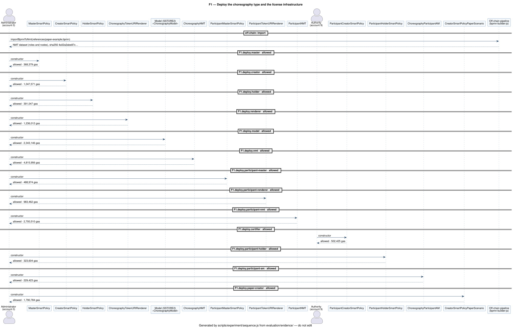
<!-- /evidence:phase:F1 -->

<!-- evidence:phase-title:F2 -->
### F2

**Mint the instance and assign the role accounts**
<!-- /evidence:phase-title:F2 -->

<!-- narrative:F2 -->
The administrator mints the instance, which decodes the model of the type in its constructor, and assigns an account to every role except the Special Carrier, whose Creator rule needs a license. The Master policy then faces a mint by an unauthorized creator, which is <!-- outcome:F2.denied.unauthorized-creator -->denied<!-- /outcome -->, and a mint to an ineligible holder, which is <!-- outcome:F2.denied.ineligible-holder -->denied<!-- /outcome -->.

<!-- evidence:phase:F2 -->
**Actors**

| Account | Index | Address | Plays |
| --- | ---: | --- | --- |
| Administrator | 0 | `0xf39Fd6e51aad88F6F4ce6aB8827279cffFb92266` | Master administrator, authorized creator, holder of the instances |
| Unauthorized creator | 2 | `0x3C44CdDdB6a900fa2b585dd299e03d12FA4293BC` | an account the Master policy does not authorize to mint |

**Transactions**

| Key | Operation | From | Call | Contract | Outcome | Reason | Gas |
| --- | --- | --- | --- | --- | --- | --- | ---: |
| `F2.mint` | mint the instance, born with the model and the paper-scenario Creator policy | Administrator | `ChoreographyNMT.mint` | ChoreographyNMT `0x5FC8d32690cc91D4c39d9d3abcBD16989F875707` | allowed | — | 5,619,770 |
| `F2.roles` | assign an account to every role except Special Carrier | Administrator | `ChoreographyMutableAsset.setRoles` | ChoreographyMutableAsset `0x61c36a8d610163660E21a8b7359e1Cac0C9133e1` | allowed | — | 176,849 |
| `F2.denied.unauthorized-creator` | the Master policy denies a mint by an unauthorized creator | Unauthorized creator | `ChoreographyNMT.mint` | ChoreographyNMT `0x5FC8d32690cc91D4c39d9d3abcBD16989F875707` | denied | `MasterDenied` | 29,810 |
| `F2.denied.ineligible-holder` | the Master policy denies a mint to an ineligible holder | Administrator | `ChoreographyNMT.mint` | ChoreographyNMT `0x5FC8d32690cc91D4c39d9d3abcBD16989F875707` | denied | `MasterDenied` | 30,099 |

**Costs**

| Key | Gas | Cost (ETH) | USD @10 gwei | USD @30 gwei | USD @100 gwei |
| --- | ---: | ---: | ---: | ---: | ---: |
| `F2.mint` | 5,619,770 | 0.00118997624935124 | $168.5931 | $505.7793 | $1685.9310 |
| `F2.roles` | 176,849 | 0.000033643386090929 | $5.3055 | $15.9164 | $53.0547 |
| `F2.denied.unauthorized-creator` | 29,810 | 0.00000496629717122 | $0.8943 | $2.6829 | $8.9430 |
| `F2.denied.ineligible-holder` | 30,099 | 0.00000438826143174 | $0.9030 | $2.7089 | $9.0297 |
| **phase total** | 5,856,528 | 0.001232974194045129 | $175.6958 | $527.0875 | $1756.9584 |

**Trust-table rows**

| Key | Table | Row of docs/choreography-policies.md |
| --- | --- | --- |
| `F2.mint` | choreography | `mint` an instance of the choreography type to an eligible holder |
| `F2.roles` | choreography | `setRoles` |
| `F2.denied.unauthorized-creator` | choreography | `mint` an instance of the choreography type to an eligible holder |
| `F2.denied.ineligible-holder` | choreography | `mint` an instance of the choreography type to an eligible holder |

**The instance at the end of the phase**

| Address | Nodes | Tasks | Gateways | Edges | Messages | Roles |
| --- | ---: | ---: | ---: | ---: | ---: | ---: |
| `0x61c36a8d610163660E21a8b7359e1Cac0C9133e1` | 11 | 9 | 0 | 10 | 9 | 5 |

| Role | Played by | Address |
| --- | --- | --- |
| Bulk Buyer | Bulk Buyer account | `0xBcd4042DE499D14e55001CcbB24a551F3b954096` |
| Manufacturer | Manufacturer account | `0x71bE63f3384f5fb98995898A86B02Fb2426c5788` |
| Middleman | Middleman account | `0xFABB0ac9d68B0B445fB7357272Ff202C5651694a` |
| Supplier | Supplier account | `0x1CBd3b2770909D4e10f157cABC84C7264073C9Ec` |
| Special Carrier | none | `0x0000000000000000000000000000000000000000` |

**Policies in force at the end of the phase**

| Resource | Layer | Contract | Address | Source | Bytecode keccak256 |
| --- | --- | --- | --- | --- | --- |
| choreography type | Master | MasterSmartPolicy | `0x5FbDB2315678afecb367f032d93F642f64180aa3` | [MasterSmartPolicy.sol](../contracts/choreography/MasterSmartPolicy.sol) | `0x6a27d43e7031776b97c80ef69e68e0a1e5400105b61c6574c1fce04c4bbbc1a5` |
| instance | Creator | CreatorSmartPolicyPaperScenario | `0xB7f8BC63BbcaD18155201308C8f3540b07f84F5e` | [CreatorSmartPolicyPaperScenario.sol](../contracts/choreography/CreatorSmartPolicyPaperScenario.sol) | `0x8275b4f71374b572d87afdc6c6df708c989e2d53826a5a33671a582fe06fa57d` |
| instance | Holder | HolderSmartPolicy | `0x9fE46736679d2D9a65F0992F2272dE9f3c7fa6e0` | [HolderSmartPolicy.sol](../contracts/choreography/HolderSmartPolicy.sol) | `0x64f3e21bf63e229868d575e36b6dfdafb0a11d8ed37cf63bf59858a08474030b` |
| license type | Master | ParticipantMasterSmartPolicy | `0x0165878A594ca255338adfa4d48449f69242Eb8F` | [ParticipantMasterSmartPolicy.sol](../contracts/participant/ParticipantMasterSmartPolicy.sol) | `0xd90bd67ad225d75183d46666712a0e2cfaa1c9ced3d4e1b51034e69cdc511d13` |

**Duration (ms)**

| Measured | Median | Min | Max | Std dev |
| --- | ---: | ---: | ---: | ---: |
| phase F2 | 14.980 | 14.014 | 17.869 | 1.328 |

**Sequence diagram** (filtered; [complete](../evaluation/evidence/uml/F2-full.svg))

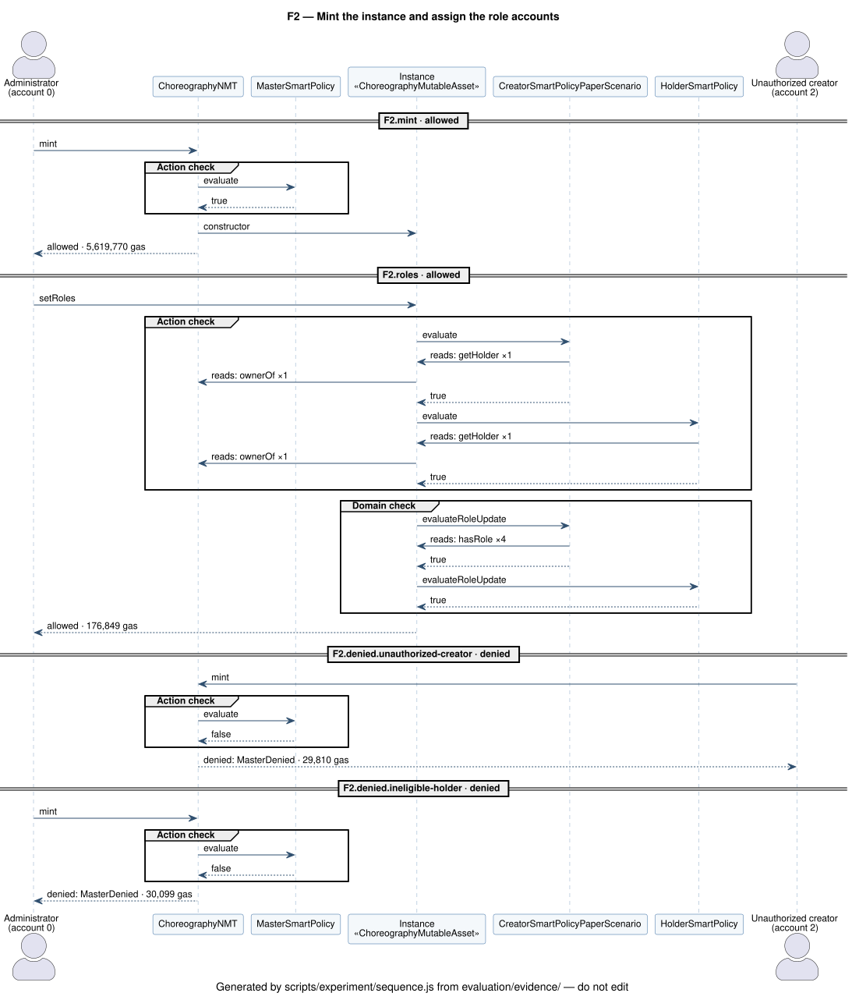
<!-- /evidence:phase:F2 -->

<!-- evidence:phase-title:F3 -->
### F3

**Issue the participant licenses and link the Special Carrier role**
<!-- /evidence:phase-title:F3 -->

<!-- narrative:F3 -->
The authority issues three licenses: a SpecialCarrier license to Carrier A, a Carrier license to Carrier C, and a Supplier license to the supplier company. Linking the Special Carrier role to a plain account is <!-- outcome:F3.denied.plain-account -->denied<!-- /outcome -->, and so does linking it to the Carrier license (<!-- outcome:F3.denied.carrier-license -->denied<!-- /outcome -->) or to the Supplier license (<!-- outcome:F3.denied.supplier-license -->denied<!-- /outcome -->); linking it to the SpecialCarrier license is <!-- outcome:F3.link -->allowed<!-- /outcome -->. A new role outside the model is <!-- outcome:F3.denied.new-role -->denied<!-- /outcome -->. Carrier A then writes its name and the messages of the Special Carrier tasks on its license; a message of another role is <!-- outcome:F3.denied.foreign-message -->denied<!-- /outcome --> by the certifier.

<!-- evidence:phase:F3 -->
**Actors**

| Account | Index | Address | Plays |
| --- | ---: | --- | --- |
| Authority | 9 | `0xa0Ee7A142d267C1f36714E4a8F75612F20a79720` | issuer of the license types and certifier of the licenses |
| Administrator | 0 | `0xf39Fd6e51aad88F6F4ce6aB8827279cffFb92266` | Master administrator, authorized creator, holder of the instances |
| Carrier A | 5 | `0x9965507D1a55bcC2695C58ba16FB37d819B0A4dc` | organization qualified for SpecialCarrier, first holder of its license |

**Transactions**

| Key | Operation | From | Call | Contract | Outcome | Reason | Gas |
| --- | --- | --- | --- | --- | --- | --- | ---: |
| `F3.license.special-carrier` | the Authority issues a SpecialCarrier license to Carrier A | Authority | `ParticipantNMT.mintWithParticipantType` | ParticipantNMT `0x2279B7A0a67DB372996a5FaB50D91eAA73d2eBe6` | allowed | — | 1,196,735 |
| `F3.license.carrier` | the Authority issues a Carrier license to Carrier C | Authority | `ParticipantNMT.mintWithParticipantType` | ParticipantNMT `0x2279B7A0a67DB372996a5FaB50D91eAA73d2eBe6` | allowed | — | 1,199,468 |
| `F3.license.supplier` | the Authority issues a Supplier license to the Supplier company | Authority | `ParticipantNMT.mintWithParticipantType` | ParticipantNMT `0x2279B7A0a67DB372996a5FaB50D91eAA73d2eBe6` | allowed | — | 1,199,497 |
| `F3.denied.plain-account` | the Creator policy denies linking Special Carrier to a plain account | Administrator | `ChoreographyMutableAsset.setRoles` | ChoreographyMutableAsset `0x61c36a8d610163660E21a8b7359e1Cac0C9133e1` | denied | `OperationDenied(CREATOR)` | 63,707 |
| `F3.denied.carrier-license` | the Creator policy denies linking Special Carrier to a Carrier license | Administrator | `ChoreographyMutableAsset.setRoles` | ChoreographyMutableAsset `0x61c36a8d610163660E21a8b7359e1Cac0C9133e1` | denied | `OperationDenied(CREATOR)` | 69,939 |
| `F3.denied.supplier-license` | the Creator policy denies linking Special Carrier to a Supplier license | Administrator | `ChoreographyMutableAsset.setRoles` | ChoreographyMutableAsset `0x61c36a8d610163660E21a8b7359e1Cac0C9133e1` | denied | `OperationDenied(CREATOR)` | 69,939 |
| `F3.link` | link Special Carrier to the SpecialCarrier license held by Carrier A | Administrator | `ChoreographyMutableAsset.setRoles` | ChoreographyMutableAsset `0x61c36a8d610163660E21a8b7359e1Cac0C9133e1` | allowed | — | 97,276 |
| `F3.denied.new-role` | the Creator policy denies a new Backup Carrier role | Administrator | `ChoreographyMutableAsset.setRoles` | ChoreographyMutableAsset `0x61c36a8d610163660E21a8b7359e1Cac0C9133e1` | denied | `OperationDenied(CREATOR)` | 54,893 |
| `F3.license.name` | Carrier A updates the name on its license | Carrier A | `ParticipantMutableAsset.setName` | ParticipantMutableAsset `0x94099942864EA81cCF197E9D71ac53310b1468D8` | allowed | — | 66,674 |
| `F3.license.messages` | Carrier A declares the Special Carrier messages on its license | Carrier A | `ParticipantMutableAsset.setMessages` | ParticipantMutableAsset `0x94099942864EA81cCF197E9D71ac53310b1468D8` | allowed | — | 232,409 |
| `F3.denied.foreign-message` | the certifier denies a message of another role | Carrier A | `ParticipantMutableAsset.setMessages` | ParticipantMutableAsset `0x94099942864EA81cCF197E9D71ac53310b1468D8` | denied | `OperationDenied(CREATOR)` | 46,708 |

**Costs**

| Key | Gas | Cost (ETH) | USD @10 gwei | USD @30 gwei | USD @100 gwei |
| --- | ---: | ---: | ---: | ---: | ---: |
| `F3.license.special-carrier` | 1,196,735 | 0.00015268933872457 | $35.9021 | $107.7061 | $359.0205 |
| `F3.license.carrier` | 1,199,468 | 0.000134671392402048 | $35.9840 | $107.9521 | $359.8404 |
| `F3.license.supplier` | 1,199,497 | 0.000118513393504272 | $35.9849 | $107.9547 | $359.8491 |
| `F3.denied.plain-account` | 63,707 | 0.00000553907264442 | $1.9112 | $5.7336 | $19.1121 |
| `F3.denied.carrier-license` | 69,939 | 0.000005322419656137 | $2.0982 | $6.2945 | $20.9817 |
| `F3.denied.supplier-license` | 69,939 | 0.000004658668192611 | $2.0982 | $6.2945 | $20.9817 |
| `F3.link` | 97,276 | 0.00000567153661618 | $2.9183 | $8.7548 | $29.1828 |
| `F3.denied.new-role` | 54,893 | 0.000002801697111106 | $1.6468 | $4.9404 | $16.4679 |
| `F3.license.name` | 66,674 | 0.000002978394987414 | $2.0002 | $6.0007 | $20.0022 |
| `F3.license.messages` | 232,409 | 0.000009087086153905 | $6.9723 | $20.9168 | $69.7227 |
| `F3.denied.foreign-message` | 46,708 | 0.00000159974736522 | $1.4012 | $4.2037 | $14.0124 |
| **phase total** | 4,297,245 | 0.000443532747357883 | $128.9173 | $386.7521 | $1289.1735 |

**Trust-table rows**

| Key | Table | Row of docs/choreography-policies.md |
| --- | --- | --- |
| `F3.license.special-carrier` | licenses | Mint a license of a type (`mintWithParticipantType`) |
| `F3.license.carrier` | licenses | Mint a license of a type (`mintWithParticipantType`) |
| `F3.license.supplier` | licenses | Mint a license of a type (`mintWithParticipantType`) |
| `F3.denied.plain-account` | choreography | `setRoles` |
| `F3.denied.carrier-license` | choreography | `setRoles` |
| `F3.denied.supplier-license` | choreography | `setRoles` |
| `F3.link` | choreography | `setRoles` |
| `F3.denied.new-role` | choreography | `setRoles` |
| `F3.license.name` | licenses | Update the organization data (`setName`, `setProfile`, `setLinked`) |
| `F3.license.messages` | licenses | Declare messages (`setMessages`) allowed for the license type |
| `F3.denied.foreign-message` | licenses | Declare messages (`setMessages`) allowed for the license type |

**The instance at the end of the phase**

| Address | Nodes | Tasks | Gateways | Edges | Messages | Roles |
| --- | ---: | ---: | ---: | ---: | ---: | ---: |
| `0x61c36a8d610163660E21a8b7359e1Cac0C9133e1` | 11 | 9 | 0 | 10 | 9 | 5 |

| Role | Played by | Address |
| --- | --- | --- |
| Bulk Buyer | Bulk Buyer account | `0xBcd4042DE499D14e55001CcbB24a551F3b954096` |
| Manufacturer | Manufacturer account | `0x71bE63f3384f5fb98995898A86B02Fb2426c5788` |
| Middleman | Middleman account | `0xFABB0ac9d68B0B445fB7357272Ff202C5651694a` |
| Supplier | Supplier account | `0x1CBd3b2770909D4e10f157cABC84C7264073C9Ec` |
| Special Carrier | ParticipantMutableAsset | `0x94099942864EA81cCF197E9D71ac53310b1468D8` |

**Policies in force at the end of the phase**

| Resource | Layer | Contract | Address | Source | Bytecode keccak256 |
| --- | --- | --- | --- | --- | --- |
| choreography type | Master | MasterSmartPolicy | `0x5FbDB2315678afecb367f032d93F642f64180aa3` | [MasterSmartPolicy.sol](../contracts/choreography/MasterSmartPolicy.sol) | `0x6a27d43e7031776b97c80ef69e68e0a1e5400105b61c6574c1fce04c4bbbc1a5` |
| instance | Creator | CreatorSmartPolicyPaperScenario | `0xB7f8BC63BbcaD18155201308C8f3540b07f84F5e` | [CreatorSmartPolicyPaperScenario.sol](../contracts/choreography/CreatorSmartPolicyPaperScenario.sol) | `0x8275b4f71374b572d87afdc6c6df708c989e2d53826a5a33671a582fe06fa57d` |
| instance | Holder | HolderSmartPolicy | `0x9fE46736679d2D9a65F0992F2272dE9f3c7fa6e0` | [HolderSmartPolicy.sol](../contracts/choreography/HolderSmartPolicy.sol) | `0x64f3e21bf63e229868d575e36b6dfdafb0a11d8ed37cf63bf59858a08474030b` |
| license type | Master | ParticipantMasterSmartPolicy | `0x0165878A594ca255338adfa4d48449f69242Eb8F` | [ParticipantMasterSmartPolicy.sol](../contracts/participant/ParticipantMasterSmartPolicy.sol) | `0xd90bd67ad225d75183d46666712a0e2cfaa1c9ced3d4e1b51034e69cdc511d13` |
| licensed role | Creator | ParticipantCreatorSmartPolicy | `0x700b6A60ce7EaaEA56F065753d8dcB9653dbAD35` | [CreatorSmartPolicy.sol](../contracts/participant/CreatorSmartPolicy.sol) | `0x4d098019c20560369a6704135eed48691ee32450415386e62b410242325ffe13` |
| licensed role | Holder | ParticipantHolderSmartPolicy | `0x8A791620dd6260079BF849Dc5567aDC3F2FdC318` | [HolderSmartPolicy.sol](../contracts/participant/HolderSmartPolicy.sol) | `0x29c7f6744db23d0f03ec3cd9c5c8cd4b279ba4324371e80d432e259078e2c57b` |

**Duration (ms)**

| Measured | Median | Min | Max | Std dev |
| --- | ---: | ---: | ---: | ---: |
| phase F3 | 18.035 | 16.436 | 51.583 | 10.637 |

**Sequence diagram** (filtered; [complete](../evaluation/evidence/uml/F3-full.svg))

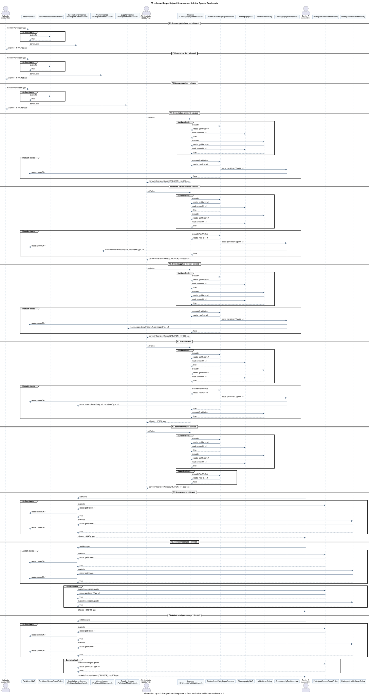
<!-- /evidence:phase:F3 -->

<!-- evidence:phase-title:F4 -->
### F4

**Render the baseline model from the chain**
<!-- /evidence:phase-title:F4 -->

<!-- narrative:F4 -->
Anyone can read the model: the render reads the instance with one `tokenURI` call, which the renderer computes from the asset state, and regenerates the BPMN XML off-chain. Nothing is stored and no transaction is sent; the run traces the call and hashes what each off-chain step writes.

<!-- evidence:phase:F4 -->
**Actors**

| Account | Index | Address | Plays |
| --- | ---: | --- | --- |

**Off-chain steps**

| Step | Function | Output | SHA-256 |
| --- | --- | --- | --- |
| export | `exportContractToJson` | raw JSON (hashed without `contractExport.exportedAt`, `contractExport.rpcUrl`) | `dd6455b790a7debd1721499728a75af90192ecc5c37face0c3f9b148a1f4882b` |
| normalize | `normalizeInput` | normalized JSON (hashed without `contractExport.exportedAt`, `contractExport.rpcUrl`) | `b00084fa5ddcd14a7a0c4ee141dd3b2a6bb339a7e65d917c64ec0f846144e6ac` |
| generate | `generateBpmnXml` | BPMN XML | `d5f5a1d02813c172a1dd55c4ac16ade7520f97a17b3b044f76d7e596cc5471cc` |

**Reads**

| Key | Call | By | Gas |
| --- | --- | --- | ---: |
| `F4.tokenURI` | `ChoreographyMutableAsset.tokenURI` | eth_call (any account) | 1,250,222 |

**The instance at the end of the phase**

| Address | Nodes | Tasks | Gateways | Edges | Messages | Roles |
| --- | ---: | ---: | ---: | ---: | ---: | ---: |
| `0x61c36a8d610163660E21a8b7359e1Cac0C9133e1` | 11 | 9 | 0 | 10 | 9 | 5 |

| Role | Played by | Address |
| --- | --- | --- |
| Bulk Buyer | Bulk Buyer account | `0xBcd4042DE499D14e55001CcbB24a551F3b954096` |
| Manufacturer | Manufacturer account | `0x71bE63f3384f5fb98995898A86B02Fb2426c5788` |
| Middleman | Middleman account | `0xFABB0ac9d68B0B445fB7357272Ff202C5651694a` |
| Supplier | Supplier account | `0x1CBd3b2770909D4e10f157cABC84C7264073C9Ec` |
| Special Carrier | ParticipantMutableAsset | `0x94099942864EA81cCF197E9D71ac53310b1468D8` |

**Policies in force at the end of the phase**

| Resource | Layer | Contract | Address | Source | Bytecode keccak256 |
| --- | --- | --- | --- | --- | --- |
| choreography type | Master | MasterSmartPolicy | `0x5FbDB2315678afecb367f032d93F642f64180aa3` | [MasterSmartPolicy.sol](../contracts/choreography/MasterSmartPolicy.sol) | `0x6a27d43e7031776b97c80ef69e68e0a1e5400105b61c6574c1fce04c4bbbc1a5` |
| instance | Creator | CreatorSmartPolicyPaperScenario | `0xB7f8BC63BbcaD18155201308C8f3540b07f84F5e` | [CreatorSmartPolicyPaperScenario.sol](../contracts/choreography/CreatorSmartPolicyPaperScenario.sol) | `0x8275b4f71374b572d87afdc6c6df708c989e2d53826a5a33671a582fe06fa57d` |
| instance | Holder | HolderSmartPolicy | `0x9fE46736679d2D9a65F0992F2272dE9f3c7fa6e0` | [HolderSmartPolicy.sol](../contracts/choreography/HolderSmartPolicy.sol) | `0x64f3e21bf63e229868d575e36b6dfdafb0a11d8ed37cf63bf59858a08474030b` |
| license type | Master | ParticipantMasterSmartPolicy | `0x0165878A594ca255338adfa4d48449f69242Eb8F` | [ParticipantMasterSmartPolicy.sol](../contracts/participant/ParticipantMasterSmartPolicy.sol) | `0xd90bd67ad225d75183d46666712a0e2cfaa1c9ced3d4e1b51034e69cdc511d13` |
| licensed role | Creator | ParticipantCreatorSmartPolicy | `0x700b6A60ce7EaaEA56F065753d8dcB9653dbAD35` | [CreatorSmartPolicy.sol](../contracts/participant/CreatorSmartPolicy.sol) | `0x4d098019c20560369a6704135eed48691ee32450415386e62b410242325ffe13` |
| licensed role | Holder | ParticipantHolderSmartPolicy | `0x8A791620dd6260079BF849Dc5567aDC3F2FdC318` | [HolderSmartPolicy.sol](../contracts/participant/HolderSmartPolicy.sol) | `0x29c7f6744db23d0f03ec3cd9c5c8cd4b279ba4324371e80d432e259078e2c57b` |

**Duration (ms)**

| Measured | Median | Min | Max | Std dev |
| --- | ---: | ---: | ---: | ---: |
| phase F4 | 17.430 | 16.918 | 19.630 | 0.860 |
| step `F4.render` | 16.813 | 16.208 | 18.932 | 0.863 |

**Sequence diagram** (filtered; [complete](../evaluation/evidence/uml/F4-full.svg))

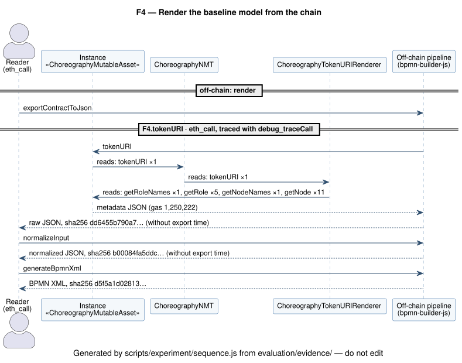
<!-- /evidence:phase:F4 -->

<!-- evidence:phase-title:F5 -->
### F5

**Apply the delta: one allowed update and five denied ones**
<!-- /evidence:phase-title:F5 -->

<!-- narrative:F5 -->
The holder applies the delta through the `modify:asset` function: every changed node is written whole, and both endpoints of every changed flow are in the delta. The update is <!-- outcome:F5.delta -->allowed<!-- /outcome -->. Five well-formed updates follow, each breaking one rule of the paper-scenario Creator policy: one task too many (<!-- outcome:F5.denied.task-limit -->denied<!-- /outcome -->), flows above the limit (<!-- outcome:F5.denied.flow-limit -->denied<!-- /outcome -->), a task name outside the allowlist (<!-- outcome:F5.denied.task-name -->denied<!-- /outcome -->), a flow to an unknown node (<!-- outcome:F5.denied.unknown-target -->denied<!-- /outcome -->), and a change to the protected `Order` task (<!-- outcome:F5.denied.protected-node -->denied<!-- /outcome -->). The sequence diagram shows where each one stops: both action checks pass, the Creator policy and then the Holder policy, and the domain check of the Creator policy refuses the update, so the domain check of the Holder policy is never asked.

<!-- evidence:phase:F5 -->
**Actors**

| Account | Index | Address | Plays |
| --- | ---: | --- | --- |
| Administrator | 0 | `0xf39Fd6e51aad88F6F4ce6aB8827279cffFb92266` | Master administrator, authorized creator, holder of the instances |

**Inputs**

| File | SHA-256 |
| --- | --- |
| [scripts/data/paper-example-parallel-transport-preparation.delta.json](../scripts/data/paper-example-parallel-transport-preparation.delta.json) | `0906afd9b88d63f815eaf4d89a1bdf304ef3379d7a737731568ed717c27cab99` |

**The delta**

Split transport preparation into parallel detail collection and documentation preparation, then join before the waybill. Nodes it writes, each in its final state: `Order Special Transport`, `Parallel Transport Preparation Split`, `Request Details`, `Transport Details`, `Prepare Transport Documentation`, `Parallel Transport Preparation Join`, `Waybill for Intermediate`.

**Transactions**

| Key | Operation | From | Call | Contract | Outcome | Reason | Gas |
| --- | --- | --- | --- | --- | --- | --- | ---: |
| `F5.delta` | apply the parallel transport preparation delta | Administrator | `ChoreographyMutableAsset.setNodes` | ChoreographyMutableAsset `0x61c36a8d610163660E21a8b7359e1Cac0C9133e1` | allowed | — | 1,866,349 |
| `F5.denied.task-limit` | the Creator policy denies an update above the task limit | Administrator | `ChoreographyMutableAsset.setNodes` | ChoreographyMutableAsset `0x61c36a8d610163660E21a8b7359e1Cac0C9133e1` | denied | `OperationDenied(CREATOR)` | 318,816 |
| `F5.denied.flow-limit` | the Creator policy denies an update above the sequence-flow limit | Administrator | `ChoreographyMutableAsset.setNodes` | ChoreographyMutableAsset `0x61c36a8d610163660E21a8b7359e1Cac0C9133e1` | denied | `OperationDenied(CREATOR)` | 547,091 |
| `F5.denied.task-name` | the Creator policy denies a task name outside the allowlist | Administrator | `ChoreographyMutableAsset.setNodes` | ChoreographyMutableAsset `0x61c36a8d610163660E21a8b7359e1Cac0C9133e1` | denied | `OperationDenied(CREATOR)` | 298,426 |
| `F5.denied.unknown-target` | the Creator policy denies a flow to an unknown node | Administrator | `ChoreographyMutableAsset.setNodes` | ChoreographyMutableAsset `0x61c36a8d610163660E21a8b7359e1Cac0C9133e1` | denied | `OperationDenied(CREATOR)` | 76,686 |
| `F5.denied.protected-node` | the Creator policy denies a change to the protected Order task | Administrator | `ChoreographyMutableAsset.setNodes` | ChoreographyMutableAsset `0x61c36a8d610163660E21a8b7359e1Cac0C9133e1` | denied | `OperationDenied(CREATOR)` | 340,491 |

**Costs**

| Key | Gas | Cost (ETH) | USD @10 gwei | USD @30 gwei | USD @100 gwei |
| --- | ---: | ---: | ---: | ---: | ---: |
| `F5.delta` | 1,866,349 | 0.000055944531685714 | $55.9905 | $167.9714 | $559.9047 |
| `F5.denied.task-limit` | 318,816 | 0.000008436370625856 | $9.5645 | $28.6934 | $95.6448 |
| `F5.denied.flow-limit` | 547,091 | 0.000012686505235002 | $16.4127 | $49.2382 | $164.1273 |
| `F5.denied.task-name` | 298,426 | 0.000006070956515056 | $8.9528 | $26.8583 | $89.5278 |
| `F5.denied.unknown-target` | 76,686 | 0.00000136697741247 | $2.3006 | $6.9017 | $23.0058 |
| `F5.denied.protected-node` | 340,491 | 0.000005312727379776 | $10.2147 | $30.6442 | $102.1473 |
| **phase total** | 3,447,859 | 0.000089818068853874 | $103.4358 | $310.3073 | $1034.3577 |

**Trust-table rows**

| Key | Table | Row of docs/choreography-policies.md |
| --- | --- | --- |
| `F5.delta` | choreography | `setNodes` |
| `F5.denied.task-limit` | choreography | `setNodes` |
| `F5.denied.flow-limit` | choreography | `setNodes` |
| `F5.denied.task-name` | choreography | `setNodes` |
| `F5.denied.unknown-target` | choreography | `setNodes` |
| `F5.denied.protected-node` | choreography | `setNodes` |

**The instance at the end of the phase**

| Address | Nodes | Tasks | Gateways | Edges | Messages | Roles |
| --- | ---: | ---: | ---: | ---: | ---: | ---: |
| `0x61c36a8d610163660E21a8b7359e1Cac0C9133e1` | 14 | 10 | 2 | 14 | 10 | 5 |

| Role | Played by | Address |
| --- | --- | --- |
| Bulk Buyer | Bulk Buyer account | `0xBcd4042DE499D14e55001CcbB24a551F3b954096` |
| Manufacturer | Manufacturer account | `0x71bE63f3384f5fb98995898A86B02Fb2426c5788` |
| Middleman | Middleman account | `0xFABB0ac9d68B0B445fB7357272Ff202C5651694a` |
| Supplier | Supplier account | `0x1CBd3b2770909D4e10f157cABC84C7264073C9Ec` |
| Special Carrier | ParticipantMutableAsset | `0x94099942864EA81cCF197E9D71ac53310b1468D8` |

**Policies in force at the end of the phase**

| Resource | Layer | Contract | Address | Source | Bytecode keccak256 |
| --- | --- | --- | --- | --- | --- |
| choreography type | Master | MasterSmartPolicy | `0x5FbDB2315678afecb367f032d93F642f64180aa3` | [MasterSmartPolicy.sol](../contracts/choreography/MasterSmartPolicy.sol) | `0x6a27d43e7031776b97c80ef69e68e0a1e5400105b61c6574c1fce04c4bbbc1a5` |
| instance | Creator | CreatorSmartPolicyPaperScenario | `0xB7f8BC63BbcaD18155201308C8f3540b07f84F5e` | [CreatorSmartPolicyPaperScenario.sol](../contracts/choreography/CreatorSmartPolicyPaperScenario.sol) | `0x8275b4f71374b572d87afdc6c6df708c989e2d53826a5a33671a582fe06fa57d` |
| instance | Holder | HolderSmartPolicy | `0x9fE46736679d2D9a65F0992F2272dE9f3c7fa6e0` | [HolderSmartPolicy.sol](../contracts/choreography/HolderSmartPolicy.sol) | `0x64f3e21bf63e229868d575e36b6dfdafb0a11d8ed37cf63bf59858a08474030b` |
| license type | Master | ParticipantMasterSmartPolicy | `0x0165878A594ca255338adfa4d48449f69242Eb8F` | [ParticipantMasterSmartPolicy.sol](../contracts/participant/ParticipantMasterSmartPolicy.sol) | `0xd90bd67ad225d75183d46666712a0e2cfaa1c9ced3d4e1b51034e69cdc511d13` |
| licensed role | Creator | ParticipantCreatorSmartPolicy | `0x700b6A60ce7EaaEA56F065753d8dcB9653dbAD35` | [CreatorSmartPolicy.sol](../contracts/participant/CreatorSmartPolicy.sol) | `0x4d098019c20560369a6704135eed48691ee32450415386e62b410242325ffe13` |
| licensed role | Holder | ParticipantHolderSmartPolicy | `0x8A791620dd6260079BF849Dc5567aDC3F2FdC318` | [HolderSmartPolicy.sol](../contracts/participant/HolderSmartPolicy.sol) | `0x29c7f6744db23d0f03ec3cd9c5c8cd4b279ba4324371e80d432e259078e2c57b` |

**Duration (ms)**

| Measured | Median | Min | Max | Std dev |
| --- | ---: | ---: | ---: | ---: |
| phase F5 | 155.554 | 143.558 | 240.698 | 30.469 |
| step `F5.delta` | 73.910 | 68.175 | 111.248 | 12.443 |

**Sequence diagram** (filtered; [complete](../evaluation/evidence/uml/F5-full.svg))


<!-- /evidence:phase:F5 -->

<!-- evidence:phase-title:F6 -->
### F6

**Sell the Special Carrier role: Carrier A to Carrier B**
<!-- /evidence:phase-title:F6 -->

<!-- narrative:F6 -->
The organization behind the Special Carrier role changes by selling the license, not by editing the choreography. The participant Master policy checks the buyer: a sale to Carrier C, qualified only for Carrier, is <!-- outcome:F6.denied.carrier-buyer -->denied<!-- /outcome -->, a sale to the supplier company is <!-- outcome:F6.denied.supplier-buyer -->denied<!-- /outcome -->, and Carrier B taking the license without the seller is <!-- outcome:F6.denied.without-seller -->denied<!-- /outcome -->. The sale from Carrier A to Carrier B is <!-- outcome:F6.sale -->allowed<!-- /outcome -->. The sale resets the license Holder policy and clears the seller's name and profile, while the messages stay, marked as written by Carrier A: Carrier B updating the license before installing its own Holder policy is <!-- outcome:F6.denied.buyer-without-policy -->denied<!-- /outcome -->, and after it does, Carrier A updating the license is <!-- outcome:F6.denied.former-holder -->denied<!-- /outcome --> while Carrier B updates its data and confirms the messages. The choreography role keeps pointing at the same license throughout.

<!-- evidence:phase:F6 -->
**Actors**

| Account | Index | Address | Plays |
| --- | ---: | --- | --- |
| Carrier A | 5 | `0x9965507D1a55bcC2695C58ba16FB37d819B0A4dc` | organization qualified for SpecialCarrier, first holder of its license |
| Carrier B | 6 | `0x976EA74026E726554dB657fA54763abd0C3a0aa9` | organization qualified for SpecialCarrier, buyer of the license |

**Transactions**

| Key | Operation | From | Call | Contract | Outcome | Reason | Gas |
| --- | --- | --- | --- | --- | --- | --- | ---: |
| `F6.denied.carrier-buyer` | the participant Master policy denies selling to Carrier C, not qualified for SpecialCarrier | Carrier A | `ParticipantNMT.transferFrom` | ParticipantNMT `0x2279B7A0a67DB372996a5FaB50D91eAA73d2eBe6` | denied | `MasterDenied` | 37,239 |
| `F6.denied.supplier-buyer` | the participant Master policy denies selling to the Supplier company | Carrier A | `ParticipantNMT.transferFrom` | ParticipantNMT `0x2279B7A0a67DB372996a5FaB50D91eAA73d2eBe6` | denied | `MasterDenied` | 37,239 |
| `F6.denied.without-seller` | the participant Master policy denies Carrier B taking the license without the seller | Carrier B | `ParticipantNMT.transferFrom` | ParticipantNMT `0x2279B7A0a67DB372996a5FaB50D91eAA73d2eBe6` | denied | `MasterDenied` | 30,168 |
| `F6.sale` | Carrier A sells the SpecialCarrier license to Carrier B | Carrier A | `ParticipantNMT.transferFrom` | ParticipantNMT `0x2279B7A0a67DB372996a5FaB50D91eAA73d2eBe6` | allowed | — | 108,940 |
| `F6.denied.buyer-without-policy` | Carrier B cannot update the license before installing a Holder policy | Carrier B | `ParticipantMutableAsset.setName` | ParticipantMutableAsset `0x94099942864EA81cCF197E9D71ac53310b1468D8` | denied | `HolderPolicyDisabled` | 37,003 |
| `F6.buyer.holder-policy` | Carrier B installs its Holder policy on the license | Carrier B | `ParticipantMutableAsset.setHolderSmartPolicy` | ParticipantMutableAsset `0x94099942864EA81cCF197E9D71ac53310b1468D8` | allowed | — | 49,611 |
| `F6.denied.former-holder` | Carrier A can no longer update the license | Carrier A | `ParticipantMutableAsset.setName` | ParticipantMutableAsset `0x94099942864EA81cCF197E9D71ac53310b1468D8` | denied | `OperationDenied(CREATOR)` | 34,894 |
| `F6.buyer.name` | Carrier B updates the name on the license | Carrier B | `ParticipantMutableAsset.setName` | ParticipantMutableAsset `0x94099942864EA81cCF197E9D71ac53310b1468D8` | allowed | — | 66,674 |
| `F6.buyer.profile` | Carrier B links its organization profile | Carrier B | `ParticipantMutableAsset.setProfile` | ParticipantMutableAsset `0x94099942864EA81cCF197E9D71ac53310b1468D8` | allowed | — | 67,102 |
| `F6.buyer.messages` | Carrier B confirms the Special Carrier messages | Carrier B | `ParticipantMutableAsset.setMessages` | ParticipantMutableAsset `0x94099942864EA81cCF197E9D71ac53310b1468D8` | allowed | — | 76,009 |

**Costs**

| Key | Gas | Cost (ETH) | USD @10 gwei | USD @30 gwei | USD @100 gwei |
| --- | ---: | ---: | ---: | ---: | ---: |
| `F6.denied.carrier-buyer` | 37,239 | 0.00000050923885632 | $1.1172 | $3.3515 | $11.1717 |
| `F6.denied.supplier-buyer` | 37,239 | 0.000000445663057677 | $1.1172 | $3.3515 | $11.1717 |
| `F6.denied.without-seller` | 30,168 | 0.00000031596590556 | $0.9050 | $2.7151 | $9.0504 |
| `F6.sale` | 108,940 | 0.00000099850787192 | $3.2682 | $9.8046 | $32.6820 |
| `F6.denied.buyer-without-policy` | 37,003 | 0.000000296916549363 | $1.1101 | $3.3303 | $11.1009 |
| `F6.buyer.holder-policy` | 49,611 | 0.000000348385508184 | $1.4883 | $4.4650 | $14.8833 |
| `F6.denied.former-holder` | 34,894 | 0.000000214458663576 | $1.0468 | $3.1405 | $10.4682 |
| `F6.buyer.name` | 66,674 | 0.000000358615976752 | $2.0002 | $6.0007 | $20.0022 |
| `F6.buyer.profile` | 67,102 | 0.000000315903600824 | $2.0131 | $6.0392 | $20.1306 |
| `F6.buyer.messages` | 76,009 | 0.000000313206637868 | $2.2803 | $6.8408 | $22.8027 |
| **phase total** | 544,879 | 0.000004116862628044 | $16.3464 | $49.0391 | $163.4637 |

**Trust-table rows**

| Key | Table | Row of docs/choreography-policies.md |
| --- | --- | --- |
| `F6.denied.carrier-buyer` | licenses | Sell the license (`transferFrom`) to an organization qualified for its type |
| `F6.denied.supplier-buyer` | licenses | Sell the license (`transferFrom`) to an organization qualified for its type |
| `F6.denied.without-seller` | licenses | Sell the license (`transferFrom`) to an organization qualified for its type |
| `F6.sale` | licenses | Sell the license (`transferFrom`) to an organization qualified for its type |
| `F6.denied.buyer-without-policy` | licenses | Update the organization data (`setName`, `setProfile`, `setLinked`) |
| `F6.buyer.holder-policy` | licenses | Install a Holder policy on the license (`setHolderSmartPolicy`; not a policy decision, only the current holder) |
| `F6.denied.former-holder` | licenses | Update the organization data (`setName`, `setProfile`, `setLinked`) |
| `F6.buyer.name` | licenses | Update the organization data (`setName`, `setProfile`, `setLinked`) |
| `F6.buyer.profile` | licenses | Update the organization data (`setName`, `setProfile`, `setLinked`) |
| `F6.buyer.messages` | licenses | Declare messages (`setMessages`) allowed for the license type |

**Transfers**

| Key | From | To | Sent by | Outcome |
| --- | --- | --- | --- | --- |
| `F6.denied.carrier-buyer` | Carrier A | Carrier C | Carrier A | denied |
| `F6.denied.supplier-buyer` | Carrier A | Supplier company | Carrier A | denied |
| `F6.denied.without-seller` | Carrier A | Carrier B | Carrier B | denied |
| `F6.sale` | Carrier A | Carrier B | Carrier A | allowed |

**The license before and after the sale**

| Field | Before the sale | After the sale | After the buyer's updates |
| --- | --- | --- | --- |
| licenseHolder | Carrier A | Carrier B | Carrier B |
| roleLinkedTo | ParticipantMutableAsset | ParticipantMutableAsset | ParticipantMutableAsset |
| roleLicense | `0x94099942864EA81cCF197E9D71ac53310b1468D8` | `0x94099942864EA81cCF197E9D71ac53310b1468D8` | `0x94099942864EA81cCF197E9D71ac53310b1468D8` |
| licenseName | Carrier A | (empty) | Carrier B |
| messagesWriter | Carrier A | Carrier A | Carrier B |
| holderPolicy | ParticipantHolderSmartPolicy | none | ParticipantHolderSmartPolicy |

Tasks of `Special Carrier`, which keep the role through the sale: `Order Special Transport`, `Request Details`, `Transport Details`, `Waybill for Intermediate`, `Arrival Intermediate`, `Prepare Transport Documentation`.

Messages declared on the license: `Message_0dai5by`, `Message_10n229k`, `Message_1325zdq`, `Message_1vaojlk`, `Message_11ex51i`, `Prepare transport documentation`.

**The instance at the end of the phase**

| Address | Nodes | Tasks | Gateways | Edges | Messages | Roles |
| --- | ---: | ---: | ---: | ---: | ---: | ---: |
| `0x61c36a8d610163660E21a8b7359e1Cac0C9133e1` | 14 | 10 | 2 | 14 | 10 | 5 |

| Role | Played by | Address |
| --- | --- | --- |
| Bulk Buyer | Bulk Buyer account | `0xBcd4042DE499D14e55001CcbB24a551F3b954096` |
| Manufacturer | Manufacturer account | `0x71bE63f3384f5fb98995898A86B02Fb2426c5788` |
| Middleman | Middleman account | `0xFABB0ac9d68B0B445fB7357272Ff202C5651694a` |
| Supplier | Supplier account | `0x1CBd3b2770909D4e10f157cABC84C7264073C9Ec` |
| Special Carrier | ParticipantMutableAsset | `0x94099942864EA81cCF197E9D71ac53310b1468D8` |

**Policies in force at the end of the phase**

| Resource | Layer | Contract | Address | Source | Bytecode keccak256 |
| --- | --- | --- | --- | --- | --- |
| choreography type | Master | MasterSmartPolicy | `0x5FbDB2315678afecb367f032d93F642f64180aa3` | [MasterSmartPolicy.sol](../contracts/choreography/MasterSmartPolicy.sol) | `0x6a27d43e7031776b97c80ef69e68e0a1e5400105b61c6574c1fce04c4bbbc1a5` |
| instance | Creator | CreatorSmartPolicyPaperScenario | `0xB7f8BC63BbcaD18155201308C8f3540b07f84F5e` | [CreatorSmartPolicyPaperScenario.sol](../contracts/choreography/CreatorSmartPolicyPaperScenario.sol) | `0x8275b4f71374b572d87afdc6c6df708c989e2d53826a5a33671a582fe06fa57d` |
| instance | Holder | HolderSmartPolicy | `0x9fE46736679d2D9a65F0992F2272dE9f3c7fa6e0` | [HolderSmartPolicy.sol](../contracts/choreography/HolderSmartPolicy.sol) | `0x64f3e21bf63e229868d575e36b6dfdafb0a11d8ed37cf63bf59858a08474030b` |
| license type | Master | ParticipantMasterSmartPolicy | `0x0165878A594ca255338adfa4d48449f69242Eb8F` | [ParticipantMasterSmartPolicy.sol](../contracts/participant/ParticipantMasterSmartPolicy.sol) | `0xd90bd67ad225d75183d46666712a0e2cfaa1c9ced3d4e1b51034e69cdc511d13` |
| licensed role | Creator | ParticipantCreatorSmartPolicy | `0x700b6A60ce7EaaEA56F065753d8dcB9653dbAD35` | [CreatorSmartPolicy.sol](../contracts/participant/CreatorSmartPolicy.sol) | `0x4d098019c20560369a6704135eed48691ee32450415386e62b410242325ffe13` |
| licensed role | Holder | ParticipantHolderSmartPolicy | `0x8A791620dd6260079BF849Dc5567aDC3F2FdC318` | [HolderSmartPolicy.sol](../contracts/participant/HolderSmartPolicy.sol) | `0x29c7f6744db23d0f03ec3cd9c5c8cd4b279ba4324371e80d432e259078e2c57b` |

**Duration (ms)**

| Measured | Median | Min | Max | Std dev |
| --- | ---: | ---: | ---: | ---: |
| phase F6 | 14.113 | 13.440 | 23.441 | 3.104 |

**Sequence diagram** (filtered; [complete](../evaluation/evidence/uml/F6-full.svg))

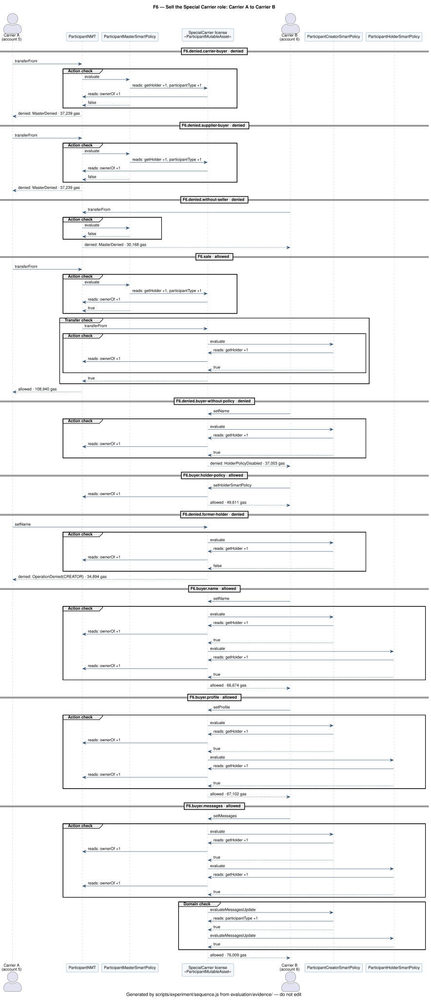
<!-- /evidence:phase:F6 -->

<!-- evidence:phase-title:F7 -->
### F7

**Transfer a second instance and restrict it through its Holder policy**
<!-- /evidence:phase-title:F7 -->

<!-- narrative:F7 -->
A second instance, with the default policies, shows the transfer and the Holder layer without touching the first one. A transfer to an ineligible holder is <!-- outcome:F7.denied.transfer -->denied<!-- /outcome --> by the Master policy; the transfer to the partner is <!-- outcome:F7.transfer -->allowed<!-- /outcome -->, checked by the Master policy and then by the Creator policy of the asset. The partner, now the holder, installs `DenyAllSmartPolicy` as its Holder policy, and the delta on this instance is <!-- outcome:F7.denied.delta -->denied<!-- /outcome --> at the Holder action check.

<!-- evidence:phase:F7 -->
**Actors**

| Account | Index | Address | Plays |
| --- | ---: | --- | --- |
| Administrator | 0 | `0xf39Fd6e51aad88F6F4ce6aB8827279cffFb92266` | Master administrator, authorized creator, holder of the instances |
| Partner | 1 | `0x70997970C51812dc3A010C7d01b50e0d17dc79C8` | eligible holder |

**Inputs**

| File | SHA-256 |
| --- | --- |
| [scripts/data/paper-example-parallel-transport-preparation.delta.json](../scripts/data/paper-example-parallel-transport-preparation.delta.json) | `0906afd9b88d63f815eaf4d89a1bdf304ef3379d7a737731568ed717c27cab99` |

**Transactions**

| Key | Operation | From | Call | Contract | Outcome | Reason | Gas |
| --- | --- | --- | --- | --- | --- | --- | ---: |
| `F7.deploy.deny-all` | deploy the deny-all policy | Administrator | `DenyAllSmartPolicy.constructor` | DenyAllSmartPolicy `0x7a2088a1bFc9d81c55368AE168C2C02570cB814F` | allowed | — | 335,458 |
| `F7.mint` | mint a second instance with the default policies | Administrator | `ChoreographyNMT.mint` | ChoreographyNMT `0x5FC8d32690cc91D4c39d9d3abcBD16989F875707` | allowed | — | 5,625,370 |
| `F7.denied.transfer` | the Master policy denies a transfer to an ineligible holder | Administrator | `ChoreographyNMT.transferFrom` | ChoreographyNMT `0x5FC8d32690cc91D4c39d9d3abcBD16989F875707` | denied | `MasterDenied` | 30,322 |
| `F7.transfer` | the holder transfers the instance to the Partner | Administrator | `ChoreographyNMT.transferFrom` | ChoreographyNMT `0x5FC8d32690cc91D4c39d9d3abcBD16989F875707` | allowed | — | 106,564 |
| `F7.holder.deny-all` | the new holder installs the deny-all policy | Partner | `ChoreographyMutableAsset.setHolderSmartPolicy` | ChoreographyMutableAsset `0x23dB4a08f2272df049a4932a4Cc3A6Dc1002B33E` | allowed | — | 49,633 |
| `F7.denied.delta` | the Holder policy denies the delta | Partner | `ChoreographyMutableAsset.setNodes` | ChoreographyMutableAsset `0x23dB4a08f2272df049a4932a4Cc3A6Dc1002B33E` | denied | `OperationDenied(HOLDER)` | 136,179 |

**Costs**

| Key | Gas | Cost (ETH) | USD @10 gwei | USD @30 gwei | USD @100 gwei |
| --- | ---: | ---: | ---: | ---: | ---: |
| `F7.deploy.deny-all` | 335,458 | 0.000001209955409208 | $10.0637 | $30.1912 | $100.6374 |
| `F7.mint` | 5,625,370 | 0.00001778212646683 | $168.7611 | $506.2833 | $1687.6110 |
| `F7.denied.transfer` | 30,322 | 0.000000086115056118 | $0.9097 | $2.7290 | $9.0966 |
| `F7.transfer` | 106,564 | 0.000000264851608064 | $3.1969 | $9.5908 | $31.9692 |
| `F7.holder.deny-all` | 49,633 | 0.000000107991878464 | $1.4890 | $4.4670 | $14.8899 |
| `F7.denied.delta` | 136,179 | 0.000000259323218478 | $4.0854 | $12.2561 | $40.8537 |
| **phase total** | 6,283,526 | 0.000019710363637162 | $188.5058 | $565.5173 | $1885.0578 |

**Trust-table rows**

| Key | Table | Row of docs/choreography-policies.md |
| --- | --- | --- |
| `F7.mint` | choreography | `mint` an instance of the choreography type to an eligible holder |
| `F7.denied.transfer` | choreography | `transferFrom` to an eligible holder |
| `F7.transfer` | choreography | `transferFrom` to an eligible holder |
| `F7.holder.deny-all` | choreography | `setHolderSmartPolicy` |
| `F7.denied.delta` | choreography | `setNodes` |

**Transfers**

| Key | From | To | Sent by | Outcome |
| --- | --- | --- | --- | --- |
| `F7.denied.transfer` | Administrator | Ineligible holder | Administrator | denied |
| `F7.transfer` | Administrator | Partner | Administrator | allowed |

**The second instance at the end of the phase**

| Address | Nodes | Tasks | Gateways | Edges | Messages | Roles |
| --- | ---: | ---: | ---: | ---: | ---: | ---: |
| `0x23dB4a08f2272df049a4932a4Cc3A6Dc1002B33E` | 11 | 9 | 0 | 10 | 9 | 5 |

| Role | Played by | Address |
| --- | --- | --- |
| Bulk Buyer | none | `0x0000000000000000000000000000000000000000` |
| Manufacturer | none | `0x0000000000000000000000000000000000000000` |
| Middleman | none | `0x0000000000000000000000000000000000000000` |
| Supplier | none | `0x0000000000000000000000000000000000000000` |
| Special Carrier | none | `0x0000000000000000000000000000000000000000` |

Holder: Partner.

**Policies in force at the end of the phase**

| Resource | Layer | Contract | Address | Source | Bytecode keccak256 |
| --- | --- | --- | --- | --- | --- |
| choreography type | Master | MasterSmartPolicy | `0x5FbDB2315678afecb367f032d93F642f64180aa3` | [MasterSmartPolicy.sol](../contracts/choreography/MasterSmartPolicy.sol) | `0x6a27d43e7031776b97c80ef69e68e0a1e5400105b61c6574c1fce04c4bbbc1a5` |
| restricted instance | Creator | CreatorSmartPolicy | `0xe7f1725E7734CE288F8367e1Bb143E90bb3F0512` | [CreatorSmartPolicy.sol](../contracts/choreography/CreatorSmartPolicy.sol) | `0x43492bed290349b36ee4209e036f71822a65418023ba5edd9e222d5e13406330` |
| restricted instance | Holder | DenyAllSmartPolicy | `0x7a2088a1bFc9d81c55368AE168C2C02570cB814F` | [DenyAllSmartPolicy.sol](../contracts/choreography/DenyAllSmartPolicy.sol) | `0x9f03a9ce484e3bd5888dbcdf647bf64f9b80a32025b7548177e9283f625f21f1` |

**Duration (ms)**

| Measured | Median | Min | Max | Std dev |
| --- | ---: | ---: | ---: | ---: |
| phase F7 | 22.016 | 20.424 | 23.513 | 0.944 |

**Sequence diagram** (filtered; [complete](../evaluation/evidence/uml/F7-full.svg))

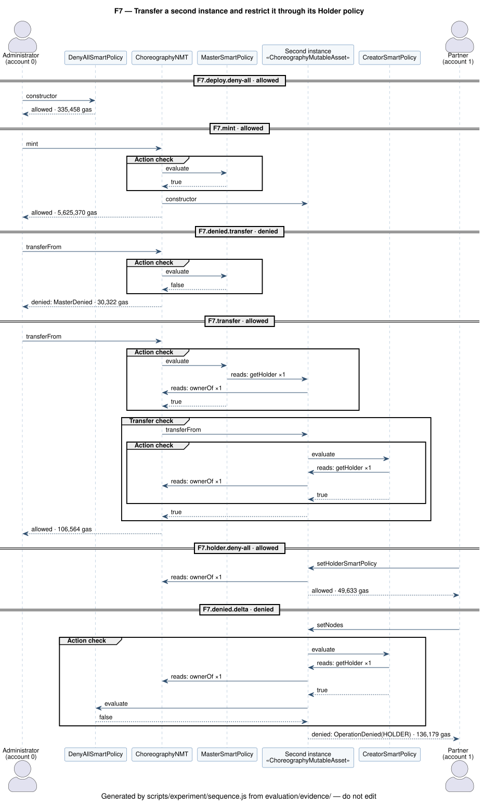
<!-- /evidence:phase:F7 -->

<!-- evidence:phase-title:F8 -->
### F8

**Render the final model and compare the delta with a new instance**
<!-- /evidence:phase-title:F8 -->

<!-- narrative:F8 -->
The render reads the instance again and regenerates the BPMN of the changed model. Then the alternative to the delta is measured: a new instance of the same type, born with the whole model, with the same role accounts and the same licensed role.

<!-- evidence:phase:F8 -->
**Actors**

| Account | Index | Address | Plays |
| --- | ---: | --- | --- |
| Administrator | 0 | `0xf39Fd6e51aad88F6F4ce6aB8827279cffFb92266` | Master administrator, authorized creator, holder of the instances |

**Off-chain steps**

| Step | Function | Output | SHA-256 |
| --- | --- | --- | --- |
| export | `exportContractToJson` | raw JSON (hashed without `contractExport.exportedAt`, `contractExport.rpcUrl`) | `dc0ec05c8bbae1c4834d06719fd5a3a2978e68bc6a4cf3f2eeda51fe0dc09fe1` |
| normalize | `normalizeInput` | normalized JSON (hashed without `contractExport.exportedAt`, `contractExport.rpcUrl`) | `f554401c2c56d65f5553794fe878e3f99c3994dc7fb753eb4a8ae163a1b14f35` |
| generate | `generateBpmnXml` | BPMN XML | `2f18c67a6da78d275690d5ad112e7ed981605069dfb2e6195b49ea37b632697e` |

**Reads**

| Key | Call | By | Gas |
| --- | --- | --- | ---: |
| `F8.tokenURI` | `ChoreographyMutableAsset.tokenURI` | eth_call (any account) | 1,649,219 |

**Transactions**

| Key | Operation | From | Call | Contract | Outcome | Reason | Gas |
| --- | --- | --- | --- | --- | --- | --- | ---: |
| `F8.new-instance.mint` | mint a new instance, born with the whole model | Administrator | `ChoreographyNMT.mint` | ChoreographyNMT `0x5FC8d32690cc91D4c39d9d3abcBD16989F875707` | allowed | — | 5,625,370 |
| `F8.new-instance.roles` | assign its role accounts except Special Carrier | Administrator | `ChoreographyMutableAsset.setRoles` | ChoreographyMutableAsset `0x8EFa1819Ff5B279077368d44B593a4543280e402` | allowed | — | 176,849 |
| `F8.new-instance.link` | link its Special Carrier role to the SpecialCarrier license | Administrator | `ChoreographyMutableAsset.setRoles` | ChoreographyMutableAsset `0x8EFa1819Ff5B279077368d44B593a4543280e402` | allowed | — | 97,276 |

**Costs**

| Key | Gas | Cost (ETH) | USD @10 gwei | USD @30 gwei | USD @100 gwei |
| --- | ---: | ---: | ---: | ---: | ---: |
| `F8.new-instance.mint` | 5,625,370 | 0.00000937933691136 | $168.7611 | $506.2833 | $1687.6110 |
| `F8.new-instance.roles` | 176,849 | 0.000000264918564057 | $5.3055 | $15.9164 | $53.0547 |
| `F8.new-instance.link` | 97,276 | 0.000000127611423324 | $2.9183 | $8.7548 | $29.1828 |
| **phase total** | 5,899,495 | 0.000009771866898741 | $176.9848 | $530.9546 | $1769.8485 |

**Trust-table rows**

| Key | Table | Row of docs/choreography-policies.md |
| --- | --- | --- |
| `F8.new-instance.mint` | choreography | `mint` an instance of the choreography type to an eligible holder |
| `F8.new-instance.roles` | choreography | `setRoles` |
| `F8.new-instance.link` | choreography | `setRoles` |

**The instance at the end of the phase**

| Address | Nodes | Tasks | Gateways | Edges | Messages | Roles |
| --- | ---: | ---: | ---: | ---: | ---: | ---: |
| `0x61c36a8d610163660E21a8b7359e1Cac0C9133e1` | 14 | 10 | 2 | 14 | 10 | 5 |

| Role | Played by | Address |
| --- | --- | --- |
| Bulk Buyer | Bulk Buyer account | `0xBcd4042DE499D14e55001CcbB24a551F3b954096` |
| Manufacturer | Manufacturer account | `0x71bE63f3384f5fb98995898A86B02Fb2426c5788` |
| Middleman | Middleman account | `0xFABB0ac9d68B0B445fB7357272Ff202C5651694a` |
| Supplier | Supplier account | `0x1CBd3b2770909D4e10f157cABC84C7264073C9Ec` |
| Special Carrier | ParticipantMutableAsset | `0x94099942864EA81cCF197E9D71ac53310b1468D8` |

**The new instance**

| Address | Nodes | Tasks | Gateways | Edges | Messages | Roles |
| --- | ---: | ---: | ---: | ---: | ---: | ---: |
| `0x8EFa1819Ff5B279077368d44B593a4543280e402` | 11 | 9 | 0 | 10 | 9 | 5 |

**Policies in force at the end of the phase**

| Resource | Layer | Contract | Address | Source | Bytecode keccak256 |
| --- | --- | --- | --- | --- | --- |
| choreography type | Master | MasterSmartPolicy | `0x5FbDB2315678afecb367f032d93F642f64180aa3` | [MasterSmartPolicy.sol](../contracts/choreography/MasterSmartPolicy.sol) | `0x6a27d43e7031776b97c80ef69e68e0a1e5400105b61c6574c1fce04c4bbbc1a5` |
| instance | Creator | CreatorSmartPolicyPaperScenario | `0xB7f8BC63BbcaD18155201308C8f3540b07f84F5e` | [CreatorSmartPolicyPaperScenario.sol](../contracts/choreography/CreatorSmartPolicyPaperScenario.sol) | `0x8275b4f71374b572d87afdc6c6df708c989e2d53826a5a33671a582fe06fa57d` |
| instance | Holder | HolderSmartPolicy | `0x9fE46736679d2D9a65F0992F2272dE9f3c7fa6e0` | [HolderSmartPolicy.sol](../contracts/choreography/HolderSmartPolicy.sol) | `0x64f3e21bf63e229868d575e36b6dfdafb0a11d8ed37cf63bf59858a08474030b` |
| license type | Master | ParticipantMasterSmartPolicy | `0x0165878A594ca255338adfa4d48449f69242Eb8F` | [ParticipantMasterSmartPolicy.sol](../contracts/participant/ParticipantMasterSmartPolicy.sol) | `0xd90bd67ad225d75183d46666712a0e2cfaa1c9ced3d4e1b51034e69cdc511d13` |
| licensed role | Creator | ParticipantCreatorSmartPolicy | `0x700b6A60ce7EaaEA56F065753d8dcB9653dbAD35` | [CreatorSmartPolicy.sol](../contracts/participant/CreatorSmartPolicy.sol) | `0x4d098019c20560369a6704135eed48691ee32450415386e62b410242325ffe13` |
| licensed role | Holder | ParticipantHolderSmartPolicy | `0x8A791620dd6260079BF849Dc5567aDC3F2FdC318` | [HolderSmartPolicy.sol](../contracts/participant/HolderSmartPolicy.sol) | `0x29c7f6744db23d0f03ec3cd9c5c8cd4b279ba4324371e80d432e259078e2c57b` |

**Duration (ms)**

| Measured | Median | Min | Max | Std dev |
| --- | ---: | ---: | ---: | ---: |
| phase F8 | 40.317 | 37.242 | 42.743 | 1.802 |
| step `F8.render` | 22.599 | 21.601 | 27.383 | 2.026 |

**Sequence diagram** (filtered; [complete](../evaluation/evidence/uml/F8-full.svg))

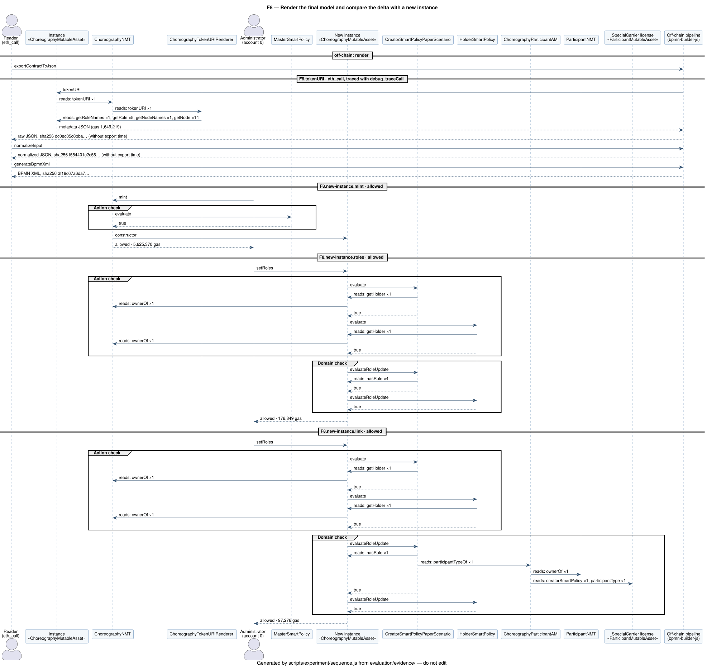
<!-- /evidence:phase:F8 -->

<!-- narrative:comparison -->
## Delta update versus a new instance

A choreography type fixes its model, so the alternative to a delta is a new instance of the type, born with the whole model. The comparison counts only the per-instance transactions: the deployment of the type is shared and left out. It is a measurement, not a recommendation: both strategies stay available. Compare the gas and the USD columns: the ETH column uses the local gas price of each receipt, which changes from block to block on the local network.

<!-- evidence:comparison -->
| Strategy | Transactions | Gas | Cost (ETH) | USD @10 gwei | USD @30 gwei | USD @100 gwei | Relative gas saving |
| --- | ---: | ---: | ---: | ---: | ---: | ---: | ---: |
| Delta update, 7 nodes written | `F5.delta` | 1,866,349 | 0.000055944531685714 | $55.9905 | $167.9714 | $559.9047 | 68.36% |
| New instance, 11 nodes | `F8.new-instance.mint`, `F8.new-instance.roles`, `F8.new-instance.link` | 5,899,495 | 0.000009771866898741 | $176.9848 | $530.9546 | $1769.8485 | 0.00% |
<!-- /evidence:comparison -->

## Public-network cost scenarios

The measured gas of a choreography type and its first instance, priced at three public-network gas prices.

<!-- evidence:scenarios -->
The gas of a choreography type and its first complete instance: `F1.deploy.master`, `F1.deploy.creator`, `F1.deploy.holder`, `F1.deploy.renderer`, `F1.deploy.model`, `F1.deploy.nmt`, `F2.mint`, `F2.roles`, `F3.link`, 16,096,006 gas in all, 0.008262300436534401 ETH at the local gas price of the receipts.

| Network condition | Gas price | Meaning | Gas | Estimated ETH cost | Estimated USD cost |
| --- | ---: | --- | ---: | --- | --- |
| Low congestion | 10 gwei | low demand; transactions are usually inexpensive | 16,096,006 | 0.160960 | $482.88 |
| Typical congestion | 30 gwei | ordinary public-network demand | 16,096,006 | 0.482880 | $1448.64 |
| High congestion | 100 gwei | high demand; users pay more to be included sooner | 16,096,006 | 1.609601 | $4828.80 |
<!-- /evidence:scenarios -->

## Charts

<!-- evidence:charts -->
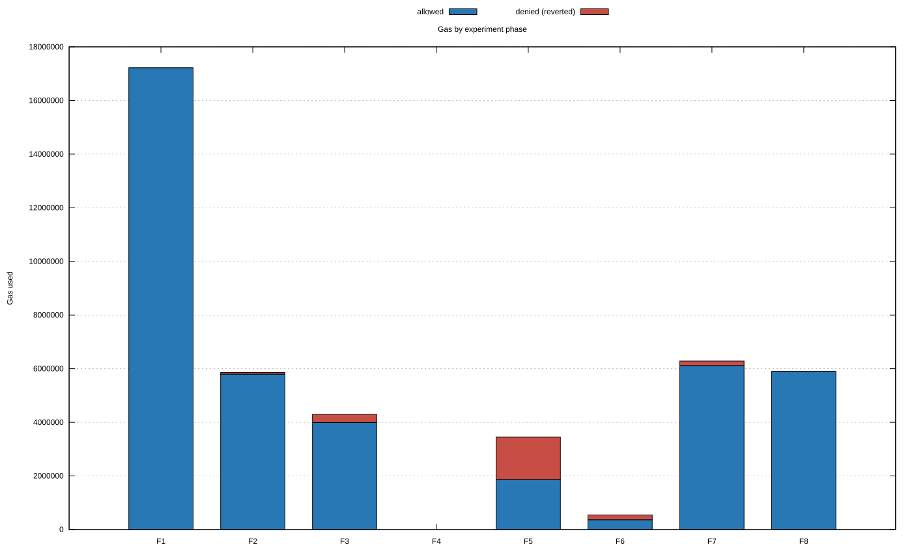

*Gas by phase, allowed and denied transactions stacked.* Data: [phase-gas.dat](../evaluation/evidence/charts/phase-gas.dat).

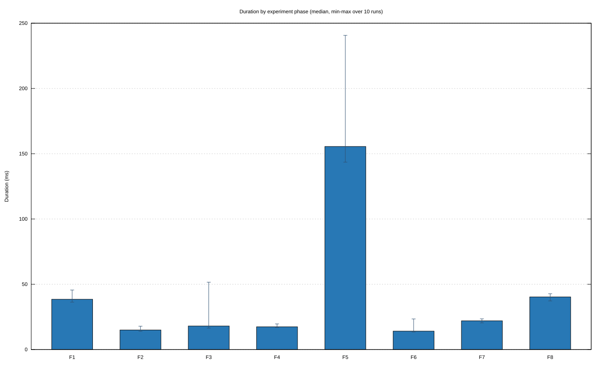

*Median duration by phase over 10 runs, with min–max bars.* Data: [phase-duration.dat](../evaluation/evidence/charts/phase-duration.dat).

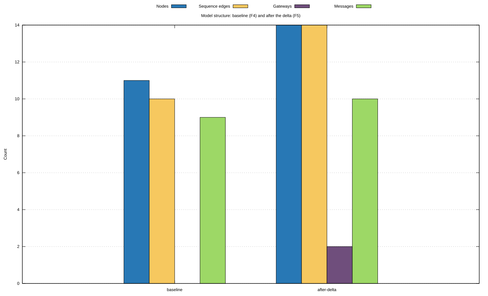

*Model structure read from the chain: baseline (F4) and after the delta (F5).* Data: [model-comparison.dat](../evaluation/evidence/charts/model-comparison.dat).

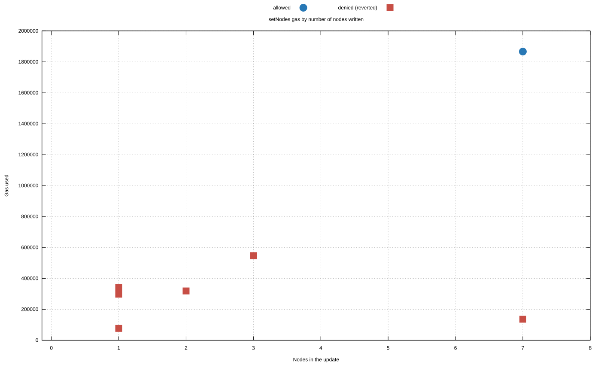

*Gas of every setNodes by the number of nodes it writes.* Data: [gas-by-changed-nodes.dat](../evaluation/evidence/charts/gas-by-changed-nodes.dat).

<!-- /evidence:charts -->

## BPMN models

<!-- evidence:bpmn -->
**Baseline (F4)**: [XML](../evaluation/evidence/bpmn/baseline.bpmn.xml), SHA-256 `d5f5a1d02813c172a1dd55c4ac16ade7520f97a17b3b044f76d7e596cc5471cc`, 25 names drawn.

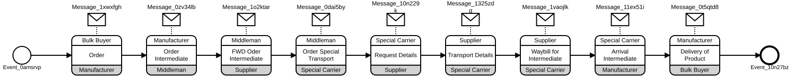

**After the delta (F8)**: [XML](../evaluation/evidence/bpmn/final.bpmn.xml), SHA-256 `2f18c67a6da78d275690d5ad112e7ed981605069dfb2e6195b49ea37b632697e`, 29 names drawn.

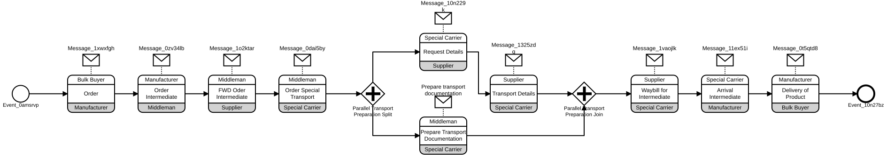

Checked before drawing: the baseline XML is equivalent to the source BPMN, the final XML is the baseline with the delta written over it, both equal the model the chain returned to their render, and each drawing shows exactly the names of its XML.
<!-- /evidence:bpmn -->

## UML diagrams

The use case diagrams are written by hand and checked by `npm run check:use-cases` against the trust tables, the test cases, and this evidence; the sequence diagrams are generated from the call traces of each phase. All of them are in [UML diagrams](uml.md).

<!-- evidence:uml-guide -->
| Diagram | Shows |
| --- | --- |
| [Choreography use cases](uml/use-case-choreography.svg) | who may mint, transfer, edit the model, assign and link roles, and install a Holder policy; checked against the trust table, the tests, and this evidence |
| [Participant license use cases](uml/use-case-participant-license.svg) | issuing, declaring messages, updating organization data, selling, and linking a role to a license |
| [F1](../evaluation/evidence/uml/F1.svg) · [complete](../evaluation/evidence/uml/F1-full.svg) | Deploy the choreography type and the license infrastructure |
| [F2](../evaluation/evidence/uml/F2.svg) · [complete](../evaluation/evidence/uml/F2-full.svg) | Mint the instance and assign the role accounts |
| [F3](../evaluation/evidence/uml/F3.svg) · [complete](../evaluation/evidence/uml/F3-full.svg) | Issue the participant licenses and link the Special Carrier role |
| [F4](../evaluation/evidence/uml/F4.svg) · [complete](../evaluation/evidence/uml/F4-full.svg) | Render the baseline model from the chain |
| [F5](../evaluation/evidence/uml/F5.svg) · [complete](../evaluation/evidence/uml/F5-full.svg) | Apply the delta: one allowed update and five denied ones |
| [F6](../evaluation/evidence/uml/F6.svg) · [complete](../evaluation/evidence/uml/F6-full.svg) | Sell the Special Carrier role: Carrier A to Carrier B |
| [F7](../evaluation/evidence/uml/F7.svg) · [complete](../evaluation/evidence/uml/F7-full.svg) | Transfer a second instance and restrict it through its Holder policy |
| [F8](../evaluation/evidence/uml/F8.svg) · [complete](../evaluation/evidence/uml/F8-full.svg) | Render the final model and compare the delta with a new instance |
<!-- /evidence:uml-guide -->

<!-- narrative:tests -->
## Cross-check: the policy test matrix

The experiment exercises the policies on the paper example; `npm test` exercises them on a small fixture, with the semantics and the mapping to test cases in [Policy and test specification](policy-test-specification.md), case by case: the Master mint and eligibility controls, the Creator constraints and the attempts to bypass them, role licenses and their sale, the Holder restrictions, the replacement of the Master policy, and the transfer of an instance. Its results are kept with the evidence.

<!-- evidence:tests -->
| Test matrix | Value |
| --- | --- |
| Cases | 58 |
| Gas of the allowed cases | 12,608,484 |
| Gas of the denied cases | 2,366,193 |

| Case | Outcome | Gas | Cost (wei) | USD @10 gwei | USD @30 gwei | USD @100 gwei |
| --- | --- | ---: | ---: | ---: | ---: | ---: |
| authorized creator mints eligible holder | allowed | 3,173,819 | 1,642,656,922,973,363 | $95.2146 | $285.6437 | $952.1457 |
| creator and holder update roles | allowed | 109,294 | 50,243,936,558,990 | $3.2788 | $9.8365 | $32.7882 |
| creator and holder update nodes | allowed | 224,844 | 90,490,432,262,028 | $6.7453 | $20.2360 | $67.4532 |
| creator policy denies a flow declared on one endpoint | denied | 121,951 | 42,991,195,664,489 | $3.6585 | $10.9756 | $36.5853 |
| authorized creator mints with the test-scenario creator policy | allowed | 3,179,419 | 243,961,350,542,075 | $95.3826 | $286.1477 | $953.8257 |
| creator policy allows approved task within limits | allowed | 609,279 | 41,526,325,991,337 | $18.2784 | $54.8351 | $182.7837 |
| creator policy allows second approved task within limits | allowed | 601,451 | 35,972,764,462,117 | $18.0435 | $54.1306 | $180.4353 |
| creator policy denies task count above limit | denied | 164,755 | 8,646,936,836,040 | $4.9427 | $14.8279 | $49.4265 |
| creator policy denies sequence flow count above limit | denied | 324,233 | 14,901,485,078,571 | $9.7270 | $29.1810 | $97.2699 |
| creator policy denies task outside name allowlist | denied | 144,822 | 5,832,905,759,538 | $4.3447 | $13.0340 | $43.4466 |
| creator policy denies flow to unknown node | denied | 76,086 | 2,683,259,147,610 | $2.2826 | $6.8477 | $22.8258 |
| creator policy denies protected node update | denied | 167,677 | 5,176,029,529,173 | $5.0303 | $15.0909 | $50.3031 |
| creator policy denies flow from unknown node | denied | 93,939 | 2,539,357,638,915 | $2.8182 | $8.4545 | $28.1817 |
| creator policy allows update keeping protected node links | allowed | 231,955 | 5,488,883,147,395 | $6.9587 | $20.8759 | $69.5865 |
| creator policy denies unlinking protected node | denied | 127,358 | 2,639,939,411,494 | $3.8207 | $11.4622 | $38.2074 |
| creator policy denies new link to protected node | denied | 134,415 | 2,439,421,487,280 | $4.0324 | $12.0974 | $40.3245 |
| creator policy allows unprotected role update | allowed | 97,958 | 1,556,556,832,194 | $2.9387 | $8.8162 | $29.3874 |
| creator policy allows the first assignment of a protected role | allowed | 99,718 | 1,387,104,702,732 | $2.9915 | $8.9746 | $29.9154 |
| creator policy denies protected role update | denied | 58,627 | 713,916,808,290 | $1.7588 | $5.2764 | $17.5881 |
| unauthorized issuer cannot mint a participant license | denied | 30,360 | 220,508,869,680 | $0.9108 | $2.7324 | $9.1080 |
| participant license cannot be minted without a type | denied | 29,817 | 189,521,741,988 | $0.8945 | $2.6835 | $8.9451 |
| license holder declares messages allowed for its type | allowed | 139,736 | 777,272,277,424 | $4.1921 | $12.5762 | $41.9208 |
| creator policy denies a message not allowed for the license type | denied | 46,603 | 226,973,806,507 | $1.3981 | $4.1943 | $13.9809 |
| license holder updates its organization data | allowed | 66,674 | 284,199,191,806 | $2.0002 | $6.0007 | $20.0022 |
| authorized creator mints a model whose Carrier role requires a SpecialCarrier license | allowed | 3,223,648 | 8,273,737,589,248 | $96.7094 | $290.1283 | $967.0944 |
| holder assigns the accounts of the new instance | allowed | 135,868 | 309,810,017,904 | $4.0760 | $12.2281 | $40.7604 |
| creator policy denies a plain account for a licensed role | denied | 63,657 | 127,090,627,587 | $1.9097 | $5.7291 | $19.0971 |
| creator policy denies a license of another type | denied | 69,889 | 122,128,301,829 | $2.0967 | $6.2900 | $20.9667 |
| creator policy denies a license from an untrusted certifier | denied | 69,240 | 105,905,211,120 | $2.0772 | $6.2316 | $20.7720 |
| creator policy denies new role when known roles are enforced | denied | 54,893 | 73,490,089,684 | $1.6468 | $4.9404 | $16.4679 |
| creator policy denies account already holding another role | denied | 73,824 | 86,502,976,704 | $2.2147 | $6.6442 | $22.1472 |
| holder links a role to a certified license | allowed | 120,833 | 123,930,916,454 | $3.6250 | $10.8750 | $36.2499 |
| participant master denies selling a license to an unqualified buyer | denied | 37,239 | 33,438,760,050 | $1.1172 | $3.3515 | $11.1717 |
| buyer cannot take a license without the seller | denied | 30,168 | 23,707,402,128 | $0.9050 | $2.7151 | $9.0504 |
| holder sells a license to a qualified buyer | allowed | 106,940 | 73,544,242,100 | $3.2082 | $9.6246 | $32.0820 |
| former license holder cannot install a Holder policy | denied | 27,477 | 16,542,720,189 | $0.8243 | $2.4729 | $8.2431 |
| new license holder installs its Holder policy | allowed | 49,611 | 26,138,497,959 | $1.4883 | $4.4650 | $14.8833 |
| former license holder cannot update the license | denied | 34,894 | 16,090,321,280 | $1.0468 | $3.1405 | $10.4682 |
| new license holder updates its data | allowed | 66,674 | 26,906,159,352 | $2.0002 | $6.0007 | $20.0022 |
| new license holder rewrites the messages | allowed | 62,936 | 22,230,002,176 | $1.8881 | $5.6642 | $18.8808 |
| unauthorized creator cannot mint | denied | 29,810 | 9,215,999,980 | $0.8943 | $2.6829 | $8.9430 |
| authorized creator cannot assign an ineligible holder | denied | 30,099 | 8,143,344,648 | $0.9030 | $2.7089 | $9.0297 |
| non-holder cannot update choreography | denied | 39,477 | 9,346,890,336 | $1.1843 | $3.5529 | $11.8431 |
| holder links the asset | allowed | 66,238 | 13,725,242,218 | $1.9871 | $5.9614 | $19.8714 |
| non-holder cannot link the asset | denied | 35,225 | 6,388,652,575 | $1.0568 | $3.1702 | $10.5675 |
| holder transfers to eligible holder | allowed | 113,970 | 18,089,774,280 | $3.4191 | $10.2573 | $34.1910 |
| holder cannot transfer to an ineligible holder | denied | 30,322 | 4,213,545,120 | $0.9097 | $2.7290 | $9.0966 |
| holder cannot replace creator policy | denied | 28,929 | 2,738,650,572 | $0.8679 | $2.6036 | $8.6787 |
| creator policy administrator replaces creator policy | allowed | 29,146 | 2,414,658,662 | $0.8744 | $2.6231 | $8.7438 |
| holder installs restrictive policy | allowed | 32,533 | 2,095,157,733 | $0.9760 | $2.9280 | $9.7599 |
| holder policy can deny further updates | denied | 45,904 | 2,587,149,440 | $1.3771 | $4.1314 | $13.7712 |
| holder cannot replace master policy | denied | 28,800 | 1,420,617,600 | $0.8640 | $2.5920 | $8.6400 |
| master administrator cannot remove master policy | denied | 28,595 | 1,234,360,365 | $0.8579 | $2.5736 | $8.5785 |
| master administrator replaces master policy | allowed | 32,920 | 1,243,618,840 | $0.9876 | $2.9628 | $9.8760 |
| replaced master policy governs minting | denied | 29,136 | 963,236,160 | $0.8741 | $2.6222 | $8.7408 |
| license holder cannot replace participant master policy | denied | 28,900 | 836,134,800 | $0.8670 | $2.6010 | $8.6700 |
| participant master administrator replaces participant master policy | allowed | 33,020 | 836,066,400 | $0.9906 | $2.9718 | $9.9060 |
| replaced participant master policy governs sales | denied | 29,072 | 644,206,448 | $0.8722 | $2.6165 | $8.7216 |
<!-- /evidence:tests -->

## Evidence files

<!-- evidence:artifacts -->
- [bpmn/baseline.bpmn.xml](../evaluation/evidence/bpmn/baseline.bpmn.xml)
- [bpmn/baseline.svg](../evaluation/evidence/bpmn/baseline.svg)
- [bpmn/final.bpmn.xml](../evaluation/evidence/bpmn/final.bpmn.xml)
- [bpmn/final.svg](../evaluation/evidence/bpmn/final.svg)
- [bpmn/images.json](../evaluation/evidence/bpmn/images.json)
- [charts/gas-by-changed-nodes.dat](../evaluation/evidence/charts/gas-by-changed-nodes.dat)
- [charts/gas-by-changed-nodes.svg](../evaluation/evidence/charts/gas-by-changed-nodes.svg)
- [charts/model-comparison.dat](../evaluation/evidence/charts/model-comparison.dat)
- [charts/model-comparison.svg](../evaluation/evidence/charts/model-comparison.svg)
- [charts/phase-duration.dat](../evaluation/evidence/charts/phase-duration.dat)
- [charts/phase-duration.svg](../evaluation/evidence/charts/phase-duration.svg)
- [charts/phase-gas.dat](../evaluation/evidence/charts/phase-gas.dat)
- [charts/phase-gas.svg](../evaluation/evidence/charts/phase-gas.svg)
- [experiment.json](../evaluation/evidence/experiment.json)
- [tests.json](../evaluation/evidence/tests.json)
- [timings.json](../evaluation/evidence/timings.json)
- [traces.json](../evaluation/evidence/traces.json)
- [transactions.csv](../evaluation/evidence/transactions.csv)
- [uml/F1-full.puml](../evaluation/evidence/uml/F1-full.puml)
- [uml/F1-full.svg](../evaluation/evidence/uml/F1-full.svg)
- [uml/F1.puml](../evaluation/evidence/uml/F1.puml)
- [uml/F1.svg](../evaluation/evidence/uml/F1.svg)
- [uml/F2-full.puml](../evaluation/evidence/uml/F2-full.puml)
- [uml/F2-full.svg](../evaluation/evidence/uml/F2-full.svg)
- [uml/F2.puml](../evaluation/evidence/uml/F2.puml)
- [uml/F2.svg](../evaluation/evidence/uml/F2.svg)
- [uml/F3-full.puml](../evaluation/evidence/uml/F3-full.puml)
- [uml/F3-full.svg](../evaluation/evidence/uml/F3-full.svg)
- [uml/F3.puml](../evaluation/evidence/uml/F3.puml)
- [uml/F3.svg](../evaluation/evidence/uml/F3.svg)
- [uml/F4-full.puml](../evaluation/evidence/uml/F4-full.puml)
- [uml/F4-full.svg](../evaluation/evidence/uml/F4-full.svg)
- [uml/F4.puml](../evaluation/evidence/uml/F4.puml)
- [uml/F4.svg](../evaluation/evidence/uml/F4.svg)
- [uml/F5-full.puml](../evaluation/evidence/uml/F5-full.puml)
- [uml/F5-full.svg](../evaluation/evidence/uml/F5-full.svg)
- [uml/F5.puml](../evaluation/evidence/uml/F5.puml)
- [uml/F5.svg](../evaluation/evidence/uml/F5.svg)
- [uml/F6-full.puml](../evaluation/evidence/uml/F6-full.puml)
- [uml/F6-full.svg](../evaluation/evidence/uml/F6-full.svg)
- [uml/F6.puml](../evaluation/evidence/uml/F6.puml)
- [uml/F6.svg](../evaluation/evidence/uml/F6.svg)
- [uml/F7-full.puml](../evaluation/evidence/uml/F7-full.puml)
- [uml/F7-full.svg](../evaluation/evidence/uml/F7-full.svg)
- [uml/F7.puml](../evaluation/evidence/uml/F7.puml)
- [uml/F7.svg](../evaluation/evidence/uml/F7.svg)
- [uml/F8-full.puml](../evaluation/evidence/uml/F8-full.puml)
- [uml/F8-full.svg](../evaluation/evidence/uml/F8-full.svg)
- [uml/F8.puml](../evaluation/evidence/uml/F8.puml)
- [uml/F8.svg](../evaluation/evidence/uml/F8.svg)
<!-- /evidence:artifacts -->
