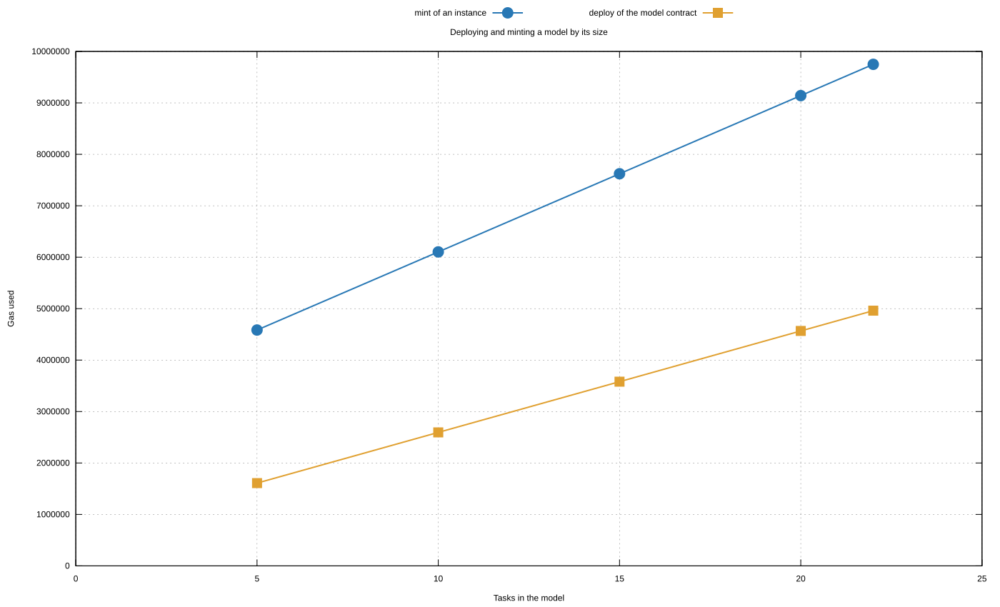
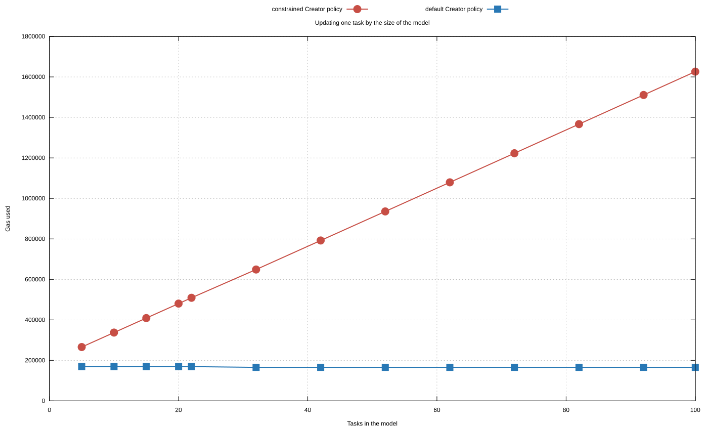
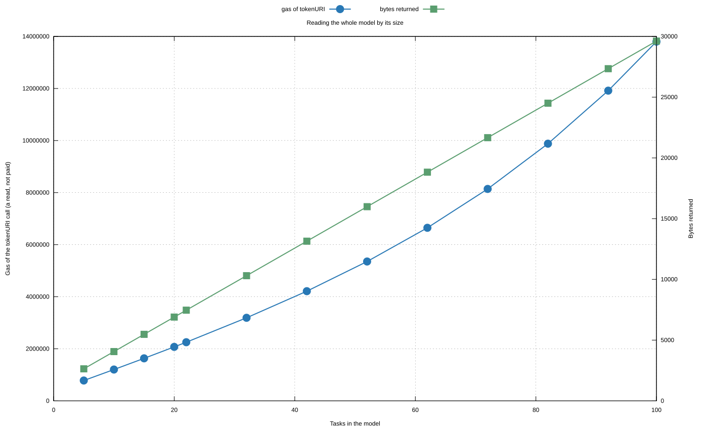

# Extended evaluation

The [experiment](experiment.md) follows one scenario from the deployment of the type to the final render, with one update, and repeats it to show that it is reproducible. Repeating it adds no variety. This page adds four studies that vary what the experiment keeps fixed: the kind of update, the size of the model, the organizations in disagreement, and the transactions that meet in one block.

The studies are separate from the experiment. They run on their own ephemeral networks, they do not change a transaction, a gas figure, or an outcome of the experiment, and their evidence is in its own directory. Like the experiment, they are code: a specification states every transaction and its expected outcome, a run checks each one against it, and the tables below are generated from the evidence of that run (decision D28 in [Design decisions](decisions.md)). The text between the tables is hand-written and holds no measured value.

The parties are those of the experiment. The **Master** deploys the choreography type and administers its policies; the **authorized creator** mints an instance for its **Holder**, who owns it and alone changes its model; the **Creator policy** of an instance holds the constraints of whoever designed the type, and the Holder policy the further restrictions of the Holder. A role is played by a **license**, issued by a **license authority** and held by an organization, the license holder; the **certifier** is the Creator policy of a license, through which its authority restricts it.

What the studies do not cover is listed in [Limits](#limits).

## How it runs

`npm run evidence:update` runs the studies after the experiment and rewrites the blocks of this page; `npm run check:evidence` reruns them and compares the evidence; `npm run check:protocol` fails if a block of this page differs from the evidence.

<!-- extended:provenance -->
| Item | Value |
| --- | --- |
| Specification | [extended-spec.js](../scripts/experiment/extended-spec.js) |
| Compiler | solc 0.8.28, optimizer on, 200 runs |
| Network | hardhat (edr-simulated, ephemeral), one network per study |
| Hardhat, Node | ^3.9.0, 22 |
| Block gas limit of the local network | 60,000,000 |
| Runs | 1 warm-up and 3 measured, all with the same evidence |
| USD column | Polygon, 300 gwei (the reference scenario of the experiment, a Polygon Gas Station reading of about 271 gwei rounded up) and $0.090 per POL, both calculation assumptions: USD = gas × gas price in gwei × 10⁻⁹ × POL/USD |
| Timings | Apple M2 Pro, 10 cores, 32 GiB, darwin 25.6.0; local, not compared |
<!-- /extended:provenance -->

## Study 1: variety of updates

The experiment applies one delta. This study applies a series of updates of different kinds to one instance of the paper example, born with the paper-scenario Creator policy as in the experiment: the delta of the experiment, a change of message, a change of the roles of a task, a change of gateway type, a task inserted on a flow, the same task detached, and a second insertion.

After every update the run reads the model back from the chain, compares it node by node with the model it expects, and renders it to BPMN.

<!-- extended:updates -->
Model: `references/paper-example.bpmn`, Creator policy `CreatorSmartPolicyPaperScenario`. Baseline: 11 nodes, 9 tasks, 10 sequence flows, 18 messages.

| Key | Kind of update | Nodes written | Calldata bytes | Outcome | Gas | USD @300 gwei | Tasks after | Edges after |
| --- | --- | ---: | ---: | --- | ---: | ---: | ---: | ---: |
| `U1.parallel-block` | add a parallel block | 7 | 7,460 | allowed | 1,867,847 | $0.0504 | 10 | 14 |
| `U2.message` | change a message | 1 | 1,572 | allowed | 401,592 | $0.0108 | 10 | 14 |
| `U3.roles` | reassign a task | 1 | 1,572 | allowed | 404,925 | $0.0109 | 10 | 14 |
| `U4.gateway-type` | change a gateway pair | 2 | 2,564 | allowed | 611,382 | $0.0165 | 10 | 14 |
| `U5.insert-task` | insert a task on a flow | 3 | 3,428 | allowed | 785,548 | $0.0212 | 11 | 15 |
| `U6.detach-task` | detach a task | 3 | 3,172 | allowed | 540,386 | $0.0146 | 11 | 14 |
| `U7.insert-after-detach` | insert a task on a flow | 3 | 3,428 | denied, `OperationDenied(CREATOR)` | 455,083 | $0.0123 | 11 | 14 |

- `U1.parallel-block`: the delta of the experiment: a parallel split and join around the transport preparation, with one new task. Nodes written: `Order Special Transport`, `Parallel Transport Preparation Split`, `Request Details`, `Transport Details`, `Prepare Transport Documentation`, `Parallel Transport Preparation Join`, `Waybill for Intermediate`.
- `U2.message`: the initiating message of Transport Details. Nodes written: `Transport Details`.
- `U3.roles`: Prepare Transport Documentation is started by the Supplier instead of the Middleman. Nodes written: `Prepare Transport Documentation`.
- `U4.gateway-type`: the parallel split and join become an exclusive split and join, with a condition on each branch. Nodes written: `Parallel Transport Preparation Split`, `Parallel Transport Preparation Join`.
- `U5.insert-task`: Optional Quality Inspection between Arrival Intermediate and Delivery of Product. Nodes written: `Arrival Intermediate`, `Optional Quality Inspection`, `Delivery of Product`.
- `U6.detach-task`: the flow goes again from Arrival Intermediate to Delivery of Product; Optional Quality Inspection stays in the model with no flow, since a node is never deleted. Nodes written: `Arrival Intermediate`, `Optional Quality Inspection`, `Delivery of Product`.
- `U7.insert-after-detach`: Optional Customs Inspection between Order Intermediate and FWD Oder Intermediate: the detached task still counts toward the task limit. Nodes written: `Order Intermediate`, `Optional Customs Inspection`, `FWD Oder Intermediate`.

The 6 accepted updates use between 401,592 and 1,867,847 gas, 4,611,680 in all. Check of the run: after every update the model on the chain equals the expected one, node by node, and the render:asset function generates its BPMN.
<!-- /extended:updates -->

Two results go beyond the cost of each kind.

- The cost of an update follows the nodes it writes, and whether it creates a node or overwrites one, more than the kind of change: an update is always a list of whole nodes (compare the rows that write the same number of nodes).
- A detached task is still in the model, because a node is never deleted, and it still counts toward the task limit of the Creator policy. The last row shows the consequence: the Creator policy refuses a new optional task although the previous one is no longer on any flow. A detached task still counts toward the limit; attaching it again is the only way to use its slot.

## Study 2: scalability

The experiment uses one model. This study generates models of growing size in code, a chain of tasks shared among a fixed set of roles, and measures each size under two Creator policies: the default one, which only requires a well-formed update, and a constrained one (`CreatorSmartPolicyScaleScenario`) that keeps the checks of the constrained policies, the counts of the tasks and flows of the whole model and the known flow targets, with scenario data that never denies: limits that no synthetic model reaches, every task name accepted, and no protected node, protected role, or license type. The paper-scenario policy also looks up the name of every task it is given, a small cost per node written that this policy leaves out.

The synthetic models exist only to measure sizes: they are not BPMN models of a process, and the paper example stays the only supported scenario. Every node of a chain has one incoming and one outgoing flow, and every task two short messages; the figures below hold for this shape, and a model with wider gateways or longer names gives other figures.

### How large a model can be

A type fixes its model in a contract, so the model of a mint is bounded by the size limit of a contract, and how many tasks fit depends on their names and messages. An instance can grow beyond it through updates, which this study does from the largest minted model, to measure how the costs continue; a model above the size limit stays a non-goal of the prototype, not a supported use.

<!-- extended:scale-limit -->
Shape: a chain Start -> Task 001 -> ... -> Task n -> End, every task with two messages, over 5 roles. Policies: `CreatorSmartPolicy` (default) and `CreatorSmartPolicyScaleScenario` (constrained).

| Limit | Tasks | Model bytes | Result |
| --- | ---: | ---: | --- |
| Largest chain that fits in a model contract | 22 | 23,904 | deployed and minted (limit: 24,576 bytes) |
| First chain that does not fit | 23 | 24,864 | above the limit of a contract, so it cannot be deployed: the run computes its encoding and does not send it |
| Largest model reached by updates | 100 | — | updated, read, and rendered; where the study stops, not a limit it found |
<!-- /extended:scale-limit -->

### Deploying and minting

<!-- extended:scale-mint -->
| Tasks | Nodes | Model bytes | Deploy model (gas) | Deploy type NMT (gas) | Mint (gas) | Mint USD @300 gwei | Link roles (gas) |
| ---: | ---: | ---: | ---: | ---: | ---: | ---: | ---: |
| 5 | 7 | 7,584 | 1,608,835 | 4,815,968 | 4,584,370 | $0.1238 | 197,968 |
| 10 | 12 | 12,384 | 2,594,734 | 4,815,968 | 6,102,927 | $0.1648 | 197,968 |
| 15 | 17 | 17,184 | 3,580,457 | 4,815,968 | 7,621,872 | $0.2058 | 197,968 |
| 20 | 22 | 21,984 | 4,566,507 | 4,815,968 | 9,141,205 | $0.2468 | 197,968 |
| 22 | 24 | 23,904 | 4,960,683 | 4,815,968 | 9,749,047 | $0.2632 | 197,968 |

Each task more adds about 303,805 gas to a mint and about 197,168 gas to the model contract (from 5 to 22 tasks). The type NMT and the link of the roles do not depend on the size. The largest mint, 9,749,047 gas, is below 16,777,216 gas, the per-transaction cap introduced by EIP-7825. A mint under the constrained policy costs 5,588 gas more than under the default one, the same at every size.

<!-- /extended:scale-mint -->

The cost of a mint grows linearly with the model: a mint copies every node from the model contract into the storage of the new instance.

### Updating

<!-- extended:scale-update -->
| Tasks | Model | Update one task, default (gas) | Update one task, constrained (gas) | Update constrained USD |
| ---: | --- | ---: | ---: | ---: |
| 5 | minted | 169,167 | 265,798 | $0.0072 |
| 10 | minted | 169,167 | 337,331 | $0.0091 |
| 15 | minted | 169,167 | 408,892 | $0.0110 |
| 20 | minted | 169,167 | 480,482 | $0.0130 |
| 22 | minted | 169,167 | 509,126 | $0.0137 |
| 32 | grown by updates | 165,512 | 648,745 | $0.0175 |
| 42 | grown by updates | 165,512 | 792,143 | $0.0214 |
| 52 | grown by updates | 165,512 | 935,655 | $0.0253 |
| 62 | grown by updates | 165,512 | 1,079,281 | $0.0291 |
| 72 | grown by updates | 165,512 | 1,223,022 | $0.0330 |
| 82 | grown by updates | 165,512 | 1,366,876 | $0.0369 |
| 92 | grown by updates | 165,512 | 1,510,844 | $0.0408 |
| 100 | grown by updates | 165,512 | 1,626,100 | $0.0439 |

Under the default policy an update of one task stays between 165,512 and 169,167 gas at every size: it does not grow with the model. Under the constrained policy each node of the model adds about 14,319 gas to it (from 5 to 100 tasks; in a chain, tasks, nodes, and flows grow together): the policy reads every node of the model, to count its tasks and its flows, at every update.

| Tasks | Update 5 tasks, default (gas) | Update 5 tasks, constrained (gas) | Insert a task on a flow, default (gas) | Insert a task on a flow, constrained (gas) |
| ---: | ---: | ---: | ---: | ---: |
| 5 | 444,560 | 577,571 | 563,488 | 674,845 |
| 10 | 448,245 | 650,863 | 563,488 | 746,401 |
| 15 | 448,245 | 722,492 | 563,488 | 817,985 |
| 20 | 448,245 | 794,150 | 563,488 | 889,598 |
| 22 | 448,245 | 822,821 | 563,488 | 918,251 |

| Tasks after | Nodes written | Append tasks, default (gas) | Append tasks, constrained (gas) | Append constrained USD |
| ---: | ---: | ---: | ---: | ---: |
| 32 | 12 | 3,428,635 | 3,876,287 | $0.1047 |
| 42 | 12 | 3,428,635 | 4,019,699 | $0.1085 |
| 52 | 12 | 3,428,635 | 4,163,226 | $0.1124 |
| 62 | 12 | 3,428,635 | 4,306,867 | $0.1163 |
| 72 | 12 | 3,428,635 | 4,450,622 | $0.1202 |
| 82 | 12 | 3,428,635 | 4,594,491 | $0.1241 |
| 92 | 12 | 3,428,635 | 4,738,474 | $0.1279 |
| 100 | 10 | 2,780,335 | 4,212,043 | $0.1137 |

An update that appends 10 tasks writes 12 nodes: the new tasks and the two nodes whose flows change.

<!-- /extended:scale-update -->

The two policies behave differently, and the difference comes from the constrained policy, not from the asset. The asset writes only the nodes of the update, and the default policy reads only those nodes and their neighbours: the cost does not depend on the size of the model, and it does depend on the nodes written and on how many neighbours they have, which in a chain is one on each side. The constrained policy enforces limits on the whole model, and to do so it reads every node at every update: its cost grows linearly with the model. Counts kept by the asset would remove the growth of this reading, at the price of storage writes at every update; it is not implemented or measured (see [Future improvements](future-improvements.md)).

### Reading and rendering

<!-- extended:scale-read -->
| Tasks | Model | tokenURI gas | Bytes returned | Read tokenURI (ms) | Render BPMN (ms) | Mint and link roles (ms) |
| ---: | --- | ---: | ---: | ---: | ---: | ---: |
| 5 | minted | 781,750 | 2,637 | 6.4 (6.2–7.7) | 12.2 (10.0–12.2) | 9.0 (8.6–9.7) |
| 10 | minted | 1,203,513 | 4,057 | 9.5 (9.0–9.5) | 13.9 (13.4–16.8) | 12.4 (10.7–20.5) |
| 15 | minted | 1,633,707 | 5,477 | 13.3 (13.2–14.2) | 18.6 (18.4–19.3) | 14.6 (14.5–15.1) |
| 20 | minted | 2,073,733 | 6,897 | 15.2 (15.0–18.8) | 21.3 (21.2–22.4) | 44.2 (43.6–59.8) |
| 22 | minted | 2,252,975 | 7,465 | 16.2 (15.8–16.4) | 22.6 (21.7–28.1) | 48.4 (48.0–59.2) |
| 32 | grown by updates | 3,191,085 | 10,305 | 21.4 (20.3–33.2) | 29.3 (27.9–86.0) | — |
| 42 | grown by updates | 4,213,380 | 13,145 | 29.6 (28.9–43.8) | 39.3 (36.8–64.5) | — |
| 52 | grown by updates | 5,353,402 | 15,985 | 34.8 (32.6–34.9) | 45.5 (43.6–57.9) | — |
| 62 | grown by updates | 6,648,588 | 18,825 | 39.0 (38.3–40.7) | 51.3 (48.0–55.3) | — |
| 72 | grown by updates | 8,141,510 | 21,665 | 48.1 (47.9–48.4) | 61.2 (60.6–67.0) | — |
| 82 | grown by updates | 9,880,060 | 24,505 | 56.3 (53.5–68.2) | 69.2 (67.6–736.7) | — |
| 92 | grown by updates | 11,917,244 | 27,345 | 70.9 (59.7–85.3) | 85.6 (83.7–86.2) | — |
| 100 | grown by updates | 13,801,110 | 29,617 | 61.8 (59.8–95.6) | 87.0 (78.5–100.6) | — |

The read is an `eth_call`: its gas is not paid, but an RPC provider caps the gas of a call. Its gas grows faster than linearly: each task more adds about 84,353 gas between 5 and 10 tasks, and about 235,483 between 92 and 100, while the bytes it returns grow by about 284 and 284 per task. The milliseconds are the median and the range over 3 measured runs on the local network: the render column is the whole `render:asset` function (read, normalization, validation, BPMN generation), the last column the mint and the link of the roles as the local network executes them. They are not the latency of a public network.

<!-- /extended:scale-read -->

The render reads the whole model in one call. The call costs nothing, but its gas grows faster than linearly, and an RPC provider caps the gas of a call. For a model grown by updates this read, rather than the cost of a transaction, may be the first bound, depending on the cap of the provider; the study measures the gas, not the caps. Why the gas of the read grows faster than its output was not investigated. The times are the median over the measured runs; the study does not interpret their irregularities, such as a step between two sizes or an outlier in a range.

## Study 3: conflicts between organizations

The experiment shows each policy at work. This study puts two parties against each other on the same asset and records who prevails and by which rule, under the policies in force: the Master, the Holder of the instance, the organization whose license plays a role, the authority that issued that license, and the Creator policy as the will of whoever wrote the constraints.

<!-- extended:conflicts -->
Licensed role: `Special Carrier`, linked to the first SpecialCarrier license and played by Carrier A when the study starts. The model: unchanged by the whole study, node by node.

| Key | Between | What one party does | Outcome | Prevails | Rule | Gas |
| --- | --- | --- | --- | --- | --- | ---: |
| `X1.holder-replaces-creator-policy` | Holder and Creator | the Holder replaces the paper-scenario Creator policy of its instance with the default one, to drop the constraints | denied, `OperationDenied(CREATOR)` | Creator | the Creator policy lets only its administrator, the Master, replace it; the study does not exercise that replacement | 28,929 |
| `X2.master-updates-instance` | Master and Holder | the Master, who deployed the type and administers the policies, changes a message in the Holder's instance | denied, `OperationDenied(CREATOR)` | Holder | the Creator policy accepts model updates from the holder of the instance only | 54,163 |
| `X3.master-replaces-holder-policy` | Master and Holder | the Master replaces the Holder policy of the Holder's instance | denied, `CallerNotHolder` | Holder | only the holder of the instance sets its Holder policy | 27,499 |
| `X4.participant-updates-instance` | Carrier A and Holder | Carrier A, whose license plays Special Carrier, changes a message of a task it takes part in | denied, `OperationDenied(CREATOR)` | Holder | playing a role gives no right on the model | 53,770 |
| `X5.holder-updates-license` | Holder and Carrier A | the Holder of the choreography renames the license that plays Special Carrier | denied, `OperationDenied(CREATOR)` | Carrier A | the license Creator policy (certifier) accepts updates from the holder of the license only | 35,014 |
| `X6.authority-updates-license` | Transport authority and Carrier A | the authority that issued and certifies the license renames it | denied, `OperationDenied(CREATOR)` | Carrier A | the license Creator policy (certifier) lets only the holder of the license write it; the authority restricts which messages a license may declare, and it can replace the certifier, which the study does not exercise | 35,050 |
| `X7.sale-without-holder` | Carrier A and Holder | Carrier A sells the license that plays Special Carrier to Carrier B; the Holder of the choreography takes no part | allowed | Carrier A | the participant Master policy (a seller who holds the license, a buyer qualified for the type) and the license Creator policy decide a sale; the role follows the license, so Carrier B plays it, and the sale clears the Holder policy of the license | 110,998 |
| `X8.second-license` | Transport authority and Holder | the authority issues a second SpecialCarrier license, to Carrier A, which the Holder can choose | allowed | Transport authority | an authority issues the licenses of its types | 1,199,713 |
| `X9.holder-relinks-role` | Holder and Carrier B | the Holder does not want Carrier B and links Special Carrier to the second license | allowed | Holder | the Holder chooses who plays a role, among the licenses of the type the Creator policy requires | 80,422 |
| `X10.holder-links-other-type` | Holder and Creator | the Holder links Special Carrier to the Carrier license of Carrier C | denied, `OperationDenied(CREATOR)` | Creator | the Creator policy requires a SpecialCarrier license for the role | 63,953 |

| After | Special Carrier linked to | Played by |
| --- | --- | --- |
| the start, until `X1.holder-replaces-creator-policy` | the first SpecialCarrier license | Carrier A |
| `X7.sale-without-holder` | the first SpecialCarrier license | Carrier B |
| `X9.holder-relinks-role` | the second SpecialCarrier license | Carrier A |
<!-- /extended:conflicts -->

The cases draw the boundary between the two assets.

- **On the model, the Holder decides inside the Creator constraints.** Under the policies in force, neither the Master, who administers the policies, nor a participant, who plays a role, can change the model or the Holder policy, and the Holder cannot drop the Creator constraints. The Master can replace the Creator policy of an instance, and with it the rules; the study does not exercise that replacement, an open question of [Design decisions](decisions.md).
- **On a license, its holder decides inside what the certifier allows.** Under the policies in force, neither the Holder of the choreography nor the authority that issued the license can write it. The authority can replace the certifier; the study does not exercise that either.
- **The two meet at the role.** A license can be sold without the Holder of the choreography, and the role follows the license, so the Holder does not choose the buyer. The buyer is not arbitrary: the participant Master policy accepts only an organization the license authorities qualified for the type. The sale also clears the Holder policy of the license, so the buyer cannot update the license until it installs one.
- **The Holder keeps a remedy.** It can link the role to another license, provided it is of the type the Creator policy requires; the paper-scenario policy protects no role, so it allows the new link. Until then, the role is played by an organization the Holder did not choose. Decision D9 of [Design decisions](decisions.md) says that a role is linked once; whether the Holder should be able to link it again is not settled there, and this study only shows what the current policies allow.

## Study 4: concurrency

A blockchain executes transactions one after the other, so two transactions never run at the same time. What can happen is that they are sent on the same state and land in the same block. Their order is chosen by whoever builds the block, usually by fee, and the transactions of one account always follow its nonces. This study sends the transactions of each case with mining stopped, fixes their order with their fees and nonces, mines one block, and reads the result.

<!-- extended:concurrency -->
Mining: automine off: the transactions of a case are sent, then one block is mined; their order is the position in that block.

**`K1.two-organizations`**: the Holder updates the model and Carrier A sells the license of a role, in the same block.

| Position | Transaction | Sender | Outcome | Gas |
| ---: | --- | --- | --- | ---: |
| 1 | the Holder applies the delta of the experiment | Holder | allowed | 1,867,847 |
| 2 | Carrier A sells the SpecialCarrier license to Carrier B | Carrier A | allowed | 110,998 |

Result: independent: the two assets have different holders and policies, both transactions pass. After the block the license is held by Carrier B and the model has the delta.

**`K2.license-first`**: the license holder acts first and the Holder second, in the same block: Carrier B installs the Holder policy the sale of K1 cleared.

| Position | Transaction | Sender | Outcome | Gas |
| ---: | --- | --- | --- | ---: |
| 1 | Carrier B installs its Holder policy on the license | Carrier B | allowed | 49,611 |
| 2 | the Holder changes a message of Arrival Intermediate | Holder | allowed | 396,277 |

Result: independent for this pair of transactions too.

**`K3.lost-update`**: two updates of the same task, each built on the state before the block: one changes the initiating message, the other the return message.

| Position | Transaction | Sender | Outcome | Gas |
| ---: | --- | --- | --- | ---: |
| 1 | the first update changes the initiating message of Transport Details | Holder | allowed | 401,592 |
| 2 | the second update changes the return message of Transport Details | Holder | allowed | 404,416 |

Result: the last write wins: an update carries the whole node, so the second one writes back the old initiating message; the asset has no version check. `Transport Details` had the initiating message `Cargo Specification` and the return message `Vehicle Assignment`; after the block it has `Cargo Specification` and `Vehicle and Driver Assignment`: the initiating message "Detailed Cargo Specification" of the first update is lost, and both transactions succeeded.

**`K4.limit-under-race`**: two updates, each inserting one optional task, each within the task limit on the state before the block.

| Position | Transaction | Sender | Outcome | Gas |
| ---: | --- | --- | --- | ---: |
| 1 | the first update inserts Optional Quality Inspection | Holder | allowed | 785,620 |
| 2 | the second update inserts Optional Customs Inspection | Holder | denied, `OperationDenied(CREATOR)` | 458,712 |

Result: the Creator policy evaluates each update on the state its transaction finds: the limit holds whatever the sender saw. Each update is within the limit when evaluated alone on the state before the block; after the block the model has 11 tasks.

**`K5.three-instances`**: the delta of the experiment on three other instances of the type, in the same block.

| Position | Transaction | Sender | Outcome | Gas |
| ---: | --- | --- | --- | ---: |
| 1 | the Holder applies the delta to instance 1 | Holder | allowed | 1,867,847 |
| 2 | the Holder applies the delta to instance 2 | Holder | allowed | 1,867,847 |
| 3 | the Holder applies the delta to instance 3 | Holder | allowed | 1,867,847 |

Result: instances do not interfere: each update costs what it costs alone. The same delta alone in its block uses 1,867,847 gas.

**`K6.freeze-in-block`**: the Holder freezes the instance and updates it in the same block.

| Position | Transaction | Sender | Outcome | Gas |
| ---: | --- | --- | --- | ---: |
| 1 | the Holder installs the deny-all Holder policy | Holder | allowed | 32,533 |
| 2 | the Holder changes a message of Request Details | Holder | denied, `OperationDenied(HOLDER)` | 60,920 |

Result: the order in the block decides: after the deny-all Holder policy is installed, the update that follows it in the same block is refused.
<!-- /extended:concurrency -->

Three results.

- **Different assets do not interfere, in the pairs tested.** An update of the model next to a sale of a license, or next to an update of the license, and updates of different instances in one block, all pass, and the delta costs in a shared block what it costs alone.
- **The policies judge the state, not what the sender saw.** Each policy evaluates an update on the state its transaction finds: a limit or a freeze cannot be passed by sending two transactions together. The cases come from one account, the Holder, so they show the order inside a block, not a race between parties.
- **Updates of the same node can be lost.** An update carries the whole node, and the asset does not check that the node is still the one the sender read. Two updates of the same task built on the same state both succeed. The second one writes back the old value of the field the first one changed, without any error.
- **Who can meet this.** Only the holder can update an instance, so it concerns two tools or operators that use the key of the Holder, or a Holder that is a shared account or a contract, not two organizations. It is a limitation of the prototype. A version check on the node would refuse the stale update; it is an idea, not implemented or measured (see [Future improvements](future-improvements.md)).

## Limits

- **One real scenario.** The paper example is still the only process model. The synthetic models vary the size, not the structure: they are chains, without gateways. A second real scenario needs its own Creator policy, since policies are hardcoded, and is not part of the prototype.
- **No public network.** Every run is on a local ephemeral network. The gas figures are those a network with the same EVM rules would charge; the times are local and say nothing about the latency of a public network, which is the time to include a transaction in a block. The USD figures are estimates under the stated assumptions.
- **One holder per instance.** Concurrency between organizations on the same model cannot happen by construction, since only the holder writes it; the study covers what can happen.
- **Sizes.** Two different bounds appear: a mint is bounded by the size of a contract, which the study finds; a model grown by updates is bounded in practice by the gas of the read, which the study measures without finding where it stops. The largest grown model is where the study stops, and is not a supported size.

## Evidence

<!-- extended:artifacts -->
- [charts/scale-mint.dat](../evaluation/evidence/extended/charts/scale-mint.dat)
- [charts/scale-mint.svg](../evaluation/evidence/extended/charts/scale-mint.svg)
- [charts/scale-read.dat](../evaluation/evidence/extended/charts/scale-read.dat)
- [charts/scale-read.svg](../evaluation/evidence/extended/charts/scale-read.svg)
- [charts/scale-update.dat](../evaluation/evidence/extended/charts/scale-update.dat)
- [charts/scale-update.svg](../evaluation/evidence/extended/charts/scale-update.svg)
- [extended.json](../evaluation/evidence/extended/extended.json)
- [timings.json](../evaluation/evidence/extended/timings.json)
<!-- /extended:artifacts -->
