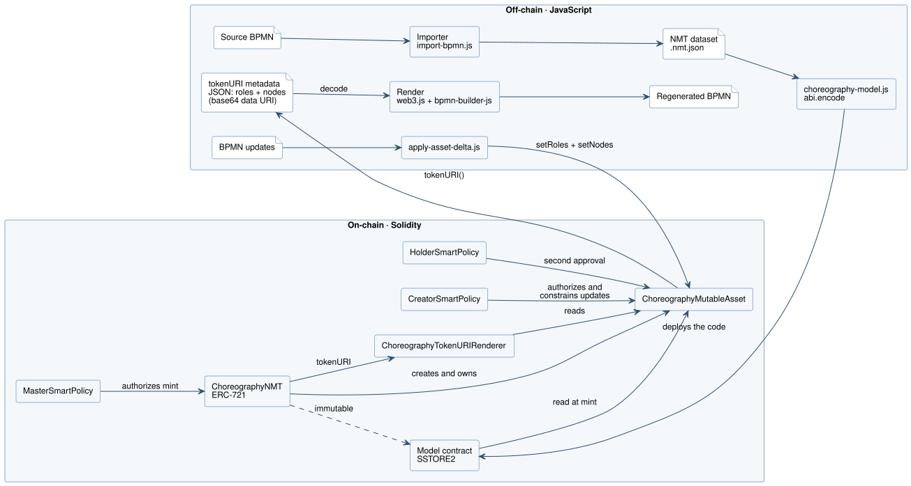
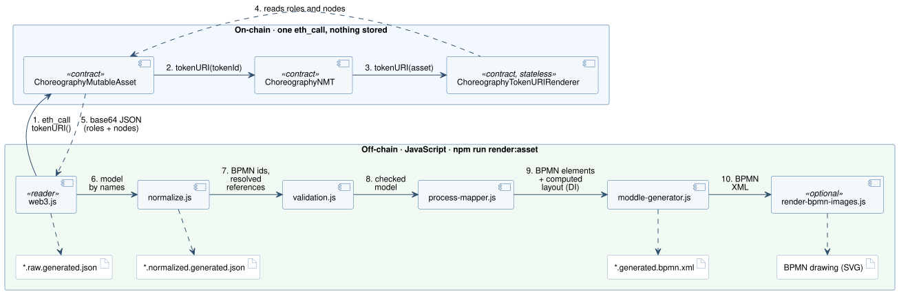
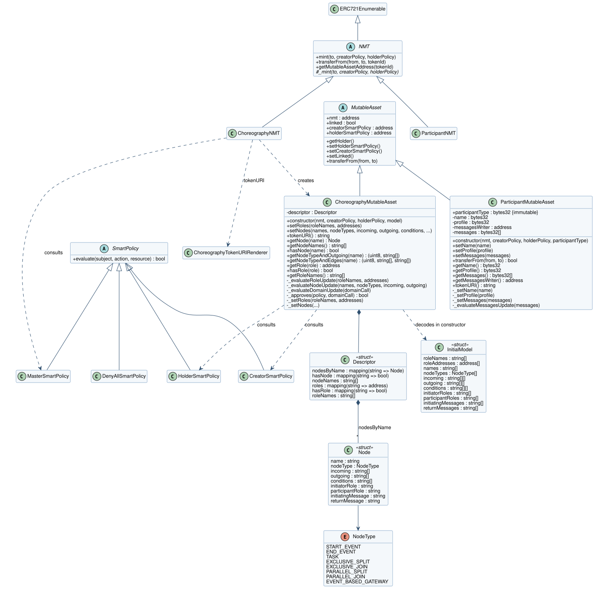
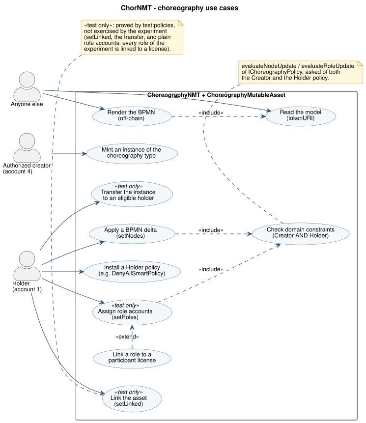
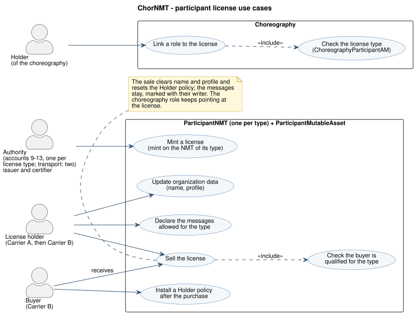
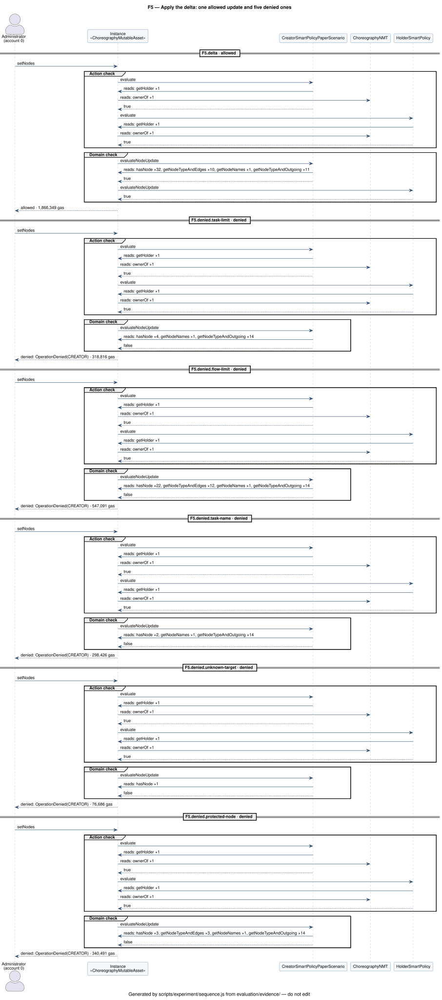

# UML diagrams

The [experiment protocol](experiment.md) embeds these diagrams next to the phases they show. Use case and sequence diagrams of ChorNMT, in [PlantUML](https://plantuml.com) and rendered to SVG. The use cases are written by hand in `docs/uml/*.puml` (shared style in `docs/uml/style.iuml`) and checked against the trust tables, the tests, and the experiment evidence; the sequence diagrams are generated from the experiment run. Every SVG is versioned, so it shows up on GitHub and in the IDE without tools.

The reading guide of the protocol lists every diagram with what it shows (the `uml-guide` block written by `scripts/experiment/protocol.js`), and each phase of the protocol embeds its sequence diagram.

Every change to an actor or a trust rule updates the use case diagrams in the same commit; a change to a flow updates the sequence diagrams by rerunning the experiment (see the `uml-diagrams` skill):

```bash
npm run docs:uml          # render docs/uml/*.puml and evaluation/evidence/uml/*.puml to SVG (Java and Graphviz; PlantUML 1.2024.7 downloaded once into .cache/)
npm run check:uml         # fail if an SVG is missing or older than its source (no Java needed; CI runs it)
npm run check:use-cases   # fail if a use case disagrees with the trust tables, the tests, or the evidence (CI runs it)
npm run evidence:update   # rerun the experiment: evidence, timings, sequence diagrams and their SVG, charts, BPMN drawings
```

## Architecture overview

The off-chain JavaScript pipeline (import, model encoding, BPMN updates applied with `setRoles` and `setNodes`, render) and the on-chain contracts it talks to. The render reads `tokenURI`, a base64 `data:application/json` URI whose `choreography` field holds the roles and the nodes, and regenerates the BPMN from that JSON. Written by hand in Mermaid in `docs/uml/architecture-overview.mmd` (the English counterpart of the overview in [Architettura](architettura.md)) and not checked by `check:uml`: after a change, rerender the SVG with `npx @mermaid-js/mermaid-cli -t neutral -b white -i docs/uml/architecture-overview.mmd -o docs/uml/architecture-overview.svg` and commit both. Update it when a component, a script, or a data flow changes.



The same overview extended with the role license path of the running example, in purple: ① the transport authority mints the `SpecialCarrier` license for Carrier A with `mint` on the `ParticipantNMT` of that type (the `ParticipantMasterSmartPolicy` checks the issuer of the type); ② `setRoles` binds the Special Carrier role to the license; ③ the choreography Creator policy asks the `ChoreographyParticipantAM` of the SpecialCarrier licenses (`participantTypeOf`) for the license type; ④ Carrier A transfers the license to Carrier B; ⑤ the participant Master checks that Carrier B is qualified for the type; ⑥ the transfer clears `name` and `profile` and resets the Holder policy to `address(0)`. Written by hand in `docs/uml/architecture-participants.mmd`, rendered like the overview.



## Rendering

How a choreography asset becomes a BPMN diagram, left to right, in numbered steps. The metadata is read the ERC-721 way, from the token contract: `web3.js` asks the asset for its `ChoreographyNMT` (step 1), then steps 2–5 are one `eth_call` to `ChoreographyNMT.tokenURI(tokenId)` with `tokenId = uint160(asset)`; the NMT delegates to the stateless `ChoreographyTokenURIRenderer`, which reads the roles and the nodes through the public getters of the asset (`getRoleNames`, `getRole`, `getNodeNames`, `getNode`) and returns them as a base64 `data:application/json` URI; nothing is stored. Steps 6–10 are the off-chain pipeline of `npm run render:asset`: `normalize.js` derives the BPMN ids from the names, `validation.js` checks the references, `process-mapper.js` builds the BPMN elements and computes the layout, `moddle-generator.js` writes the XML, and `render-bpmn-images.js` (optional, used by the experiment) draws it. Details in [Rendering](rendering.md). Written by hand in `docs/uml/rendering.puml` and rendered by `docs:uml`; update it when a render step, a script, a read function, or an output file changes.



## Classes

The contract hierarchy with the internal structure of the two mutable assets: the state and functions of `ChoreographyMutableAsset` (the `Descriptor`, `Node`, and `InitialModel` structs and the `NodeType` enum) and of `ParticipantMutableAsset`. Written by hand in `docs/uml/class-diagram.puml` and rendered by `docs:uml` like the use cases; update it when a contract changes its state or functions. The summary diagram in [Architettura](architettura.md) shows only the hierarchy.



## Use cases

### Choreography

Who does what on a choreography: the authorized creator (Hardhat account 4) mints, the holder (account 1) edits the model, assigns and links roles, installs a Holder policy, and may transfer the instance, anyone reads and renders it. Every actor is a column of the trust table in [Choreography policies](choreography-policies.md#who-can-do-what), and every use case names its row, the experiment transactions, and the `test:policies` cases that prove it (PlantUML comments checked by `check:use-cases`). `setLinked`, the transfer of an instance, and plain role accounts are proved only by the tests (`<<test only>>`): in the experiment every role is linked to a license. The Master and Creator policies are never replaced, so their setters have no use case (open question in [Design decisions](decisions.md#open-questions)).



### Participant licenses

The role licenses that choreography roles link to: the authorities (accounts 9–13, one per license type, the transport one with two types) issue and certify them, the carriers hold and sell them, the buyer installs its own Holder policy. Checked the same way against the "Role licenses" table. Details in [Participant license design](participant-license-design.md).



## Sequences

One sequence diagram per phase of the experiment, generated from the call traces of `npm run evidence:update` (decision D19); nobody writes them. Each phase has two views in `evaluation/evidence/uml/`:

- `F<n>.svg`, filtered: every state change and every policy call with its answer; consecutive read-only calls between the same two contracts become one `reads:` message with the count of each function, and the policy calls are grouped by the check they answer (Action check, Domain check, Transfer check);
- `F<n>-full.svg`, complete: every call of every trace, nothing grouped.

`scripts/experiment/sequence.js` parses both views back and fails unless the filtered one lists the phase transactions in order with their outcome, revert reason, and gas, holds exactly the calls of the complete one, and shows the actors of the phase. The phases are those of [`scripts/experiment/phases.js`](../scripts/experiment/phases.js).

| Phase | Filtered | Complete |
| --- | --- | --- |
| F1, deploy the choreography type and the license infrastructure (import as a sub-step) | [F1](../evaluation/evidence/uml/F1.svg) | [F1 complete](../evaluation/evidence/uml/F1-full.svg) |
| F2, mint the instance for its holder | [F2](../evaluation/evidence/uml/F2.svg) | [F2 complete](../evaluation/evidence/uml/F2-full.svg) |
| F3, issue the licenses and link every role to its license | [F3](../evaluation/evidence/uml/F3.svg) | [F3 complete](../evaluation/evidence/uml/F3-full.svg) |
| F4, render the baseline model (traced `tokenURI` call and off-chain pipeline) | [F4](../evaluation/evidence/uml/F4.svg) | [F4 complete](../evaluation/evidence/uml/F4-full.svg) |
| F5, apply the delta: one allowed and seven denied updates | [F5](../evaluation/evidence/uml/F5.svg) | [F5 complete](../evaluation/evidence/uml/F5-full.svg) |
| F6, sell the Special Carrier role | [F6](../evaluation/evidence/uml/F6.svg) | [F6 complete](../evaluation/evidence/uml/F6-full.svg) |
| F7, restrict a second instance through its Holder policy | [F7](../evaluation/evidence/uml/F7.svg) | [F7 complete](../evaluation/evidence/uml/F7-full.svg) |
| F8, render the final model | [F8](../evaluation/evidence/uml/F8.svg) | [F8 complete](../evaluation/evidence/uml/F8-full.svg) |


