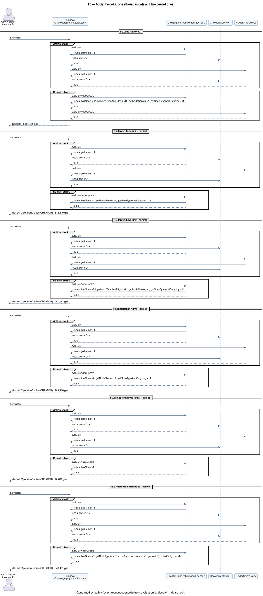

# UML diagrams

Use case and sequence diagrams of ChorNMT, in [PlantUML](https://plantuml.com) and rendered to SVG. The use cases are written by hand in `docs/uml/*.puml` (shared style in `docs/uml/style.iuml`) and checked against the trust tables, the tests, and the experiment evidence; the sequence diagrams are generated from the experiment run. Every SVG is versioned, so it shows up on GitHub and in the IDE without tools.

The evaluation reports embed these diagrams next to the rows they explain (see [UML diagrams in the reports](../evaluation/README.md#uml-diagrams-in-the-reports); the mapping is `scripts/evaluation/uml.js`).

Every change to an actor or a trust rule updates the use case diagrams in the same commit; a change to a flow updates the sequence diagrams by rerunning the experiment (see the `uml-diagrams` skill):

```bash
npm run docs:uml          # render docs/uml/*.puml and evaluation/evidence/uml/*.puml to SVG (Java and Graphviz; PlantUML 1.2024.7 downloaded once into .cache/)
npm run check:uml         # fail if an SVG is missing or older than its source (no Java needed; CI runs it)
npm run check:use-cases   # fail if a use case disagrees with the trust tables, the tests, or the evidence (CI runs it)
npm run evidence:update   # rerun the experiment: evidence, sequence diagrams, and their SVG
```

## Use cases

### Choreography

Who does what on a choreography: the authorized creator (Hardhat account 0) mints, the holder edits the model, assigns and links roles, installs a Holder policy, and transfers the instance, anyone reads and renders it. Every actor is a column of the trust table in [Choreography policies](choreography-policies.md#who-can-do-what), and every use case names its row, the experiment transactions, and the `test:policies` cases that prove it (PlantUML comments checked by `check:use-cases`). `setLinked` is proved only by the tests (`<<test only>>`). The Master and Creator policies are never replaced, so their setters have no use case (open question in [Design decisions](decisions.md#open-questions)).


### Participant licenses

The role licenses that choreography roles link to: the authority (account 9) issues and certifies them, the carriers hold and sell them, the buyer installs its own Holder policy. Checked the same way against the "Role licenses" table. Details in [Participant license design](participant-license-design.md).


## Sequences

One sequence diagram per phase of the experiment, generated from the call traces of `npm run evidence:update` (decision D19); nobody writes them. Each phase has two views in `evaluation/evidence/uml/`:

- `F<n>.svg`, filtered: every state change and every policy call with its answer; consecutive read-only calls between the same two contracts become one `reads:` message with the count of each function, and the policy calls are grouped by the check they answer (Action check, Domain check, Transfer check);
- `F<n>-full.svg`, complete: every call of every trace, nothing grouped.

`scripts/experiment/sequence.js` parses both views back and fails unless the filtered one lists the phase transactions in order with their outcome, revert reason, and gas, holds exactly the calls of the complete one, and shows the actors of the phase. The phases are those of [`scripts/experiment/phases.js`](../scripts/experiment/phases.js).

| Phase | Filtered | Complete |
| --- | --- | --- |
| F1, deploy the choreography type and the license infrastructure (import as a sub-step) | [F1](../evaluation/evidence/uml/F1.svg) | [F1 complete](../evaluation/evidence/uml/F1-full.svg) |
| F2, mint the instance and assign the role accounts | [F2](../evaluation/evidence/uml/F2.svg) | [F2 complete](../evaluation/evidence/uml/F2-full.svg) |
| F3, issue the licenses and link the Special Carrier role | [F3](../evaluation/evidence/uml/F3.svg) | [F3 complete](../evaluation/evidence/uml/F3-full.svg) |
| F4, render the baseline model (traced `tokenURI` call and off-chain pipeline) | [F4](../evaluation/evidence/uml/F4.svg) | [F4 complete](../evaluation/evidence/uml/F4-full.svg) |
| F5, apply the delta: one allowed and five denied updates | [F5](../evaluation/evidence/uml/F5.svg) | [F5 complete](../evaluation/evidence/uml/F5-full.svg) |
| F6, sell the Special Carrier role | [F6](../evaluation/evidence/uml/F6.svg) | [F6 complete](../evaluation/evidence/uml/F6-full.svg) |
| F7, transfer a second instance and restrict it through its Holder policy | [F7](../evaluation/evidence/uml/F7.svg) | [F7 complete](../evaluation/evidence/uml/F7-full.svg) |
| F8, render the final model and mint a new instance | [F8](../evaluation/evidence/uml/F8.svg) | [F8 complete](../evaluation/evidence/uml/F8-full.svg) |


