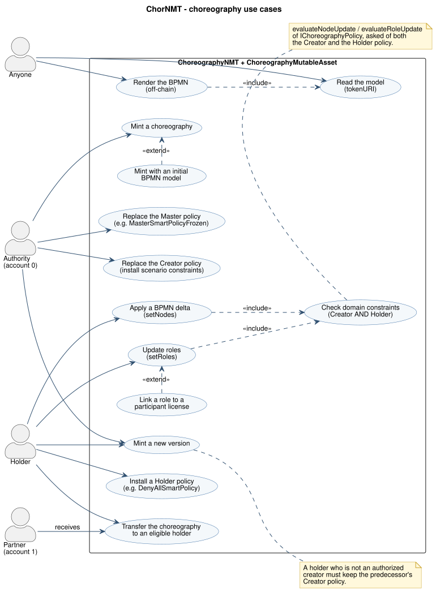
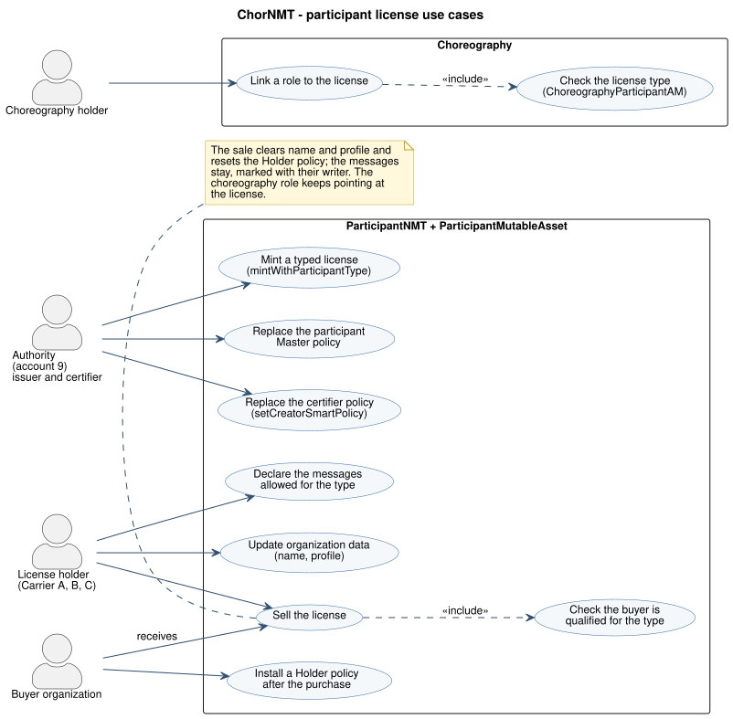
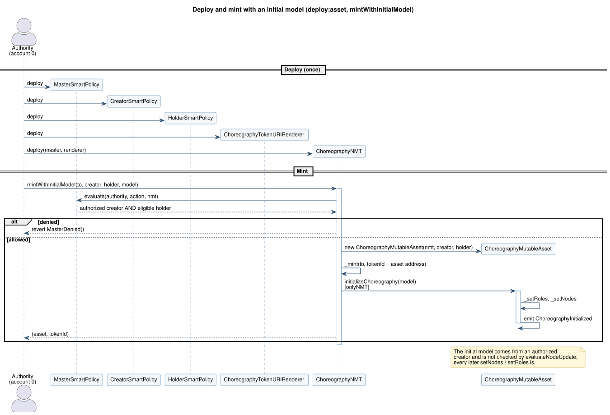
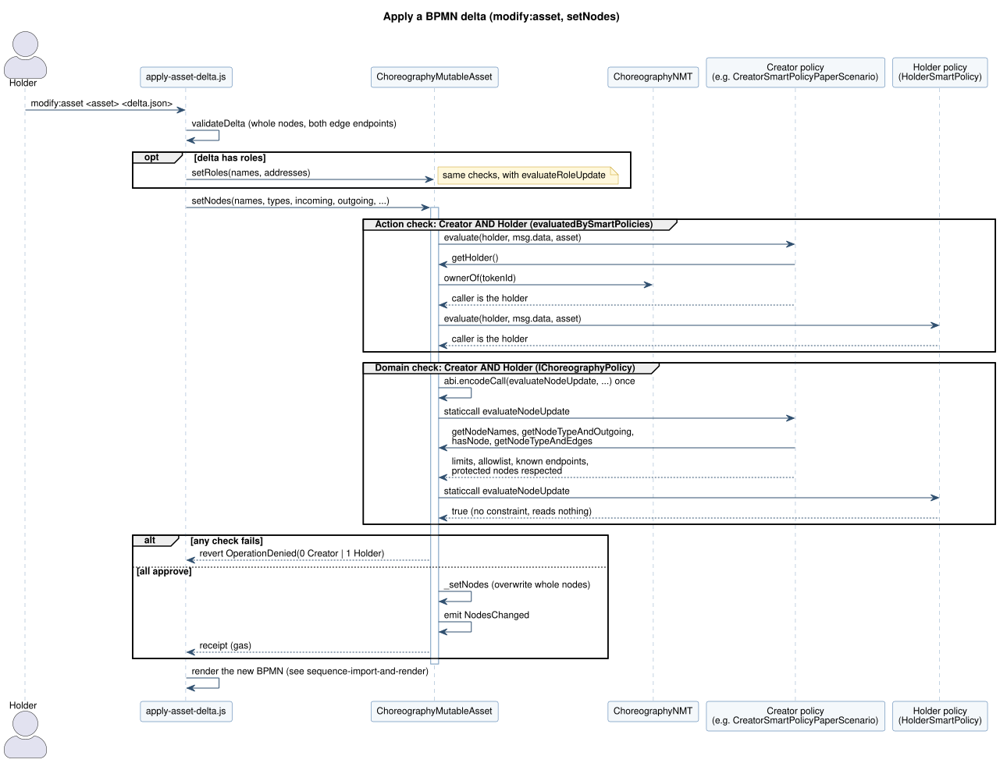
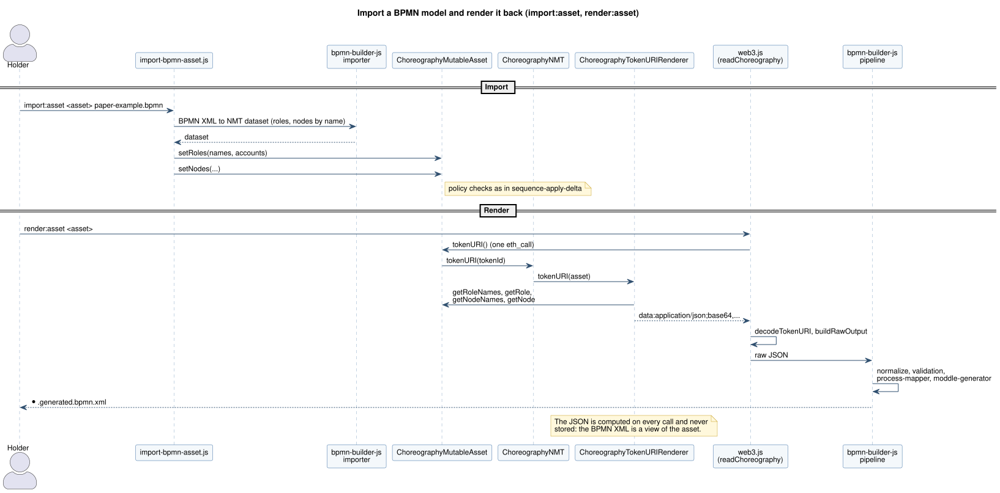
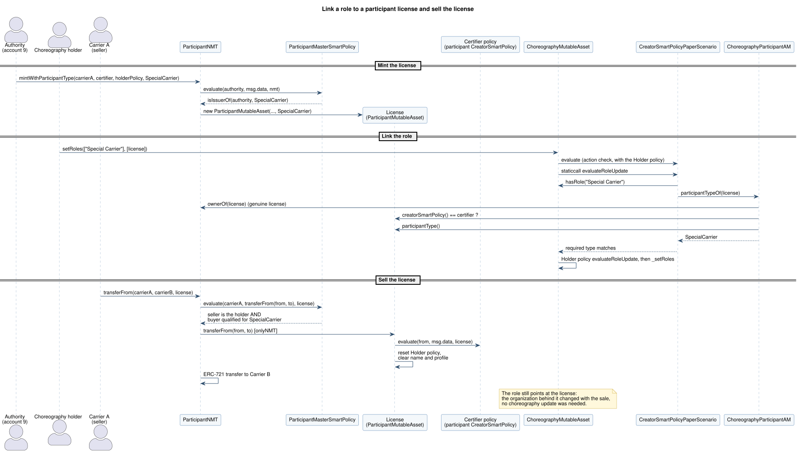
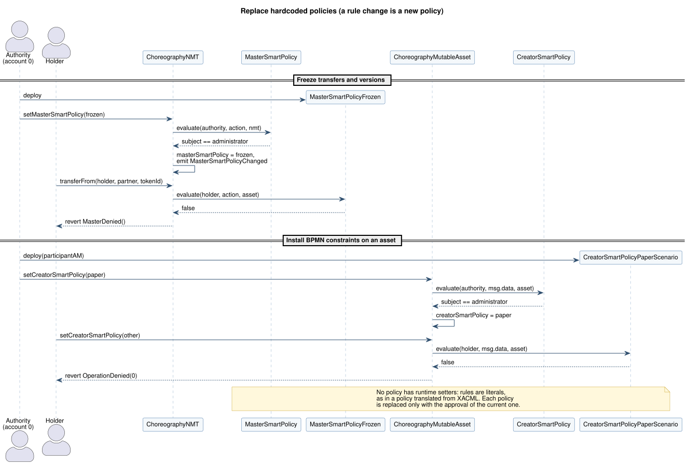

# UML diagrams

Use case and sequence diagrams of ChorNMT, written in [PlantUML](https://plantuml.com) and rendered to SVG. The sources (`docs/uml/*.puml`, shared style in `docs/uml/style.iuml`) are the reference; the SVGs next to them are generated and versioned, so they show up on GitHub and in the IDE without tools.

Every change to a flow, an actor, a policy decision, or a function shown here updates the diagram in the same commit (see the `uml-diagrams` skill):

```bash
npm run docs:uml     # render every docs/uml/*.puml to SVG (Java and Graphviz; downloads PlantUML 1.2024.7 once into .cache/)
npm run check:uml    # fail if an SVG is missing or older than its source (no Java needed; CI runs it)
```

## Use cases

### Choreography

Who does what on a choreography: the authority (Hardhat account 0) mints and replaces the policies, the holder edits the model and transfers it, anyone reads and renders it. The trust table behind it is in [Choreography policies](choreography-policies.md#who-can-do-what).



### Participant licenses

The role licenses that choreography roles link to: the authority (account 9) issues and certifies them, the carriers hold and sell them. Details in [Participant license design](participant-license-design.md).



## Sequences

### Deploy and mint with an initial model

`deploy:asset` and `mintWithInitialModel`: the Master policy approves the mint, the NMT deploys the asset and initializes it in the same transaction.



### Apply a BPMN delta

`modify:asset` and `setNodes`: the action check and the domain check, each asked of the Creator AND the Holder policy, before the asset writes the nodes.



### Import and render

`import:asset` writes the model; `render:asset` reads it back with one `tokenURI` call and regenerates the BPMN XML off-chain. The pipeline is described in [Rendering](rendering.md).



### Link a role to a license and sell it

A constrained Creator policy accepts a role link only for a certified license of the required type, read through `ChoreographyParticipantAM`; selling the license changes the organization behind the role without touching the choreography.



### Replace a hardcoded policy

Policies have no runtime setters: a rule change is a new policy, installed with the approval of the current one.


